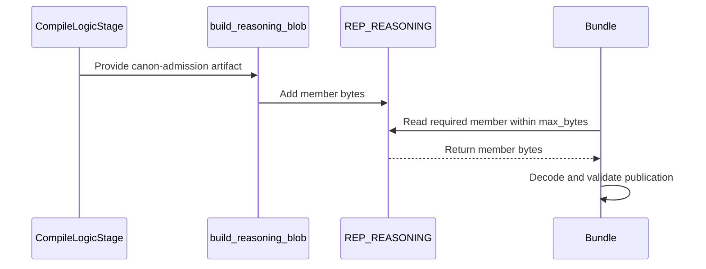
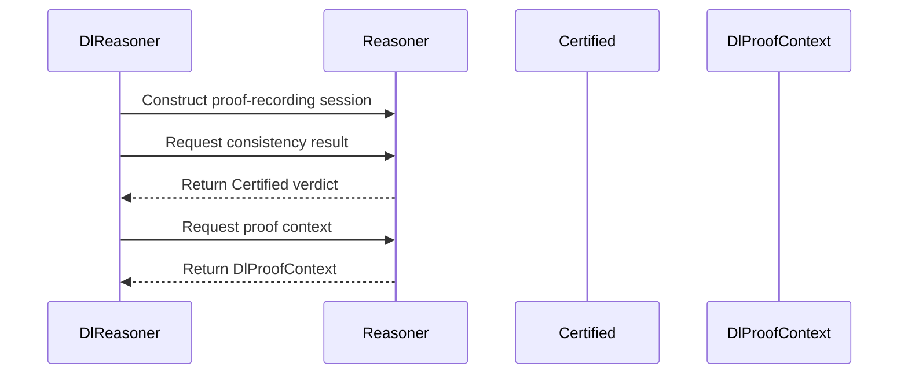

<!-- This is an auto-generated comment: summarize by coderabbit.ai -->
<!-- review_stack_entry_start -->

<a href="https://app.coderabbit.ai/change-stack/Blackcat-Informatics/gmeow-ontology/pull/1832?scope=ghh_OusAJGA4HG8ljoOV0wJvVx8NmnZIjc2DdjmxOu0xZWA&amp;cs_source=review_comment"><picture><source media="(prefers-color-scheme: dark)" srcset="https://storage.googleapis.com/coderabbit_public_assets/review-stack-in-coderabbit-ui-dark.svg?v=3"><source media="(prefers-color-scheme: light)" srcset="https://storage.googleapis.com/coderabbit_public_assets/review-stack-in-coderabbit-ui.svg?v=3"></picture></a>

<!-- review_stack_entry_end -->
<!-- recent_review_start -->

No actionable comments were generated in the recent review. 🎉

<details>
<summary><strong>ℹ️ Recent review info</strong></summary>
<dl>
<dd>

<details>
<summary><strong>⚙️ Run configuration</strong></summary>
<dl>
<dd>

- **Configuration used**: Repository UI
- **Review profile**: ASSERTIVE
- **Plan**: Team
- **Run ID**: `0319efec-aebc-41c1-97e6-471594932860`

</dd>
</dl>
</details>

<details>
<summary><strong>📥 Commits</strong></summary>
<dl>
<dd>

Reviewing files that changed from the base of the PR and between 10c6e175f2018870cd084cfae562bfd99da1a770 and 816a604cdc4715ef01ebd02b048a78c3aa9d86fb.

</dd>
</dl>
</details>

<details>
<summary><strong>📒 Files selected for processing: 2</strong></summary>
<dl>
<dd>

* `crates/logic/src/reasoner_services.rs`
* `crates/logic/src/reasoner_services.tests.rs`

</dd>
</dl>
</details>

<details>
<summary><strong>🔗 Linked repositories identified</strong></summary>
<dl>
<dd>

CodeRabbit considers these linked repositories for cross-repo context during reviews:

- [`Blackcat-Informatics/purrdf`](https://github.com/Blackcat-Informatics/purrdf) _(auto-detected)_
- [`Blackcat-Informatics/gmeow-gts`](https://github.com/Blackcat-Informatics/gmeow-gts) _(auto-detected)_

</dd>
</dl>
</details>

**Included review availability:** This review used your included allowance. 0 included reviews remain after this review. Your included PR review attempts over the past 7 days set your current allowance at 3 reviews per hour.

</dd>
</dl>
</details>


<!-- review_details_start -->

<details>
<summary><strong>📜 Recent review details</strong></summary>
<dl>
<dd>

<details>
<summary><strong>⏰ Context from checks skipped due to timeout: 2</strong></summary>
<dl>
<dd>

* GitHub Check: rust-prebuild
* GitHub Check: producer-build

</dd>
</dl>
</details>

<details>
<summary><strong>🧰 Additional context used</strong></summary>
<dl>
<dd>

<details>
<summary><strong>📚 Code guidelines: 1</strong></summary>

```
.github/copilot-instructions.md — unknown
```

</details><details>
<summary><strong>📓 Path-based instructions: 2</strong></summary>

<details>
<summary><strong>Ensure Rust code is formatted with `cargo fmt` and passes `cargo clippy` with warnings treated as errors.</strong></summary>


**📄 CodeRabbit inference engine (.github/copilot-instructions.md)**

**Files:**
- `crates/logic/src/reasoner_services.rs`
- `crates/logic/src/reasoner_services.tests.rs`

</details>
<details>
<summary><strong>Refer to the project-root `AGENTS.md` for available `make` targets and developer commands, such as `make check` and `gmeow-dev sync`.</strong></summary>


**📄 CodeRabbit inference engine (.github/copilot-instructions.md)**

**Files:**
- `crates/logic/src/reasoner_services.rs`
- `crates/logic/src/reasoner_services.tests.rs`

</details>

</details><details>
<summary><strong>🔀 Multi-repo context Blackcat-Informatics/purrdf, Blackcat-Informatics/gmeow-gts</strong></summary>

## Linked repositories findings

### Blackcat-Informatics/purrdf

- `crates/entail/src/reasoner/certificate.rs:508` defines native `Certified<T>` carrying an answer, certificate, and optional proof, matching the PR’s removal of `CertifiedAnswer`. [::Blackcat-Informatics/purrdf::]
- `crates/entail/src/reasoner/mod.rs:498` exposes `proof_context(self)` and returns `ProofsNotRecorded` when proof recording was not enabled. This confirms callers must construct a proof-recording reasoner before verifying selected proofs. [::Blackcat-Informatics/purrdf::]

### Blackcat-Informatics/gmeow-gts

- No references to `CanonAdmissionPublication`, `canon-admission`, `canon-proof-admission`, `CertifiedAnswer`, or `purrdf::entail::Certified` were found.
- `docs/GTS-SPEC.md:1367–1378` defines `ai-package` and `agent-memory` as profiles with no core wire-format impact; unsupported profiles remain parseable and are reported via diagnostics/metadata. The new admission artifact has no observed GTS core-contract consumer. [::Blackcat-Informatics/gmeow-gts::]

</details>

</dd>
</dl>
</details>

<details>
<summary><strong>🔇 Additional comments: 2</strong></summary><blockquote>

<details>
<summary><strong>crates/logic/src/reasoner_services.rs: 1</strong></summary><blockquote>

`115-120`: LGTM!


Also applies to: 124-124

<!-- cr-comment:v1:f1969270a3705ecfbcb7a000 -->

</blockquote></details>
<details>
<summary><strong>crates/logic/src/reasoner_services.tests.rs: 1</strong></summary><blockquote>

`259-260`: LGTM!


Also applies to: 262-294

<!-- cr-comment:v1:520d4634b003683afa0a4b5f -->

</blockquote></details>

</blockquote></details>

</dd>
</dl>
</details>

<!-- review_details_end -->


<!-- recent_review_end -->
<!-- walkthrough_start -->

<details>
<summary><strong>📝 Summary</strong></summary>
<dl>
<dd>

<!-- This is an auto-generated comment: release notes by coderabbit.ai -->

## Summary by CodeRabbit

* **New Features**
  * Reasoning bundles include a complete canon-admission record, retrievable with a size limit. It covers source documents, formulas, rules, and owners, including blocked or malformed entries.
  * DL reasoning results provide native certificates, with optional proof recording and access to the recorded proof context.
* **Bug Fixes**
  * Missing, ambiguous, oversized, malformed, or incompatible admission records return explicit errors.
* **Documentation**
  * Clarified that admission records do not enable proof execution or restore compiler authority.

<!-- end of auto-generated comment: release notes by coderabbit.ai -->
The compiler publishes classical admission data for the complete original source. The pipeline stores it in the reasoning archive, and the bundle API retrieves and validates it. Logic services now return native certified results and support proof recording.

**Changes: Canon Proof Admission**

|Layer / File(s)|Summary|
|:---|:---|
|**Index source origins** <br> `crates/logic-compile/src/frontend/source_admission.rs`, `crates/logic-compile/src/frontend/source_admission/origins.rs`, `crates/logic-compile/src/frontend/source_admission/origins.tests.rs`|`AdmissionBuilder` uses `OriginIndex` for node and statement document lookups. Tests compare index results with scans across synthetic receipts.|
|**Define and produce the publication** <br> `crates/logic-compile/src/tptp/canon_admission.rs`, `crates/logic-compile/src/tptp/canon_admission.tests.rs`, `crates/logic-compile/src/tptp/mod.rs`, `crates/logic-compile/src/tptp/tests.rs`, `crates/pipeline/src/stages/compile_logic.rs`|`CanonAdmissionPublication` records complete-source admission, serializes it, and rejects incompatible data. `CompileLogicStage` emits it from the original compiled catalog theory.|
|**Add publication to the reasoning archive** <br> `crates/pipeline/src/stages/carrier.rs`, `crates/pipeline/src/stages/carrier.ustar_tests.rs`|`build_reasoning_blob` adds the publication member and returns an error if the compiler artifact is missing. Tests check archive contents and missing-artifact behavior.|
|**Read admission from a bundle** <br> `crates/bundle-view/src/bundle_blobs.rs`, `crates/bundle-view/src/bundle_blobs/reasoned_gates.tests.rs`, `slices/grounding/logic/design/LOGIC-CONTRACT.md`|`Bundle::canon_proof_admission` reads and decodes the required member within the size limit. Tests cover retrieval and decoding errors; the contract describes the publication and its limits.|

**Native Certified Reasoning Results**

|Layer / File(s)|Summary|
|:---|:---|
|**Return native certified results and expose proof context** <br> `crates/logic/src/reasoner_services.rs`, `crates/logic/src/reasoner_services.tests.rs`|`DlReasoner` removes `CertifiedAnswer` and returns native `Certified` values. It adds proof-recording construction and proof-context access. Tests check certificate results, proof replay, and unrecorded-proof errors.|
|**Build reports from native certificates** <br> `crates/gmeow-cli/src/commands.rs`|CLI reports read answers, completeness, boundaries, decisions, steps, and budget from native certificates. Consistency certifies a `True` verdict only when completeness is `Decided`.|

<!-- change_assessment_start -->
**Priority:** ➖ Normal


**Estimated code review effort:** 3 (Moderate) | ~25 minutes

<!-- change_assessment_commit:"816a604cdc4715ef01ebd02b048a78c3aa9d86fb" -->
**Change:** Feature
<!-- change_assessment_end -->

### Sequence Diagram(s)





</dd>
</dl>
</details>

<!-- walkthrough_end -->
<details>
<summary><strong>Merge Risk:</strong> <strong>⚪ Minimal</strong> · up to <code>816a6</code></summary>
<dl>
<dd>

<!-- final_review_risk_start -->
<!-- final_review_risk_label
**Merge Risk:** **⚪ Minimal** · up to `816a6`
-->
<!-- final_review_risk_coverage:{"sourceCommitId":"816a604cdc4715ef01ebd02b048a78c3aa9d86fb","coveredCommitId":"816a604cdc4715ef01ebd02b048a78c3aa9d86fb","kind":"reviewed"} -->

No identified issue blocks merging after normal checks; final CLI qualification remains hosted.
<!-- final_review_risk_end -->

</dd>
</dl>
</details>
<!-- pre_merge_checks_walkthrough_start -->

<details>
<summary><strong>Pre-merge checks: <sup><picture></picture></sup> 5</strong></summary>
<dl>
<dd>

|         Check name         |                                             Status                                             | Explanation                                                                                                                                                                                               |
| :------------------------ | :--------------------------------------------------------------------------------------------: | :-------------------------------------------------------------------------------------------------------------------------------------------------------------------------------------------------------- |
|     Docstring Coverage     |  | Docstring coverage is 88.71% which is sufficient. The required threshold is 80.00%. Docstring coverage is scoped to functions touched by this diff. Analyzed 62 functions across 15 files.                |
|     Linked Issues check    |  | Check skipped because no linked issues were found for this pull request.                                                                                                                                  |
| Out of Scope Changes check |  | Check skipped because no linked issues were found for this pull request.                                                                                                                                  |
|         Title check        |  | The title accurately summarizes the preservation of canon admission and native proof evidence. It is concise and contains no agentic branding.                                                            |
|      Description check     |  | The description clearly explains the changes, rationale, validation results, limitations, dependencies, and reviewer context. It does not use the template headings or provide explicit checklist confir… |

<details>
<summary><strong>Full details: Description check</strong></summary>
<dl>
<dd>

**Explanation**

The description clearly explains the changes, rationale, validation results, limitations, dependencies, and reviewer context. It does not use the template headings or provide explicit checklist confirmations, but it is substantially complete and relevant.

</dd>
</dl>
</details>

</dd>
</dl>
</details>

<!-- pre_merge_checks_walkthrough_end -->
<!-- finishing_touch_checkbox_start -->

<details>
<summary><strong>✨ Finishing Touches</strong></summary>
<dl>
<dd>

<details open>
<summary><strong>📝 Generate docstrings</strong></summary>
<dl>
<dd>

- [ ] <!-- {"checkboxId":"3e1879ae-f29b-4d0d-8e06-d12b7ba33d98"} --> Commit to this branch
- [ ] <!-- {"checkboxId":"7962f53c-55bc-4827-bfbf-6a18da830691"} --> Create a new PR

</dd>
</dl>
</details>
<details open>
<summary><strong>🧪 Generate unit tests (beta)</strong></summary>
<dl>
<dd>

- [ ] <!-- {"checkboxId": "6ba7b810-9dad-11d1-80b4-00c04fd430c8", "radioGroupId": "utg-output-choice-group-unknown_comment_id"} --> Commit to this branch
- [ ] <!-- {"checkboxId": "f47ac10b-58cc-4372-a567-0e02b2c3d479", "radioGroupId": "utg-output-choice-group-unknown_comment_id"} --> Create a new PR

</dd>
</dl>
</details>
<details open>
<summary><strong>✨ Simplify code</strong></summary>
<dl>
<dd>

- [ ] <!-- {"checkboxId": "9a4e3077-58f6-4eba-b7ee-62e936ea00ea", "radioGroupId": "simplify-output-choice-group-unknown_comment_id"} --> Commit to this branch
- [ ] <!-- {"checkboxId": "f120d606-b0e2-4b7d-8316-181794555b43", "radioGroupId": "simplify-output-choice-group-unknown_comment_id"} --> Create a new PR

</dd>
</dl>
</details>

</dd>
</dl>
</details>

<!-- finishing_touch_checkbox_end -->

<!-- autopilot:start -->
- [ ] <!-- {"checkboxId":"2708ad07-9f24-4260-9c11-7dc76a49f2e3"} --> <strong title="Keep fixing CodeRabbit findings and required CI, and resolving merge conflicts">Autofix</strong> · Keep fixing CodeRabbit findings and required CI, and resolving merge conflicts
<!-- autopilot:end -->
<!-- tips_start -->


<!-- poem_footer_start -->
<sub>A rabbit reads the canon page,<br>And files its proof in archive space.<br>Certified answers hop in line,<br>With careful bounds and facts that shine.<br>Then off I go, through fields of thyme!</sub>
<!-- poem_footer_end -->

<sub>Comment `@coderabbitai help` to get the list of available commands.</sub>

<!-- tips_end -->
