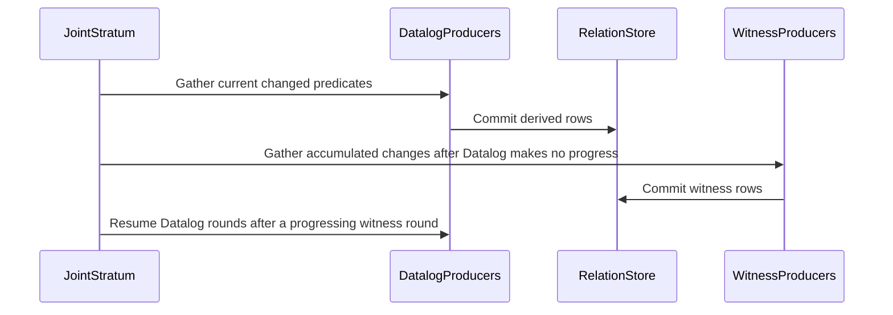

# PR #1802 — comments and review threads

13 comment(s). **Every one needs a disposition** in
`review-debt.md`: addressed (with the commit hash) or declined (with the
reason posted in reply). Bot comments count.

## 1. coderabbitai — 

<!-- This is an auto-generated comment: summarize by coderabbit.ai -->
<!-- review_stack_entry_start -->

<a href="https://app.coderabbit.ai/change-stack/Blackcat-Informatics/gmeow-ontology/pull/1802?scope=ghh_OusAJGA4HG8ljoOV0wJvVx8NmnZIjc2DdjmxOu0xZWA&amp;cs_source=review_comment"><picture><source media="(prefers-color-scheme: dark)" srcset="https://storage.googleapis.com/coderabbit_public_assets/review-stack-in-coderabbit-ui-dark.svg?v=3"><source media="(prefers-color-scheme: light)" srcset="https://storage.googleapis.com/coderabbit_public_assets/review-stack-in-coderabbit-ui.svg?v=3"></picture></a>

<!-- review_stack_entry_end -->
<!-- recent_review_start -->

No actionable comments were generated in the recent review. 🎉

<details>
<summary><strong>ℹ️ Recent review info</strong></summary>
<dl>
<dd>

<details>
<summary><strong>⚙️ Run configuration</strong></summary>
<dl>
<dd>

- **Configuration used**: Repository UI
- **Review profile**: ASSERTIVE
- **Plan**: Team
- **Run ID**: `0de424bb-1a3a-4acf-a7e1-298376321ad2`

</dd>
</dl>
</details>

<details>
<summary><strong>📥 Commits</strong></summary>
<dl>
<dd>

Reviewing files that changed from the base of the PR and between 1d5d7f36dd84ba90a3ae762ea5dcf9ff825654ad and b797a315e09cf6a118e0ca60975007a65f43a138.

</dd>
</dl>
</details>

<details>
<summary><strong>📒 Files selected for processing: 2</strong></summary>
<dl>
<dd>

* `crates/logic/src/physical/chase.tests.rs`
* `crates/logic/src/reason/artifacts.tests.rs`

</dd>
</dl>
</details>

<details>
<summary><strong>🔗 Linked repositories identified</strong></summary>
<dl>
<dd>

CodeRabbit considers these linked repositories for cross-repo context during reviews:

- [`Blackcat-Informatics/purrdf`](https://github.com/Blackcat-Informatics/purrdf) _(auto-detected)_
- [`Blackcat-Informatics/gmeow-gts`](https://github.com/Blackcat-Informatics/gmeow-gts) _(auto-detected)_

</dd>
</dl>
</details>

**Included review availability:** This review used your included allowance. 3 included reviews remain after this review. Your included PR review attempts over the past 7 days set your current allowance at 5 reviews per hour.

<!-- review_details_start -->

<details>
<summary><strong>⏰ Context from checks skipped due to timeout: 3</strong></summary>
<dl>
<dd>

* GitHub Check: rust-prebuild
* GitHub Check: producer-build
* GitHub Check: lint

</dd>
</dl>
</details>

<details>
<summary><strong>🧰 Additional context used</strong></summary>
<dl>
<dd>

<details>
<summary><strong>📚 Code guidelines: 1</strong></summary>

```
.github/copilot-instructions.md — auto-discovered
```

</details><details>
<summary><strong>📓 Path-based instructions: 2</strong></summary>

<details>
<summary><strong>Ensure Rust code is formatted with `cargo fmt` and passes `cargo clippy` with warnings treated as errors.</strong></summary>


**📄 CodeRabbit inference engine (.github/copilot-instructions.md)**

**Files:**
- `crates/logic/src/physical/chase.tests.rs`
- `crates/logic/src/reason/artifacts.tests.rs`

</details>
<details>
<summary><strong>Refer to the project-root `AGENTS.md` for available `make` targets and developer commands, such as `make check` and `gmeow-dev sync`.</strong></summary>


**📄 CodeRabbit inference engine (.github/copilot-instructions.md)**

**Files:**
- `crates/logic/src/physical/chase.tests.rs`
- `crates/logic/src/reason/artifacts.tests.rs`

</details>

</details><details>
<summary><strong>🔀 Multi-repo context Blackcat-Informatics/purrdf, Blackcat-Informatics/gmeow-gts</strong></summary>

## Linked repositories findings

### `Blackcat-Informatics/purrdf`

- Qualified cardinality restrictions support both `owl:onClass` and `owl:onDataRange` through the same filler-resolution path, so the PR’s ontology changes to `logic:onDataRange rdfs:Literal` are compatible with PurRDF’s parser contract. `crates/entail/src/owl_dl/parser.rs:989-1000` [::Blackcat-Informatics/purrdf::]
- PurRDF treats `xsd:anyURI` as a data-range name syntactically, but its range engine leaves `xsd:anyURI` in the unmodeled remainder; `rdfs:Literal` represents the whole data domain. The PR’s specialized `anyURI` reasoning therefore remains responsibility of GMEOW’s native reasoner. `crates/entail/src/owl_dl/parser.rs:606-618`, `crates/xsd/src/range.rs:44-49,167-170` [::Blackcat-Informatics/purrdf::]

### `Blackcat-Informatics/gmeow-gts`

- GTS is explicitly ontology-independent and treats GMEOW semantics as a downstream profile concern. The PR’s chase/admission changes do not require a GTS core change. `docs/GTS-SPEC.md:43-47` [::Blackcat-Informatics/gmeow-gts::]
- GTS compares literals by exact lexical form, datatype, language tag, and direction without datatype canonicalization. Its XSD helper accepts `xsd:anyURI` lexical forms unchanged. Thus the PR’s XML-whitespace normalization and `anyURI` equality/facet behavior must remain in the reasoning layer rather than being delegated to GTS transport. `docs/GTS-SPEC.md:700-706`, `go/xsd/xsd.go:1-8,95-105` [::Blackcat-Informatics/gmeow-gts::]

</details>

</dd>
</dl>
</details>

<details>
<summary><strong>🔇 Additional comments: 2</strong></summary><blockquote>

<details>
<summary><strong>crates/logic/src/physical/chase.tests.rs: 1</strong></summary><blockquote>

`2089-2089`: LGTM!


Also applies to: 2093-2093

<!-- cr-comment:v1:358417603c04e4148001ab0a -->

</blockquote></details>
<details>
<summary><strong>crates/logic/src/reason/artifacts.tests.rs: 1</strong></summary><blockquote>

`363-369`: LGTM!

<!-- cr-comment:v1:a143e358273ce72ed00a36bb -->

</blockquote></details>

</blockquote></details>

<!-- review_details_end -->

</dd>
</dl>
</details>


<!-- recent_review_end -->
<!-- walkthrough_start -->

<details>
<summary><strong>📝 Summary</strong></summary>
<dl>
<dd>

<!-- This is an auto-generated comment: release notes by coderabbit.ai -->

## Summary by CodeRabbit

* **Reasoning Improvements**
  * Witness-generating rules now run after ordinary rule processing reaches a pause, allowing existing facts to prevent unnecessary witnesses.
  * More programs can be certified for complete reasoning; unsupported cases provide clearer explanations and may still require a budget.
  * Equivalent spellings of cardinality qualifiers are treated consistently, and cardinality conflicts are limited to affected individuals.
  * `xsd:anyURI` is recognized as an unbounded datatype, with length restrictions measured on its whitespace-collapsed text.
  * Data-property cardinality constraints now consistently use literal value ranges.

* **Diagnostics**
  * Inconclusive results and encoding failures provide more detail about what could not be processed.

<!-- end of auto-generated comment: release notes by coderabbit.ai -->
The changes add Datalog-first restricted-chase execution and restricted joint acyclicity certification. They also expand native admission analysis, refine definition-writer and cardinality checks, recognize `xsd:anyURI`, update result diagnostics and artifact tests, and revise selected ontology declarations.

**Changes: Restricted Chase and Native Admission**

|Layer / File(s)|Summary|
|:---|:---|
|**Datalog-first chase rounds** <br> `crates/logic/src/physical/chase.rs`, `crates/logic/src/physical/seminaive/joint.rs`, `crates/logic/src/physical/seminaive/joint/families*`, `crates/logic/src/reason/program/list_tests.rs`, `slices/grounding/logic/design/LOGIC-PERFORMANCE.md`|Non-minting producers run before witness-minting producers. The joint stratum tracks accumulated changes and reports obstruction details.|
|**Joint graph and RJA certification** <br> `crates/logic/src/physical/chase.rs`, `crates/logic/src/physical/chase.tests.rs`, `crates/logic/src/native_semantics.rs`|Certification adds null-flow graph analysis and RJA. RJA removes candidate edges only when positive Datalog closure proves a restricted trigger is satisfied.|
|**Settled-relation admission** <br> `crates/logic/src/physical/seminaive/joint/input*`, `crates/logic/src/physical/seminaive/property.rs`, `crates/logic/src/physical/seminaive/property/minimum.rs`|Native admission derives bounded closures for eligible witness-free relations and specializes producers against settled facts. Tests cover closure, list bindings, and refusal cases.|

**Definition-Writer Checks**

|Layer / File(s)|Summary|
|:---|:---|
|**Scoped and assertion-aware writer detection** <br> `crates/logic/src/physical/effects*`, `crates/logic/src/physical/seminaive/joint.rs`|Writer detection considers world ownership, overlap, clash admission, and bounded finite writes. Already asserted writes do not count as definition writers.|

**Cardinality Reasoning**

|Layer / File(s)|Summary|
|:---|:---|
|**Qualifier normalization and class-bound clashes** <br> `crates/logic/src/reason/dl.rs`, `crates/logic/src/reason/refute/counting.rs`, `crates/logic/src/reason/program/minimum_tests.rs`, `crates/logic/src/reason/refute/native/tests.rs`|Alternate qualifier spellings are compared by normalized meaning. Property obligations are generated only for individuals whose asserted class has contradictory bounds.|

**Datatype Support**

|Layer / File(s)|Summary|
|:---|:---|
|**anyURI recognition and constructor errors** <br> `crates/logic/src/physical/seminaive/property/datatype*`, `crates/logic/src/physical/seminaive/property/datatype/extent.rs`, `crates/logic/src/reason/value.rs`|`xsd:anyURI` is recognized as a named datatype with an infinite value space. Tests cover its membership and length facets. Invalid-constructor errors identify the datatype and constructor state.|

**Result Diagnostics**

|Layer / File(s)|Summary|
|:---|:---|
|**Blocked-read and encoding diagnostics** <br> `crates/logic/src/result.rs`, `crates/logic/src/result_rdf/native.rs`, `crates/pipeline/src/stages/docs_render.rs`|Blocked native reads are included among unsupported constructs. Encoding and inconclusive-result diagnostics include receipt-size or unsupported-construct details.|

**Reasoning Artifact Tests**

|Layer / File(s)|Summary|
|:---|:---|
|**Execution-backed artifact test fixtures** <br> `crates/logic/src/reason/artifacts.tests.rs`|Tests use native execution or projection-only results to check typed RDF objects, receipts, explanations, statuses, and validation.|

**Ontology Declaration Updates**

|Layer / File(s)|Summary|
|:---|:---|
|**Literal-qualified constraints and message literals** <br> `slices/core/*/module.ttl`, `slices/extensions/images/module.ttl`, `slices/grounding/lang/module.ttl`, `slices/grounding/math/module.ttl`, `slices/grounding/logic/module.ttl`, `slices/vocabulary.ttl`|Selected cardinality restrictions now use `rdfs:Literal` as a data range. Constraint-message text remains unchanged where language tags were removed.|

<!-- change_assessment_start -->
**Priority:** ➖ Normal


**Estimated code review effort:** 4 (Complex) | ~60 minutes

<!-- change_assessment_commit:"b797a315e09cf6a118e0ca60975007a65f43a138" -->
**Change:** Bug fix
<!-- change_assessment_end -->

### Sequence Diagram(s)



</dd>
</dl>
</details>

<!-- walkthrough_end -->
<details>
<summary><strong>Merge Risk:</strong> <strong>🔵 Low</strong> · up to <code>b797a</code></summary>
<dl>
<dd>

<!-- final_review_risk_start -->
<!-- final_review_risk_label
**Merge Risk:** **🔵 Low** · up to `b797a`
-->
<!-- final_review_risk_coverage:{"sourceCommitId":"b797a315e09cf6a118e0ca60975007a65f43a138","coveredCommitId":"b797a315e09cf6a118e0ca60975007a65f43a138","kind":"reviewed"} -->

Invalid nonnumeric values may pass validation for approximationError and rootSystemRank. The issue is limited to these properties, but their numeric ranges should be enforced before relying on the resulting data.
<!-- final_review_risk_end -->

</dd>
</dl>
</details>
<!-- pre_merge_checks_walkthrough_start -->


<!-- pre_merge_checks_override_start -->
> [!IMPORTANT]
> ## Pre-merge checks failed
> 
> Please resolve all errors before merging. Addressing warnings is optional.
<!-- pre_merge_checks_override_end -->

<strong><sup><picture></picture></sup> Failed checks: 1 error</strong>

|     Check name     |                                            Status                                            | Explanation                                                                                                                                                                                   | Resolution                                                                         |
| :---------------- | :------------------------------------------------------------------------------------------: | :-------------------------------------------------------------------------------------------------------------------------------------------------------------------------------------------- | :--------------------------------------------------------------------------------- |
| Docstring Coverage |  | Docstring coverage is 77.78% which is insufficient. The required threshold is 80.00%. Docstring coverage is scoped to functions touched by this diff. Analyzed 225 functions across 28 files. | Write docstrings for the functions missing them to satisfy the coverage threshold. |

<details>
<summary><strong><sup><picture></picture></sup> Passed checks: 4 passed</strong></summary>
<dl>
<dd>

|         Check name         |                                             Status                                             | Explanation                                                                                                                                                                                               |
| :------------------------ | :--------------------------------------------------------------------------------------------: | :-------------------------------------------------------------------------------------------------------------------------------------------------------------------------------------------------------- |
|     Linked Issues check    |  | Check skipped because no linked issues were found for this pull request.                                                                                                                                  |
| Out of Scope Changes check |  | Check skipped because no linked issues were found for this pull request.                                                                                                                                  |
|         Title check        |  | The title is concise, relates to the production reasoning integration and repairs, and contains no prohibited agentic branding.                                                                           |
|      Description check     |  | The description clearly explains the changes, motivation, validation results, remaining acceptance work, and reviewer context. It does not reproduce the template headings or checklist boxes exactly, b… |

<details>
<summary><strong>Full details: Description check</strong></summary>
<dl>
<dd>

**Explanation**

The description clearly explains the changes, motivation, validation results, remaining acceptance work, and reviewer context. It does not reproduce the template headings or checklist boxes exactly, but it provides the required information in substance.

</dd>
</dl>
</details>

</dd>
</dl>
</details>

<!-- pre_merge_checks_walkthrough_end -->

- [ ] <!-- {"checkboxId":"585bb3f6-faf5-4dbf-96d2-74e382adf19a"} --> Fix all pre-merge checks with AI
<!-- finishing_touch_checkbox_start -->

<details>
<summary><strong>✨ Finishing Touches: 💡 1</strong></summary>
<dl>
<dd>

<!-- finishing_touch_suggestion:docstrings -->
<details open>
<summary><strong>📝 Generate docstrings: 💡</strong></summary>
<dl>
<dd>

- [ ] <!-- {"checkboxId":"3e1879ae-f29b-4d0d-8e06-d12b7ba33d98"} --> Commit to this branch
- [ ] <!-- {"checkboxId":"7962f53c-55bc-4827-bfbf-6a18da830691"} --> Create a new PR

</dd>
</dl>
</details>
<details open>
<summary><strong>🧪 Generate unit tests (beta)</strong></summary>
<dl>
<dd>

- [ ] <!-- {"checkboxId": "6ba7b810-9dad-11d1-80b4-00c04fd430c8", "radioGroupId": "utg-output-choice-group-unknown_comment_id"} --> Commit to this branch
- [ ] <!-- {"checkboxId": "f47ac10b-58cc-4372-a567-0e02b2c3d479", "radioGroupId": "utg-output-choice-group-unknown_comment_id"} --> Create a new PR

</dd>
</dl>
</details>
<details open>
<summary><strong>✨ Simplify code</strong></summary>
<dl>
<dd>

- [ ] <!-- {"checkboxId": "9a4e3077-58f6-4eba-b7ee-62e936ea00ea", "radioGroupId": "simplify-output-choice-group-unknown_comment_id"} --> Commit to this branch
- [ ] <!-- {"checkboxId": "f120d606-b0e2-4b7d-8316-181794555b43", "radioGroupId": "simplify-output-choice-group-unknown_comment_id"} --> Create a new PR

</dd>
</dl>
</details>

</dd>
</dl>
</details>

<!-- finishing_touch_checkbox_end -->

<!-- autopilot:start -->
- [ ] <!-- {"checkboxId":"2708ad07-9f24-4260-9c11-7dc76a49f2e3"} --> <strong title="Keep fixing CodeRabbit findings and required CI, and resolving merge conflicts">Autopilot</strong> · Keep fixing CodeRabbit findings and required CI, and resolving merge conflicts
<!-- autopilot:end -->
<!-- tips_start -->


<!-- poem_footer_start -->
<sub>A rabbit checks the rules at dawn,<br>While witness-makers wait their turn.<br>Nulls hop past fixed reads, not wide,<br>Closed facts help the cycles learn.<br>The graphs grow clear; the rows align,<br>Then carrots mark the finish line.</sub>
<!-- poem_footer_end -->

<sub>Comment `@coderabbitai help` to get the list of available commands.</sub>

<!-- tips_end -->

## 2. paudley — 

Review remediation pushed as 22193fc44 (Principles 4, 7, 17 and 18).

- Restricted blocking now retains original clause exactness before ordinary NAF/builtin filters or property operations are relaxed. Its Datalog closure excludes relaxed clauses and variable-predicate pair projections/reverse bridges. Source specialization preserves the exactness metadata.
- Binary restricted-head searches enforce distinct guards, including bindings of frozen universal variables. Guarded binary producers remain non-blockable after statement lowering discards those guards.
- anyURI length/minLength/maxLength use PurRDF's XML whitespace collapse and Unicode character counts through the existing datatype plan.
- Finite-write products use saturating multiplication. The three source provenance comments and helper-ledger final newline named by hosted lint are repaired.

Executed verification:

- make fmt: passed.
- make nextest-synthetic with the chase, joint and any_uri selection: 124 passed, 2132 skipped; nextest fd9ab4ba-45b1-422a-8c50-6e2ed7f8eb7c. This includes a genuine two-distinct-witness cycle and finite execution-prefix exhaustion, plus valid single-witness inverse examples. Test-profile compilation reported unused manifest dependencies csv and flate2; neither was suppressed.
- make lint: passed.
- Normal git commit and push: succeeded. No hook bypass or compiler/profile weakening.

Current acceptance remains incomplete. No full make check, authenticated fixture production, new production verdict, two cold-generation comparison, or independent completion audit is claimed on this commit. The prior fixture-prefix failure is an unsupported native verdict at docs rendering. The ownership agreement in #1803 assigns the generic DL/chase engines to PurRDF; the recorded released-engine benchmark does not yet decide the two large production worlds within budget. That evidence is not replaced by the focused tests above.

The branch also now contains the previously committed corpus repairs from #1804; that ancestry was already present on the local combined branch and is preserved. Other logic issues and prerequisite PRs remain open pending their individual acceptance and ghprsq integration.

@coderabbitai review

Please reassess the four recorded findings on the current head, particularly the distinction between conservative Skolem-flow over-approximation and the exact evidence used to block restricted triggers. None of the review threads has been resolved merely by posting this update.

## 3. coderabbitai — 

<!-- This is an auto-generated reply by CodeRabbit -->
<!-- CodeRabbit review command invocation: v2:29c223310988f1cf6fc1012c9d6372a728b2a8de4b6f5c51939028f39e288d21 -->
<details>
<summary>⚠️ Action not completed</summary>

Already reviewed the last commit. Use `@coderabbitai full review` to rerun a review of the entire changeset.

> Note: CodeRabbit is an incremental review system and does not re-review already reviewed commits. This command is applicable only when automatic reviews are paused.

</details>

## 4. paudley — 

Review follow-up is pushed through 1d5d7f36d (Principles 1, 4, 7, 12, 17 and 18):

- d3ca06032 preserves ordinary distinct_pairs and separates restricted-blocking premises from the deliberately coarser vocabulary quotient. A reproduced cycle exhausted 40 steps while previously receiving a false certificate because two ordinary data URIs were identified. It is now refused; valid mixed operator spellings remain certifiable. Unknown-count summaries cannot supply two guaranteed witnesses; the selected count-1 expansion is covered.
- 551dee071 compares admitted anyURI enumeration values using the substrate's XML whitespace normalization and preserves unknown foreign/nonmatching values.
- 13a44f7a9 integrates the native artifact-test fixture repair from #1782. Real execution evidence is retained and missing/mismatched evidence is rejected.
- 1d5d7f36d removes the unused csv/flate2 dependencies and refreshes the existing locks without changing PurRDF selections or compiler settings.

Verified on the combined working source: make fmt, make lint, and 152 focused tests (nextest d240e531-3bac-4fe6-b5bb-3141da4549f5; 3801 skipped). These include actual SHACL consumer controls for the numeric-range repair. That canonical math source/compiler change is still uncommitted pending its required full qualification, so its review finding stays open.

Full production/corpus qualification, both authenticated artifact-verifier cases, cold-generation comparison and independent completion review remain open. #1805 is now in active implementation on an isolated branch; its plan is published. No merge or issue-completion claim is made.

@coderabbitai review

## 5. coderabbitai — 

<!-- This is an auto-generated reply by CodeRabbit -->
<!-- CodeRabbit review command invocation: v2:be740e0fc5094ec7620339aaec3ed4d5fd3f921e1a5b6fa199cdfef65d2bd9f4 -->
<details>
<summary>⚠️ Action not completed</summary>

Already reviewed the last commit. Use `@coderabbitai full review` to rerun a review of the entire changeset.

> Note: CodeRabbit is an incremental review system and does not re-review already reviewed commits. This command is applicable only when automatic reviews are paused.

</details>

## 6. paudley — 

The native-rule migration has passed its expanded development controls: 951 of 952 cases passed in the expanded run, and the sole fixture-identity assertion was corrected to match its authored plain literal and passed its focused recheck. This covers the native RDF rule round trip, all CL dialect metadata round trips, all six atom-scope dimensions, gate controls, the reviewed `!sameTerm` golden, and the production-profile GTS carrier-root/write/import/read control. The latter preserves a dynamic predicate, directional literal, negation, guard and rule scope through the actual statement layer. Principles 2, 3, 4, 7, 17 and 18 apply.

The first combined full gate failed helper hygiene: 716 default-hasher copies against 705 and 27 collection copies against 19. Those findings remain part of the failed run. The uncommitted repair uses PurRDF's fixed hasher in the affected native tables and its existing collection builders/walker in eight counted copies, plus the IR projection walker. Cell identities, native value kinds, graph scopes and malformed-list errors are retained. The collection count returns to 19; the hasher count falls to 704. The complete generated debt diff was inspected: its only change lowers the hasher count from 705 to 704. No ceiling or duplicate group was raised.

The compiler directly names the already-linked `purrdf-core` workspace package to call these collection APIs; both locks add only that edge, without package/version/profile/feature changes. A new product regression requires malformed selected value lists to fail shape admission rather than produce a weaker shape. The latest lint passes. The affected expanded tests and helper gate are still running, so these additional repairs are not yet reported as validated.

The optimized producer and first full run remain in flight. The coordinator rechecks source/configuration after compilation and refuses a receipt when they changed, so the earlier build cannot qualify these later edits. A fresh required full qualification is still needed after the repairs settle; it is an explicitly required retry of a failed gate. No test constructs the ontology corpus, no corpus-backed test has been waived, and no canonical commit, fresh-source CI pass, completion audit, readiness or merge is claimed. The published PR head remains `b797a315e`.

## 7. paudley — 

The current changes remain uncommitted and unqualified. Principles 4 and 7 require the production observations and their grading to stay separate.

The shared-helper selection executed 1110 cases (1109 passed, one failed), but one existing list test compiled every real slice module inside the test process. Its pass is invalid corpus acceptance. The scanner missed this through a recursive helper's mutable output vector. A new inert regression uses a renamed helper to reject that flow and accepts the same pattern over explicit temporary synthetic inputs.

The stronger scan also exposed authored goal-directed compilation/evaluation and whole-catalog PO parsing/coverage in tests. These operations now run in producer stages. The tests retain their assertions while consuming exact authenticated compact observations. The complete corpus-purity gate and local lint pass; new synthetic positive/negative observation controls are still compiling.

The shape-oracle failure was a bad negative fixture: SHACL pre-binds $this. The focus-bound positive, genuinely unscoped negative, and malformed-list controls now pass (7 cases). Helper ownership also passed after the native list paths were moved to PurRDF's existing collection algorithms.

The first full gate failed helper ownership. Its producer compiled for 43m35s and correctly refused a receipt because source inputs changed during compilation. Both commands ended. A fresh full gate is required after these repairs settle; none of the focused results establishes production reasoning completion, merge readiness, or closure of this issue. Published head remains b797a315e; its generation (b) CI job is now failed and its actual job log is being retrieved separately.

## 8. paudley — 

The combined candidate now passes `live_repo_static_passes`. This clears the 97 source-policy findings from the failed full-gate retry, including production string-error channels, diagnostic failure-class bindings and test-only ownership classification. The separate browser-asset attestation failures remain open; this is not a `crate-check` or full-gate pass.

The focused selection ran 345 tests: 344 passed, with one stale assertion expecting `diag.rs` after its test had moved to `diag.tests.rs` (nextest 46d0b3ba-352b-4cfb-859b-e9c6d8cc9eaa). The correction now asserts the exact test-file path and question-mark line. All 120 diagnostic tests then passed (42df8131-5acb-4105-af55-19cc41eac838), including the full kind-to-recorded-JSON-to-Finding failure-class preservation control. The helper parser/regex cause controls, joint input analysis, native evidence index, snapshot refusal and live binding controls passed in the first selection. No corpus was produced by either test run.

The helper-census migration preserves actual TOML/regex causes and line information, typed request/schema/home boundaries, and real I/O errors with path context. The shared macro now exposes an explicitly declared original error source. The remaining native operational refusal classes and the helper input contract are authored in canonical slices with paired French/Chinese annotations. The typed inconclusive termination-analysis result retains rule and count observations without changing certificate selection.

`make lint` passed before the subsequent Clippy repairs. Source identity controls passed 40 cases after the build-input control-flow simplifications. Helper hygiene passed after lowering the fixed-hasher copy debt to the measured 702. No ceiling was raised.

The reported Clippy failures are being repaired at source without allowances or capped lint levels. A source-only `clippy-prebuild` Make target uses the existing producer-independent workspace graph and retains `-D warnings`; `--keep-going` collects independent crate failures while preserving the failing exit status. This is development diagnosis, not a substitute for the required whole-workspace gate. Focused compiler/projection/receipt consumer checks are running for the structural repairs.

Four codebook-independent browser engines are rebuilding through the normal Make targets. The GMN and validator engines require the absent producer-selected native codebook; verification remains read-only and refuses missing or mismatched artifacts. An explicit authenticated producer bootstrap is still required. No placeholder, stamp-only refresh, corpus production from tests, resource override or host probe was used.

All new changes remain uncommitted and unpublished; PR 1802 still represents b797a315e, not this candidate. No third full gate, completed acceptance, merge readiness, issue closure or merge is claimed. Principles 2, 3, 4, 7, 12, 17, 18, 19.

## 9. paudley — 

The native rule migration also changed the original language module's byte
identity. The producer's shared source catalog emits that identity into the
native browser codebook, but both browser consumers still expected the previous
pin. Current original bytes hash to
`9127a8f94adc3dad1c8ca96fa54c6f6a995b6f737a62352ef99a2b2d0bbe2bb3`.

The combined candidate now refreshes that source pin and strengthens the existing
read-only `verify-wasm-codebook` operation: after authenticating the selected
producer artifact and comparing bytes, it invokes the exact native decoder used
by GMN and validation. This catches an authenticated packet that the compiled
browser consumers would refuse, retaining the original typed diagnostic.

Focused controls passed 4/4, including the original-byte identity check, complete
table round trip, wrong identity/tamper/inconsistent tables, trailing data and
size refusal. Source lint passed. Current-source producer-independent Clippy is
still running. The original standalone producer build was intentionally stopped
with exit 130 for this required source correction; the normal replacement build
is running. Neither invocation is being reported as a full qualification pass.

The authenticated codebook-verifier runtime, all six fresh browser assets, parity,
full corpus/gate acceptance, hosted cold generations, current-head review and
ghprsq merge remain required. These source corrections are local and uncommitted;
the published PR head is unchanged. No new PR or worktree was opened.

## 10. paudley — 

The six incorporated PRs' full review submissions and inline threads are now captured, including the native recovery of an issue comment omitted by the wrapper. Commit ancestry does not clear review requirements. Two findings remain applicable to the combined source:

- The list-cell analysis repeats graph traversal across heads. Before changing it, three new synthetic controls pass: every three-node directed graph and first-cell selection (4,096 combinations), 512 heads sharing a branching rest-only cycle, and the existing inclusive binding limit with atomic refusal beyond it. The next repair will reuse component reachability, retain exact list associations and preserve the existing admission contract. No additional traversal cutoff is proposed.
- The standalone and joint drivers enter an extra generative round even with no scheduled minting work. Gate that transition on the selected minting producers and witness-frontier properties; preserve real invention, blocked reads, retained-proof draining and budget-cut behavior. These source fixes are still pending.

The baseline nextest selection passed 3/3 (run 8c56b8e0-aa05-4b73-9192-d8685fbc654a); source lint passed. These tests consume only tiny synthetic facts and never produce corpus artifacts. This is no full-gate or production-speedup claim.

The authenticated optimized producer build completed successfully. The explicit generated-profile bootstrap has completed source loading, mappings and conformance; reasoning is still running. Production sources remain unchanged during that run. Browser asset qualification, full local qualification, independent cold CI generations, current-head review and ghprsq integration remain open. No PR or issue has been closed.

Principles 4, 7, 17 and 18.

## 11. paudley — 

Both applicable incorporated-PR performance findings now have local runtime fixes:

- List-cell admission discovers the union reachable from all first-cell heads once, then uses the existing PurRDF SCC primitive and shared immutable reachable-cell sets. It avoids repeated per-head walks and excludes incoming/unreachable rest-only components from association analysis. Original facts remain intact; the existing inclusive association bound and all-or-nothing publication are preserved. No new traversal cutoff was added.
- Standalone chase and joint execution precompute whether the selected rules/stratum can mint, including property witness frontiers. A quiet Datalog pass enters a generative pass only with that work present. Real invention, blocked reads, truncation, retained-proof draining, world scope and proof/budget accounting retain their existing paths.

Final-source validation:

- 135/135 affected synthetic runtime controls pass, nextest `c129000f-b2b2-46f9-9680-d1bbfb3bbebb`.
- 45/45 source, minimum-cardinality and per-world certificate consumers pass, nextest `dff7ae54-1c8b-4b71-bcf5-5fc081315a3c`, including rejection of copied/wrong demonstrator certificates.
- `make fmt`, `make lint`, strict `make clippy-prebuild`, `make helpers-hygiene` and `git diff --check` pass. Clippy's ambiguous inline shared-Arc initialization was fixed explicitly, without suppression. No helper ceiling, dependency, compiler profile or selected world changed.

The shared branching-cycle test observed 0.462s before and 0.027s after. The exhaustive small-graph test was 0.037s before and 0.067s after; the final selection adds one case. These are single focused observations, not a controlled benchmark or an aggregate/full-pipeline speedup. No test reads or constructs the repository corpus.

Production qualification remains open. The preceding authenticated bootstrap completed native reasoning in 28m55.830s, then failed at `stage-docs-render` because the retained result was unsupported (16,575 constructs). That failure and the refreshed upstream ownership/release evidence are recorded in #1803. The docs verdict guard remains intact. The optimized producer predates these runtime repairs and needs current-source qualification after the production capability refusal is addressed; no third full gate was started with this known failure.

These repairs remain uncommitted and unpushed in the combined candidate. The original review threads remain open pending publication/current-head review and actual production acceptance. No issue, superseded PR or merge is declared complete. The entire logic issue/PR goal remains in scope.

Principles 4, 7, 17 and 18.

## 12. paudley — 

# Program-aware obligation discharge

Scope: the complete 1746/1747 obligation contract within the existing combined
candidate and the still-active all-logic goal. This is not a replacement for the
native-production verdict, complete-canon proof or any other issue's acceptance.
The refreshed 1747 body/comments are in raw/issue1747-current.json. The first
Stagectl fetch timed out; its successful retry supplies the issue evidence.

## Observations and reproduced failure

obligations.rs obtains syntactic heads only from foundation::head_predicate_iris.
verify.rs passes its flattened reasoned store and a global derived-predicate set,
losing the actual compiled program and world ownership at this seam. The new
synthetic control constructs a real typed formula program, executes reason_program,
requires a valid conclusive native closure and checks both syntactic-only and
finite-closure declarations. The current syntactic-only case incorrectly returns
just an inventory note, even with a matching authored head. Its baseline failure
is in raw/program-obligation-baseline.log. This is an actual regression, not a
zero-case check or an upstream engine-conformance test.

Runtime-refined effects cannot alone repair the syntactic arm: they can erase a
writer whose body is currently unsatisfied, whereas a matching authored head must
still prevent syntactic discharge. Native schema/dynamic writers must also be
accounted for; a textual Horn-head union would remain incomplete.

## Required implementation

1. Retain the complete typed-program digest already computed for preparation-cache
   lookup, including for uncached programs and native publication. Bind it into
   the native source-template/input contract without another hash, lowering,
   serialization round trip or corpus materialization. This prerequisite is now
   implemented; its targeted controls are pending. The execution witness source
   contract remains distinct from the whole selected-input identity.
2. Build one reusable, content-addressed syntactic writer analysis for the actual
   selected program/source/import/world/engine scope. Reuse compiled IR and native
   flow layouts. Preserve authored head possibilities independently of current
   body satisfaction, propagate potential schema-induced consequences, retain
   unknown dynamic writes conservatively and account for rejected/lost units.
   Keep this profile distinct from runtime body-reachability pruning. Do not
   weaken runtime selection, substitute a second source compiler or infer absence
   merely from an empty current relation. Include the foundation catalog once.
3. Carry the complete analysis as mandatory native evidence for the selected
   assessment. Keep metadata compact; do not retain source datasets, a second
   serialized program or all intermediate value-flow state. The existing native
   publication authenticates the evidence, not a self-reported graph label.
4. Wire the actual verifier/public assessment through retained native evidence.
   Preserve each world's original ownership and document-scoped identities;
   flattened query presentation cannot be the authority for obligation scope.
   Reuse the one governance validator and preserve malformed-declaration failures,
   candidate attribution, complete inventories and typed receipts. Refuse missing,
   stale, foreign or unsupported analysis before publishing a negative proof.
5. Preserve the alternative-proof semantics: potential reachability means unknown,
   never violation. A certified finite closure may discharge despite a potential
   writer; a real derived forbidden edge supplies violation. Unsupported declared
   discharge conditions remain hard errors. Do not turn an inconclusive result
   into a successful empty assessment or equate rdf:type/instanceOf globally.

## Verification and publication

The source-identity control uses two equal executable rule sets with different
typed axiom content, requiring different native input contracts and preserved
identity on publication. The main regression covers firing and nonfiring custom
heads under syntactic-only versus finite-closure conditions. Add unreachable,
schema-induced/dynamic, malformed/excluded, mixed-typing, import/world/blank-scope
and changed-program/receipt controls through the real native caller. Tests use
only tiny synthetic inputs; no test produces the repository corpus.

Use focused Make checks, strict warnings, lint and affected source-policy gates.
The required final full producer/gate/cold CI and independent/current-head review
remain mandatory after the known production refusal is addressed. Collaboration
APIs are unavailable here; local analysis is not an independent completion audit.
Publish actual results and source changes through Stage 2; do not resolve or close
the issue merely because the custom-head regression has been repaired.

Principles 4, 7, 9, 17, 18 and 19.

## 13. paudley — 

The combined candidate now carries program-aware obligation evidence through the native result: complete prepared-program identity, selected input and engine contract, world-local writer inventories, source-admission requirements, and actual governance proof supports. A nonfiring authored head remains a possible writer; an incomplete source admission cannot certify absence. Derived forbidden rows remain counterexamples even when another lane is incomplete.

The affected synthetic selection completed **96 tests: 95 passed, one failed** (nextest `91f0ab88-ab04-4d2f-a480-f8e93859a75f`, 1.720s execution after 5m47s workspace compilation). All selected obligation, native receipt, original/committed schema budget-cut, and undefined-value producer-cause controls passed. The new cause controls require exact retained premise proofs, native receipt round-trip, and rejection of a foreign proof reference. Strict producer-independent workspace Clippy and helper hygiene also passed. These are focused development checks, not full qualification.

The remaining failure in that selection is the unchanged list/existential feedback regression: preparation returns `NonStratifiable` before the required termination rejection and bounded multi-witness execution. Its assertions have not been relaxed. Exact dependency-path diagnosis is in progress.

All repairs remain **uncommitted and unpublished** in the isolated combined worktree. The published PR head has not changed. The previous production bootstrap still failed with 16,575 unsupported constructs; full-corpus reasoning acceptance, prepared complete-canon consumer proof, full gates, current-head review, and final merge remain unfinished. This update does not close the issue or resolve review threads.

Principles 4, 7, 12, 17, 18, and 19.

