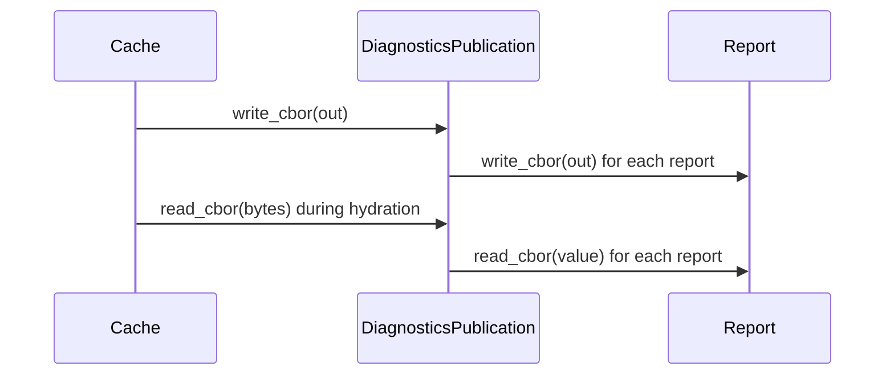

# PR review evidence

Source payload: review-evidence.json
Observed items: 1; PR head: 8f6a9b3cac769e547b31039d31a9b354ac9735eb.
Every item needs an explicit disposition; bot comments count.
Dispositions apply to the recorded item revision; edited feedback is reconsidered.

Coverage:
- comments: complete
- reviews: complete
- inline_comments: complete
- threads: complete

## github:comment:IC_kwDOSwdn1s8AAAABg48PBg — coderabbitai (comment)
https://github.com/Blackcat-Informatics/gmeow-ontology/pull/2057#issuecomment-6502158086
state=None resolved=None path=None

<!-- review_stack_entry_start -->

<a href="https://app.coderabbit.ai/change-stack/Blackcat-Informatics/gmeow-ontology/pull/2057?scope=ghh_OusAJGA4HG8ljoOV0wJvVx8NmnZIjc2DdjmxOu0xZWA&amp;cs_source=review_comment"><picture><source media="(prefers-color-scheme: dark)" srcset="https://storage.googleapis.com/coderabbit_public_assets/review-stack-in-coderabbit-ui-dark.svg?v=3"><source media="(prefers-color-scheme: light)" srcset="https://storage.googleapis.com/coderabbit_public_assets/review-stack-in-coderabbit-ui.svg?v=3"></picture></a>

<!-- review_stack_entry_end -->
<!-- walkthrough_start -->

<strong>📝 Summary</strong>

<dl>
<dd>

## Summary by CodeRabbit

* **New Features**
  * Diagnostic reports can now be serialized and read in CBOR format, including complete reports and publication data.
  * Diagnostic cache records now use CBOR encoding, with stable output and digest support.
* **Bug Fixes**
  * Invalid or malformed diagnostic data is rejected with clearer field-specific errors, while underlying codec causes are retained for troubleshooting.
  * CBOR decoding checks required fields, duplicate or unknown entries, value types, and metadata depth limits.

The PR adds native CBOR serialization and typed decoding for diagnostic reports and publications. It routes diagnostics cache encoding, decoding, and payload commitments through the native codecs. It also adds frozen CBOR fixtures and tests for round trips and malformed input.

**Changes: Diagnostics CBOR**

|Layer / File(s)|Summary|
|:---|:---|
|**Diagnostic report CBOR codec**   `crates/errors/src/cbor.rs`, `crates/errors/src/lib.rs`|Adds public report serialization and decoding. Decoding checks required, unknown, and duplicate fields, validates field types and metadata values, and enforces a metadata nesting limit.|
|**Publication codec and cache integration**   `crates/pipeline/src/bundle/diagnostics.rs`, `crates/pipeline/src/bundle/diagnostics/cbor.rs`, `crates/pipeline/src/cache.rs`, `crates/pipeline/src/error.rs`, `crates/pipeline/src/handle_identity.rs`, `crates/pipeline/src/bundle.rs`, `crates/pipeline/src/node.rs`, `crates/pipeline/src/stages/yaml_ld.rs`|Adds CBOR encoding and decoding for diagnostic publications. Cache encoding, hydration, and diagnostic payload commitments use the native codec. `Decode` can retain native error causes; existing error construction sites use its constructors.|
|**CBOR fixtures and validation**   `crates/pipeline/src/cache/fixtures/diagnostics-cbor-v1.txt`, `crates/pipeline/src/cache_diagnostics_tests.rs`|Adds frozen diagnostic records and tests for encoded identities, round trips, malformed records, and metadata depth limits.|

<!-- change_assessment_start -->
<strong>Priority: <picture></picture> Normal</strong>

**Estimated code review effort:** 4 (Complex) | ~60 minutes

<!-- change_assessment_commit:"8f6a9b3cac769e547b31039d31a9b354ac9735eb" -->
**Change:** Refactor
<!-- change_assessment_end -->

### Sequence Diagram(s)

**Possibly related issues**
- Issue 1973: This PR moves diagnostic publication cache and commitment paths to native CBOR, which addresses that issue’s diagnostics codec scope. The JSON Report v2 and metadata work is not included.
- Issue 1777: This PR replaces the diagnostics cache CBOR path with native CBOR. It does not show the broader workspace changes described in the issue.
- Issue 1776: This PR removes the Serde reader from the diagnostics publication path, but it does not cover the wider Serde and JSON codec scope.

**Suggested reviewers:** `erinaudley`

</dd>
</dl>

<!-- walkthrough_end -->

<strong>Merge Risk:</strong> <strong><picture></picture> Minimal</strong> · up to <code>8f6a9</code>

<dl>
<dd>

<!-- final_review_risk_start -->
<!-- final_review_risk_label
**Merge Risk:** **⚪ Minimal** · up to `8f6a9`
-->
<!-- final_review_risk_coverage:{"sourceCommitId":"8f6a9b3cac769e547b31039d31a9b354ac9735eb","coveredCommitId":"8f6a9b3cac769e547b31039d31a9b354ac9735eb","kind":"reviewed"} -->

This change moves diagnostics cache publications to a strict native CBOR format with typed errors that keep their causes. No concrete merge-blocking problem was found. The author should run the pending consumer diagnostics and the full workspace build before merging.
<!-- final_review_risk_end -->

</dd>
</dl>

<strong>Security architecture risk:</strong> <strong><picture></picture> Low</strong> · up to <code>8f6a9</code>

<dl>
<dd>

<!-- architecture_review_start -->
<!-- architecture_review_label
### Security Architecture Review

**Security architecture risk:** **🔵 Low** · up to `8f6a9`
-->

Producer ownership, graph binding, and integrity checks remain in place, and no introduced security bypass was identified. Residual uncertainty concerns compatibility with previously stored reports and edge-case behavior of the replacement decoder.

**Retained concerns**
No architecture-level concerns identified.

<strong>Security review details</strong>

<dl>
<dd>

**Security Blast Radius**
- _inferred_ — The established failure scope is restoration of diagnostic-bearing pipeline products and their consumers. The inspected call path does not establish a new network, tenant, credential, or privileged execution boundary; unresolved graph name matches are not evidence of wider exposure.

**Trust Boundaries and Controls**
- _observed_ — Structural decoding does not itself authorize a publication. Ownership, stage and graph binding, payload digest, and complete product checks remain separate controls. The tampering control asserts rejection of altered report evidence both before and after recomputing only its payload digest.

**Resilience and Maintainability Implications**
- _observed_ — The existing store publishes the content-addressed blob before its atomic receipt, serializes competing writers with locks, and rejects divergent same-key output. Receipt-write failure can leave an unreferenced blob, but not a published receipt for an incomplete write; pruning handles unreferenced blobs.

</dd>
</dl>

<!-- architecture_review_end -->

</dd>
</dl>

<!-- pre_merge_checks_walkthrough_start -->

<strong>Pre-merge checks: <picture></picture> 5</strong>

<dl>
<dd>

|         Check name         |                                             Status                                             | Explanation                                                                                                                                                                                               |
| :------------------------ | :--------------------------------------------------------------------------------------------: | :-------------------------------------------------------------------------------------------------------------------------------------------------------------------------------------------------------- |
|         Title check        |  | The title accurately and concisely describes the native CBOR preservation of complete diagnostics caches. It contains no agentic branding.                                                                |
|     Docstring Coverage     |  | Docstring coverage is 92.86% which is sufficient. The required threshold is 80.00%. Docstring coverage is scoped to functions touched by this diff with cyclomatic complexity of at least 2. Documentati… |
|     Linked Issues check    |  | Check skipped because no linked issues were found for this pull request.                                                                                                                                  |
| Out of Scope Changes check |  | Check skipped because no linked issues were found for this pull request.                                                                                                                                  |
|      Description check     |  | The description includes all required sections: Summary, Validation, Checklist, and Notes. It explains the scope, preservation goals, validation performed, pending checks, explicit CI waiver, and foll… |

<strong>Full details: Docstring Coverage</strong>

<dl>
<dd>

**Explanation**

Docstring coverage is 92.86% which is sufficient. The required threshold is 80.00%. Docstring coverage is scoped to functions touched by this diff with cyclomatic complexity of at least 2. Documentation-only edits and deletions within surviving functions are included; unchanged diff context and fully deleted functions are excluded. Analyzed 70 functions across 11 files. (1 skipped: 1 unsupported.)

</dd>
</dl>

<strong>Full details: Description check</strong>

<dl>
<dd>

**Explanation**

The description includes all required sections: Summary, Validation, Checklist, and Notes. It explains the scope, preservation goals, validation performed, pending checks, explicit CI waiver, and follow-up context. The validation and checklist clearly identify completed and incomplete work. The template items are addressed sufficiently for review.

</dd>
</dl>

</dd>
</dl>

<!-- pre_merge_checks_walkthrough_end -->
<!-- finishing_touch_checkbox_start -->

<strong>Finishing Touches</strong>

<dl>
<dd>

<strong>📝 Generate docstrings</strong>

<dl>
<dd>

- [ ] <!-- {"checkboxId":"3e1879ae-f29b-4d0d-8e06-d12b7ba33d98"} --> Commit to this branch
- [ ] <!-- {"checkboxId":"7962f53c-55bc-4827-bfbf-6a18da830691"} --> Create a new PR

</dd>
</dl>

<strong>🧪 Generate unit tests (beta)</strong>

<dl>
<dd>

- [ ] <!-- {"checkboxId": "6ba7b810-9dad-11d1-80b4-00c04fd430c8", "radioGroupId": "utg-output-choice-group-unknown_comment_id"} --> Commit to this branch
- [ ] <!-- {"checkboxId": "f47ac10b-58cc-4372-a567-0e02b2c3d479", "radioGroupId": "utg-output-choice-group-unknown_comment_id"} --> Create a new PR

</dd>
</dl>

<strong>✨ Simplify code</strong>

<dl>
<dd>

- [ ] <!-- {"checkboxId": "9a4e3077-58f6-4eba-b7ee-62e936ea00ea", "radioGroupId": "simplify-output-choice-group-unknown_comment_id"} --> Commit to this branch
- [ ] <!-- {"checkboxId": "f120d606-b0e2-4b7d-8316-181794555b43", "radioGroupId": "simplify-output-choice-group-unknown_comment_id"} --> Create a new PR

</dd>
</dl>

</dd>
</dl>

<!-- finishing_touch_checkbox_end -->

<!-- autopilot:start -->
- [ ] <!-- {"checkboxId":"2708ad07-9f24-4260-9c11-7dc76a49f2e3"} --> <strong title="Keep fixing CodeRabbit findings and required CI, and resolving merge conflicts">Autofix</strong> · Keep fixing CodeRabbit findings and required CI, and resolving merge conflicts
<!-- autopilot:end -->
<!-- tips_start -->

<!-- poem_footer_start -->
A rabbit checks each field in rows, And watches where the CBOR flows. The reports are packed, then read anew, With boundary cases tested through. The rabbit hops; the fixtures stay.
<!-- poem_footer_end -->

Comment `@coderabbitai help` to get the list of available commands.

<!-- tips_end -->

