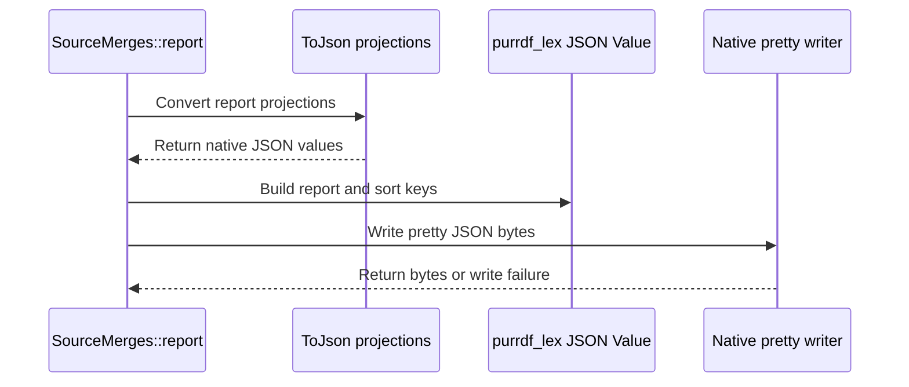

# PR review evidence

Source payload: review-evidence.json
Observed items: 1; PR head: 95678a669c4b23fcc04ba52e17e64577d63faf11.
Every item needs an explicit disposition; bot comments count.
Dispositions apply to the recorded item revision; edited feedback is reconsidered.

Coverage:
- comments: complete
- reviews: complete
- inline_comments: complete
- threads: complete

## github:comment:IC_kwDOSwdn1s8AAAABgEoxSg — coderabbitai (comment)
https://github.com/Blackcat-Informatics/gmeow-ontology/pull/2023#issuecomment-6447313226
state=None resolved=None path=None

<!-- review_stack_entry_start -->

<a href="https://app.coderabbit.ai/change-stack/Blackcat-Informatics/gmeow-ontology/pull/2023?scope=ghh_OusAJGA4HG8ljoOV0wJvVx8NmnZIjc2DdjmxOu0xZWA&amp;cs_source=review_comment"><picture><source media="(prefers-color-scheme: dark)" srcset="https://storage.googleapis.com/coderabbit_public_assets/review-stack-in-coderabbit-ui-dark.svg?v=3"><source media="(prefers-color-scheme: light)" srcset="https://storage.googleapis.com/coderabbit_public_assets/review-stack-in-coderabbit-ui.svg?v=3"></picture></a>

<!-- review_stack_entry_end -->
<!-- recent_review_start -->

No actionable comments were generated in the recent review.

<strong><picture></picture> Recent review info</strong>

<dl>
<dd>

<!-- review_info_content -->

<strong><picture><source media="(prefers-color-scheme: dark)" srcset="https://storage.googleapis.com/coderabbit_public_assets/review-comment-icons-v1/cog-dark.svg"></picture> Run configuration</strong>

<dl>
<dd>

- **Source mode**: Auto
- **Repository**: Unavailable
- **Branch**: Unavailable
- **File**: No configuration file from this repository applied
- **Commit**: Unavailable
- **Layers**: Repository UI (base), Organization UI (inherited)
- **Review profile**: ASSERTIVE
- **Plan**: Advanced
- **Run ID**: `eafadec3-b1c6-4a9c-9a7a-9e234d9aa8d0`

</dd>
</dl>

<strong><picture><source media="(prefers-color-scheme: dark)" srcset="https://storage.googleapis.com/coderabbit_public_assets/review-comment-icons-v1/git-commit-horizontal-dark.svg"></picture> Commits</strong>

<dl>
<dd>

Reviewing files that changed from the base of the PR and between 46b14d73d0c321ed04d4388e6491b9b046a65674 and 95678a669c4b23fcc04ba52e17e64577d63faf11.

</dd>
</dl>

<strong><picture><source media="(prefers-color-scheme: dark)" srcset="https://storage.googleapis.com/coderabbit_public_assets/review-comment-icons-v1/file-plus-corner-dark.svg"></picture> Files selected for processing: 10</strong>

<dl>
<dd>

* `crates/logic-compile/src/frontend/json.rs`
* `crates/logic-compile/src/ir/json.rs`
* `crates/logic-compile/src/ir/presentation.rs`
* `crates/logic/src/correspondence_exec/presentation.rs`
* `crates/logic/src/correspondence_exec/presentation/source/fixtures/documents-v1.json`
* `crates/logic/src/correspondence_exec/presentation/source/fixtures/projections-v1.json`
* `crates/logic/src/correspondence_exec/presentation/source/fixtures/report-v1.json`
* `crates/logic/src/correspondence_exec/presentation/source/report.rs`
* `crates/logic/src/correspondence_exec/presentation/source/tests.rs`
* `crates/logic/src/result.rs`

</dd>
</dl>

<strong><picture><source media="(prefers-color-scheme: dark)" srcset="https://storage.googleapis.com/coderabbit_public_assets/review-comment-icons-v1/linked-repositories-dark.svg"></picture> Linked repositories identified</strong>

<dl>
<dd>

CodeRabbit considers these linked repositories for cross-repo context during reviews:

- [`Blackcat-Informatics/purrdf`](https://github.com/Blackcat-Informatics/purrdf) _(auto-detected)_

</dd>
</dl>

**Included review availability:** This review used your included allowance. 0 included reviews remain after this review. Your included PR review attempts over the past 7 days set your current allowance at 1 review per hour.

</dd>
</dl>

<!-- review_details_start -->

<strong><picture><source media="(prefers-color-scheme: dark)" srcset="https://storage.googleapis.com/coderabbit_public_assets/review-comment-icons-v1/review-details-dark.svg"></picture> Recent review details</strong>

<dl>
<dd>

<strong><picture><source media="(prefers-color-scheme: dark)" srcset="https://storage.googleapis.com/coderabbit_public_assets/review-comment-icons-v1/clock-alert-dark.svg"></picture> Context from checks skipped due to timeout: 4</strong>

<dl>
<dd>

* GitHub Check: lint
* GitHub Check: rust-prebuild
* GitHub Check: producer-build
* GitHub Check: helpers

</dd>
</dl>

<strong><picture><source media="(prefers-color-scheme: dark)" srcset="https://storage.googleapis.com/coderabbit_public_assets/review-comment-icons-v1/layers-plus-dark.svg"></picture> Additional context used</strong>

<dl>
<dd>

<strong><picture><source media="(prefers-color-scheme: dark)" srcset="https://storage.googleapis.com/coderabbit_public_assets/review-comment-icons-v1/folders-dark.svg"></picture> Multi-repo context Blackcat-Informatics/purrdf</strong>

<dl>
<dd>

### Blackcat-Informatics/purrdf

- PurRDF exposes fallible allocation-aware writers: `write_into_with_memory` and `write_with_memory`, returning `StorageError`; these are the appropriate APIs if `SourceMerges::report` must preserve actual native writer failures. [::Blackcat-Informatics/purrdf::crates/lex/src/json/write.rs:107-181]
- The convenience `write_pretty` path returns `String` and internally uses `write_into`, which calls `expect("resident JSON writer allocation")`. If the PR claims serialization failures become diagnostics rather than panics, review that it uses the fallible writer variant instead of `write_pretty`. [::Blackcat-Informatics/purrdf::crates/lex/src/json/write.rs:94-105] [::Blackcat-Informatics/purrdf::crates/lex/src/json/write.rs:193-205]
- Both fallible writer APIs are publicly re-exported from `purrdf_lex::json`, so no new PurRDF dependency or private API is required. [::Blackcat-Informatics/purrdf::crates/lex/src/json.rs:92-100]

</dd>
</dl>

</dd>
</dl>

<strong><picture><source media="(prefers-color-scheme: dark)" srcset="https://storage.googleapis.com/coderabbit_public_assets/review-comment-icons-v1/message-square-more-dark.svg"></picture> Additional comments: 10</strong>

<dl>
<dd>

<strong>crates/logic-compile/src/frontend/json.rs: 1</strong>

<dl>
<dd>

`4-6`: LGTM!

Also applies to: 12-39

<!-- cr-comment:v1:6a04d15ec380f1160b57a7e9 -->

</dd>
</dl>

<strong>crates/logic-compile/src/ir/json.rs: 1</strong>

<dl>
<dd>

`5-8`: LGTM!

Also applies to: 14-67

<!-- cr-comment:v1:5593c4658f04b5bf3e24d7cd -->

</dd>
</dl>

<strong>crates/logic-compile/src/ir/presentation.rs: 1</strong>

<dl>
<dd>

`11-11`: LGTM!

Also applies to: 50-80

<!-- cr-comment:v1:3d007d7a673111266c7473f7 -->

</dd>
</dl>

<strong>crates/logic/src/correspondence_exec/presentation.rs: 1</strong>

<dl>
<dd>

`93-97`: LGTM!

<!-- cr-comment:v1:005cbf59ec725225eaf7170f -->

</dd>
</dl>

<strong>crates/logic/src/result.rs: 1</strong>

<dl>
<dd>

`597-603`: LGTM!

<!-- cr-comment:v1:a6611b93f16eee9d08243e71 -->

</dd>
</dl>

<strong>crates/logic/src/correspondence_exec/presentation/source/fixtures/documents-v1.json: 1</strong>

<dl>
<dd>

`1-42`: LGTM!

<!-- cr-comment:v1:f101d00beba04705710a9c00 -->

</dd>
</dl>

<strong>crates/logic/src/correspondence_exec/presentation/source/fixtures/projections-v1.json: 1</strong>

<dl>
<dd>

`1-122`: LGTM!

<!-- cr-comment:v1:b6809ee407b771213f62215c -->

</dd>
</dl>

<strong>crates/logic/src/correspondence_exec/presentation/source/tests.rs: 1</strong>

<dl>
<dd>

`23-24`: LGTM!

Also applies to: 91-260

<!-- cr-comment:v1:ab1022614e1cc4d851d3d39a -->

</dd>
</dl>

<strong>crates/logic/src/correspondence_exec/presentation/source/report.rs: 1</strong>

<dl>
<dd>

`7-7`: LGTM!

Also applies to: 15-17, 29-166

<!-- cr-comment:v1:295952db66bcbd51a126078d -->

</dd>
</dl>

<strong>crates/logic/src/correspondence_exec/presentation/source/fixtures/report-v1.json: 1</strong>

<dl>
<dd>

`1-208`: LGTM!

<!-- cr-comment:v1:3320d2720d76545d2052bb5a -->

</dd>
</dl>

</dd>
</dl>

</dd>
</dl>

<!-- review_details_end -->

<!-- recent_review_end -->
<!-- walkthrough_start -->

<strong>📝 Summary</strong>

<dl>
<dd>

## Summary by CodeRabbit

* **New Features**
  * Presentation merge reports now include structured JSON details for source documents, presentation contexts, reasoning contracts, symbols, and sentence evidence.
  * Added JSON output for source metadata, presentation settings, reasoning profiles, and result context.
* **Improvements**
  * Report and projection JSON output is consistently formatted, with sorted report keys and no trailing newline.

The report serializer now uses native PurRDF JSON instead of Serde JSON. Native JSON conversions cover the report’s source descriptions, contracts, contexts, and presentation values. Fixtures and tests check the report structure and serialized projections.

**Changes: Presentation report JSON**

|Layer / File(s)|Summary|
|:---|:---|
|**Native JSON projections**   `crates/logic-compile/src/frontend/json.rs`, `crates/logic-compile/src/ir/*.rs`, `crates/logic/src/correspondence_exec/presentation.rs`, `crates/logic/src/result.rs`, `crates/logic/src/correspondence_exec/presentation/source/fixtures/documents-v1.json`, `crates/logic/src/correspondence_exec/presentation/source/fixtures/projections-v1.json`, `crates/logic/src/correspondence_exec/presentation/source/tests.rs`|Adds `ToJson` conversions for source descriptions, reasoning contracts, presentation values, `PresentationContext`, and `ResultContext`. Projection tests compare pretty-JSON output with fixtures and check that it has no trailing newline.|
|**Native report serialization**   `crates/logic/src/correspondence_exec/presentation/source/report.rs`, `crates/logic/src/correspondence_exec/presentation/source/fixtures/report-v1.json`, `crates/logic/src/correspondence_exec/presentation/source/tests.rs`|Builds the report with native JSON values, sorts object keys, and writes pretty JSON. Tests compare the report against a frozen fixture, allowing only the engine descriptor value to vary.|

<!-- change_assessment_start -->
<strong>Priority: <picture></picture> Normal</strong>

**Estimated code review effort:** 3 (Moderate) | ~25 minutes

<!-- change_assessment_commit:"95678a669c4b23fcc04ba52e17e64577d63faf11" -->
**Change:** Refactor
<!-- change_assessment_end -->

### Sequence Diagram(s)

**Possibly related issues**

- Issue 1776 tracks the broader migration from Serde JSON to native PurRDF JSON. This change performs that migration for the presentation merge report.
- Issue 1757 tracks final merged-pipeline qualification. This change updates report serialization but does not perform that qualification.
- Issue 1962 tracks final pipeline parity and consumer acceptance. This change updates report serialization but does not perform those checks.

</dd>
</dl>

<!-- walkthrough_end -->

<strong>Merge Risk:</strong> <strong><picture></picture> Minimal</strong> · up to <code>95678</code>

<dl>
<dd>

<!-- final_review_risk_start -->
<!-- final_review_risk_label
**Merge Risk:** **⚪ Minimal** · up to `95678`
-->
<!-- final_review_risk_coverage:{"sourceCommitId":"95678a669c4b23fcc04ba52e17e64577d63faf11","coveredCommitId":"95678a669c4b23fcc04ba52e17e64577d63faf11","kind":"reviewed"} -->

No actionable report-formatting defect is established. Normal build and test checks remain appropriate before merging.
<!-- final_review_risk_end -->

</dd>
</dl>

<strong>Security architecture risk:</strong> <strong><picture></picture> Low</strong> · up to <code>95678</code>

<dl>
<dd>

<!-- architecture_review_start -->
<!-- architecture_review_label
### Security Architecture Review

**Security architecture risk:** **🔵 Low** · up to `95678`
-->

The change replaces how existing reports are encoded without expanding their observed recipients or authority. No introduced security-boundary issue was identified, but broader consumer and release compatibility remains unverified.

**Retained concerns**
No architecture-level concerns identified.

<strong>Security review details</strong>

<dl>
<dd>

**Security Blast Radius**
- _inferred_ — The demonstrated exposure remains the invocation's compiled source descriptions and merge results, delivered through the existing pipeline storage and CLI output paths. The inspected comparison does not show broader data selection, new recipients, or increased privileges. This does not establish the behavior of uninspected external consumers.

**Trust Boundaries and Controls**
- _observed_ — Evidence construction remains upstream of reporting and retains its preservation/loss checks. The report references existing formula and evidence identities, labels provenance and complement as source-publication, and emits descriptive bytes rather than hydrating a witness or granting proof authority.

</dd>
</dl>

<!-- architecture_review_end -->

</dd>
</dl>

<!-- pre_merge_checks_walkthrough_start -->

<!-- pre_merge_checks_override_start -->
> [!IMPORTANT]
> ## Pre-merge checks failed
> 
> Please resolve all errors before merging. Addressing warnings is optional.
<!-- pre_merge_checks_override_end -->

<strong><picture></picture> Failed checks: 1 error</strong>

|     Check name     |                                            Status                                            | Explanation                                                                                                                                                                                               | Resolution                                                                         |
| :---------------- | :------------------------------------------------------------------------------------------: | :-------------------------------------------------------------------------------------------------------------------------------------------------------------------------------------------------------- | :--------------------------------------------------------------------------------- |
| Docstring Coverage |  | Docstring coverage is 12.50% which is insufficient. The required threshold is 80.00%. Docstring coverage is scoped to functions touched by this diff. Documentation-only edits and deletions within surv… | Write docstrings for the functions missing them to satisfy the coverage threshold. |

<strong><picture></picture> Passed checks: 4 passed</strong>

<dl>
<dd>

|         Check name         |                                             Status                                             | Explanation                                                                                                                                                                                               |
| :------------------------ | :--------------------------------------------------------------------------------------------: | :-------------------------------------------------------------------------------------------------------------------------------------------------------------------------------------------------------- |
|         Title check        |  | The title "Render complete presentation merge reports with native JSON" matches the main change: presentation-merge reports now use native PurRDF JSON instead of Serde for every report shape and the p… |
|      Description check     |  | The description follows the template's content intent. It explains what changed (native PurRDF JSON for all report shapes and twelve projected types, complete source documents, origins, and directive … |
|     Linked Issues check    |  | Issue `#2022` is directly linked and active. `SourceMerges::report()` keeps the existing byte-returning API and builds the report with native `purrdf_lex` values. The implementation applies recursive `s… |
| Out of Scope Changes check |  | The changed files support Issue `#2022`. The new native mappings, fixtures, report implementation, and authored assertions cover the required terminal report format and projection coverage. The changes … |

<strong>Full details: Title check</strong>

<dl>
<dd>

**Explanation**

The title "Render complete presentation merge reports with native JSON" matches the main change: presentation-merge reports now use native PurRDF JSON instead of Serde for every report shape and the projected types. It is concise, accurate, and contains no agentic branding, so it meets the stated requirement.

</dd>
</dl>

<strong>Full details: Description check</strong>

<dl>
<dd>

**Explanation**

The description follows the template's content intent. It explains what changed (native PurRDF JSON for all report shapes and twelve projected types, complete source documents, origins, and directive coordinates) and why it changed (issue `#2022`, preserving the public byte API and callers). It lists validation performed and what was not run, and it closes the linked issue. The template's checklist items (make lint, make validate, make rust-test, docs updated, scope, tests updated, CLA status) are not ticked, and the Notes section is not used. The author does explain the validation scope, though, so the description is mostly complete.

**Resolution**

Optionally tick or explicitly address the template checklist items (for example, state whether make rust-test and make lint were run, and whether docs need updating), and add any reviewer notes in the Notes section. The author's note that CI is waived is useful and could be placed there.

</dd>
</dl>

<strong>Full details: Linked Issues check</strong>

<dl>
<dd>

**Explanation**

Issue `#2022` is directly linked and active. `SourceMerges::report()` keeps the existing byte-returning API and builds the report with native `purrdf_lex` values. The implementation applies recursive `sort_keys()` and the existing pretty writer without a terminal LF. The diff adds native mappings for all listed report projections, including contexts, contracts, enum tags, portable source documents, source origins, exact line and column widths, formula/evidence data, names, bindings, and image vectors. The authored control compares the complete frozen report and both projection references byte-for-byte, with only the current engine descriptor rebound. No caller, proof construction, source hashing, or report hydration change is shown.

</dd>
</dl>

<strong>Full details: Out of Scope Changes check</strong>

<dl>
<dd>

**Explanation**

The changed files support Issue `#2022`. The new native mappings, fixtures, report implementation, and authored assertions cover the required terminal report format and projection coverage. The changes do not add optimized production, corpus construction, synchronization, a generic serializer, a new dependency, proof authority, or caller/API changes. The open parent contracts and other acceptance areas remain outside this pull request as required.

</dd>
</dl>

</dd>
</dl>

<strong>Full details: Docstring Coverage</strong>

<dl>
<dd>

**Explanation**

Docstring coverage is 12.50% which is insufficient. The required threshold is 80.00%. Docstring coverage is scoped to functions touched by this diff. Documentation-only edits and deletions within surviving functions are included; unchanged diff context and fully deleted functions are excluded. Analyzed 8 functions across 7 files. (3 skipped: 3 unsupported.)

**Resolution**

Write docstrings for the functions missing them to satisfy the coverage threshold.

</dd>
</dl>

<!-- pre_merge_checks_walkthrough_end -->
<!-- finishing_touch_checkbox_start -->

<strong>Finishing Touches: 💡 1</strong>

<dl>
<dd>

<!-- finishing_touch_suggestion:docstrings -->

<strong>📝 Generate docstrings: 💡</strong>

<dl>
<dd>

- [ ] <!-- {"checkboxId":"3e1879ae-f29b-4d0d-8e06-d12b7ba33d98"} --> Commit to this branch
- [ ] <!-- {"checkboxId":"7962f53c-55bc-4827-bfbf-6a18da830691"} --> Create a new PR

</dd>
</dl>

<strong>🧪 Generate unit tests (beta)</strong>

<dl>
<dd>

- [ ] <!-- {"checkboxId": "6ba7b810-9dad-11d1-80b4-00c04fd430c8", "radioGroupId": "utg-output-choice-group-unknown_comment_id"} --> Commit to this branch
- [ ] <!-- {"checkboxId": "f47ac10b-58cc-4372-a567-0e02b2c3d479", "radioGroupId": "utg-output-choice-group-unknown_comment_id"} --> Create a new PR

</dd>
</dl>

<strong>✨ Simplify code</strong>

<dl>
<dd>

- [ ] <!-- {"checkboxId": "9a4e3077-58f6-4eba-b7ee-62e936ea00ea", "radioGroupId": "simplify-output-choice-group-unknown_comment_id"} --> Commit to this branch
- [ ] <!-- {"checkboxId": "f120d606-b0e2-4b7d-8316-181794555b43", "radioGroupId": "simplify-output-choice-group-unknown_comment_id"} --> Create a new PR

</dd>
</dl>

</dd>
</dl>

<!-- finishing_touch_checkbox_end -->

<!-- autopilot:start -->
- [ ] <!-- {"checkboxId":"2708ad07-9f24-4260-9c11-7dc76a49f2e3"} --> <strong title="Keep fixing CodeRabbit findings and required CI, and resolving merge conflicts">Autofix</strong> · Keep fixing CodeRabbit findings and required CI, and resolving merge conflicts
<!-- autopilot:end -->
<!-- tips_start -->

<!-- poem_footer_start -->
A rabbit checks the fields in view   And sorts the keys in order, too   The native writer shapes each byte   The frozen fixtures check it right   Then hops away beneath the moon
<!-- poem_footer_end -->

Comment `@coderabbitai help` to get the list of available commands.

<!-- tips_end -->

