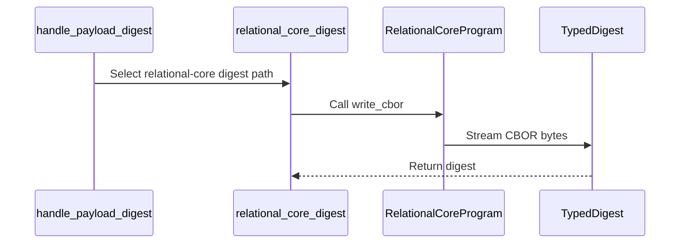

# PR review evidence

Source payload: review-evidence.json
Observed items: 1; PR head: 4b9a16f0dc55456a1c551e7d2da33f9d35481ec5.
Every item needs an explicit disposition; bot comments count.
Dispositions apply to the recorded item revision; edited feedback is reconsidered.

Coverage:
- comments: complete
- reviews: complete
- inline_comments: complete
- threads: complete

## github:comment:IC_kwDOSwdn1s8AAAABgzsfzQ — coderabbitai (comment)
https://github.com/Blackcat-Informatics/gmeow-ontology/pull/2047#issuecomment-6496657357
state=None resolved=None path=None

<!-- review_stack_entry_start -->

<a href="https://app.coderabbit.ai/change-stack/Blackcat-Informatics/gmeow-ontology/pull/2047?scope=ghh_OusAJGA4HG8ljoOV0wJvVx8NmnZIjc2DdjmxOu0xZWA&amp;cs_source=review_comment"><picture><source media="(prefers-color-scheme: dark)" srcset="https://storage.googleapis.com/coderabbit_public_assets/review-stack-in-coderabbit-ui-dark.svg?v=3"><source media="(prefers-color-scheme: light)" srcset="https://storage.googleapis.com/coderabbit_public_assets/review-stack-in-coderabbit-ui.svg?v=3"></picture></a>

<!-- review_stack_entry_end -->
<!-- walkthrough_start -->

<strong>📝 Summary</strong>

<dl>
<dd>

## Summary by CodeRabbit

* **Improvements**
  * Relational program identities now consistently account for source information, entry order, and repeated entries. This helps ensure that programs with different content are recognized as distinct, while equivalent representations retain consistent identities.
  * Serialization now preserves optional values and literal details, including datatype, language, and direction information.

Relational-core programs now have a streaming CBOR encoding. The pipeline uses it to compute relational-core payload digests. Reference fixtures and tests check the encoding and commitments across changes to source identity, body order, and multiplicity.

**Changes: Relational-core identity**

|Layer / File(s)|Summary|
|:---|:---|
|**Term and literal CBOR encodings**   `crates/logic-compile/src/ir/atomic.rs`, `crates/logic-compile/src/ir/literal_serde.rs`|Atomic terms are encoded as externally tagged maps. Literals are encoded as four-element arrays containing lexical form, effective datatype, and optional language and direction values.|
|**Relational-core program CBOR encoding**   `crates/logic-compile/src/relational_core.rs`, `crates/logic-compile/src/relational_core/cbor.rs`|`RelationalCoreProgram::write_cbor` writes facts, rules, residue, and source IRI. The encoding preserves recorded order and multiplicity and writes absent optional values as CBOR null.|
|**Digest integration and reference checks**   `crates/pipeline/src/handle_identity.rs`, `crates/pipeline/src/fixtures/relational-core-cbor-v1.txt`, `crates/pipeline/src/cache.tests.rs`|Relational-core payloads use the streaming CBOR writer for digest computation. Fixture tests compare encoded bytes, digests, and commitments, including cases with changed source identity, body order, or multiplicity.|

<!-- change_assessment_start -->
<strong>Priority: <picture></picture> Low</strong>

**Estimated code review effort:** 3 (Moderate) | ~20 minutes

<!-- change_assessment_commit:"4b9a16f0dc55456a1c551e7d2da33f9d35481ec5" -->
**Change:** Refactor
<!-- change_assessment_end -->

### Sequence Diagram(s)

**Possibly related issues**

- Issue 1777: This PR migrates relational-core handle commitments to the native CBOR writer, which covers part of the broader migration described by the issue.

**Suggested reviewers:** `erinaudley`

</dd>
</dl>

<!-- walkthrough_end -->

<strong>Merge Risk:</strong> <strong><picture></picture> Minimal</strong> · up to <code>4b9a1</code>

<dl>
<dd>

<!-- final_review_risk_start -->
<!-- final_review_risk_label
**Merge Risk:** **⚪ Minimal** · up to `4b9a1`
-->
<!-- final_review_risk_coverage:{"sourceCommitId":"4b9a16f0dc55456a1c551e7d2da33f9d35481ec5","coveredCommitId":"4b9a16f0dc55456a1c551e7d2da33f9d35481ec5","kind":"reviewed"} -->

The relational-core commitment change has no identified merge-blocking defect; it is ready for normal checks.
<!-- final_review_risk_end -->

</dd>
</dl>

<strong>Security architecture risk:</strong> <strong><picture></picture> Low</strong> · up to <code>4b9a1</code>

<dl>
<dd>

<!-- architecture_review_start -->
<!-- architecture_review_label
### Security Architecture Review

**Security architecture risk:** **🔵 Low** · up to `4b9a1`
-->

The inspected identity framing and reconstruction checks remain intact, and no new privilege expansion was identified. Compatibility with the previous implementation has not been fully verified.

**Retained concerns**
No architecture-level concerns identified.

<strong>Security review details</strong>

<dl>
<dd>

**Security Blast Radius**
- _inferred_ — The demonstrated security-sensitive scope is relational-core payload integrity and its inheritance into graph-bound product identities, persistent-cache reconstruction and downstream action inputs. The inspected digest helper does not grant additional authority over those consumers.

**Trust Boundaries and Controls**
- _observed_ — Commitment-domain separation remains explicit. Cache publication validates the typed payload against its backing graph and checks lossless codec reconstruction. Restore recomputes the payload digest before pinning and rejects an inconsistent enclosing product; the empty-carrier exception cannot admit a typed handle.

**Resilience and Maintainability Implications**
- _observed_ — Publication computes commitments before constructing the product, and carrier release preserves those commitments. The inspected persistent-store protocol serializes publication under locks, writes content before the receipt, accepts identical repetition and rejects divergent same-key receipts. These controls contain partial publication and concurrent-writer identity inconsistency.

</dd>
</dl>

<!-- architecture_review_end -->

</dd>
</dl>

<!-- pre_merge_checks_walkthrough_start -->

<strong>Pre-merge checks: <picture></picture> 5</strong>

<dl>
<dd>

|         Check name         |                                             Status                                             | Explanation                                                                                                                                                                                               |
| :------------------------ | :--------------------------------------------------------------------------------------------: | :-------------------------------------------------------------------------------------------------------------------------------------------------------------------------------------------------------- |
|         Title check        |  | The title accurately summarizes the main change: streaming complete relational-core commitments through native CBOR. It is concise and contains no agentic branding.                                      |
|     Docstring Coverage     |  | Docstring coverage is 100.00% which is sufficient. The required threshold is 80.00%. Docstring coverage is scoped to functions touched by this diff with cyclomatic complexity of at least 2. Documentat… |
|     Linked Issues check    |  | Check skipped because no linked issues were found for this pull request.                                                                                                                                  |
| Out of Scope Changes check |  | Check skipped because no linked issues were found for this pull request.                                                                                                                                  |
|      Description check     |  | The description states what changed: relational-core handle commitments now stream the complete borrowed native CBOR representation into the existing BLAKE3 sink, keeping declaration order, sequence o… |

<strong>Full details: Docstring Coverage</strong>

<dl>
<dd>

**Explanation**

Docstring coverage is 100.00% which is sufficient. The required threshold is 80.00%. Docstring coverage is scoped to functions touched by this diff with cyclomatic complexity of at least 2. Documentation-only edits and deletions within surviving functions are included; unchanged diff context and fully deleted functions are excluded. Analyzed 10 functions across 6 files. (1 skipped: 1 unsupported.)

</dd>
</dl>

<strong>Full details: Description check</strong>

<dl>
<dd>

**Explanation**

The description states what changed: relational-core handle commitments now stream the complete borrowed native CBOR representation into the existing BLAKE3 sink, keeping declaration order, sequence order and multiplicity. It explains why: eight fixture preimages and both production digests were captured before the encoder replacement, so the references protect the bytes, raw digest and handle commitment. It lists validation steps and their results, and it states scope limits and related issue `#1777`. The template's Validation checkboxes are not ticked, and make lint, make validate, make rust-test and docs status are not stated explicitly. Checklist items (tests updated, SPDX header, CLA, secrets) are not addressed. The author does say the final native runtime is pending and CI was waived. The template's Notes section is used only implicitly. Because the core Summary section is complete and the validation details are described in prose, the description is mostly complete.

</dd>
</dl>

</dd>
</dl>

<!-- pre_merge_checks_walkthrough_end -->
<!-- finishing_touch_checkbox_start -->

<strong>Finishing Touches</strong>

<dl>
<dd>

<strong>📝 Generate docstrings</strong>

<dl>
<dd>

- [ ] <!-- {"checkboxId":"3e1879ae-f29b-4d0d-8e06-d12b7ba33d98"} --> Commit to this branch
- [ ] <!-- {"checkboxId":"7962f53c-55bc-4827-bfbf-6a18da830691"} --> Create a new PR

</dd>
</dl>

<strong>🧪 Generate unit tests (beta)</strong>

<dl>
<dd>

- [ ] <!-- {"checkboxId": "6ba7b810-9dad-11d1-80b4-00c04fd430c8", "radioGroupId": "utg-output-choice-group-unknown_comment_id"} --> Commit to this branch
- [ ] <!-- {"checkboxId": "f47ac10b-58cc-4372-a567-0e02b2c3d479", "radioGroupId": "utg-output-choice-group-unknown_comment_id"} --> Create a new PR

</dd>
</dl>

<strong>✨ Simplify code</strong>

<dl>
<dd>

- [ ] <!-- {"checkboxId": "9a4e3077-58f6-4eba-b7ee-62e936ea00ea", "radioGroupId": "simplify-output-choice-group-unknown_comment_id"} --> Commit to this branch
- [ ] <!-- {"checkboxId": "f120d606-b0e2-4b7d-8316-181794555b43", "radioGroupId": "simplify-output-choice-group-unknown_comment_id"} --> Create a new PR

</dd>
</dl>

</dd>
</dl>

<!-- finishing_touch_checkbox_end -->

<!-- autopilot:start -->
- [ ] <!-- {"checkboxId":"2708ad07-9f24-4260-9c11-7dc76a49f2e3"} --> <strong title="Keep fixing CodeRabbit findings and required CI, and resolving merge conflicts">Autofix</strong> · Keep fixing CodeRabbit findings and required CI, and resolving merge conflicts
<!-- autopilot:end -->
<!-- tips_start -->

<!-- poem_footer_start -->
A rabbit taps a byte-sized beat   As terms and literals take shape   Four fields stream along the path   Hashes settle in their burrow   The fixtures greet the morning moon
<!-- poem_footer_end -->

Comment `@coderabbitai help` to get the list of available commands.

<!-- tips_end -->

