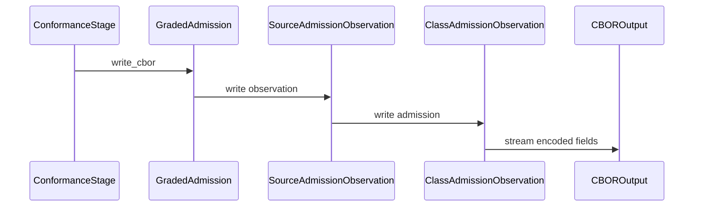

# PR review evidence

Source payload: review-evidence.json
Observed items: 1; PR head: e2ae3d30e6600ba1e2629766459a94b157d936c4.
Every item needs an explicit disposition; bot comments count.
Dispositions apply to the recorded item revision; edited feedback is reconsidered.

Coverage:
- comments: complete
- reviews: complete
- inline_comments: complete
- threads: complete

## github:comment:IC_kwDOSwdn1s8AAAABgx8f6w — coderabbitai (comment)
https://github.com/Blackcat-Informatics/gmeow-ontology/pull/2044#issuecomment-6494822379
state=None resolved=None path=None

<!-- review_stack_entry_start -->

<a href="https://app.coderabbit.ai/change-stack/Blackcat-Informatics/gmeow-ontology/pull/2044?scope=ghh_OusAJGA4HG8ljoOV0wJvVx8NmnZIjc2DdjmxOu0xZWA&amp;cs_source=review_comment"><picture><source media="(prefers-color-scheme: dark)" srcset="https://storage.googleapis.com/coderabbit_public_assets/review-stack-in-coderabbit-ui-dark.svg?v=3"><source media="(prefers-color-scheme: light)" srcset="https://storage.googleapis.com/coderabbit_public_assets/review-stack-in-coderabbit-ui.svg?v=3"></picture></a>

<!-- review_stack_entry_end -->
<!-- walkthrough_start -->

<strong>📝 Summary</strong>

<dl>
<dd>

## Summary by CodeRabbit

* **New Features**
  * Added CBOR serialization for admission observations and term values, including optional values.
  * Conformance receipts now use a structured CBOR format containing schema, corpus, case, token, and observation data.
  * Serialization failures now report diagnostic details, including the underlying error when available.

The change adds streaming CBOR writers for terms and source-admission observations. The conformance stage uses these writers to encode receipts, reports serialization failures as diagnostics, and checks emitted receipts against frozen fixtures.

**Changes: Source-admission CBOR**

|Layer / File(s)|Summary|
|:---|:---|
|**Term CBOR encoding**   `crates/logic-compile/src/term_serde*`, `crates/logic/src/term_serde.rs`|Adds streaming writers for retained and optional terms. Exposes the writers through the compile and logic APIs.|
|**Admission observation encoding**   `crates/conformance/src/native_observation*`, `crates/logic/src/reason/refute*`|Adds CBOR writers for source-admission observations, class-admission observations, worlds, boundaries, premises, and source issues.|
|**Receipt emission and validation**   `crates/pipeline/src/stages/conformance/source_admission.rs`, `crates/pipeline/src/stages/conformance/source_admission.tests.rs`, `crates/pipeline/src/stages/conformance/fixtures/source-admission-cbor-v1.txt`|Encodes receipts as five-element arrays. Serialization failures produce stage diagnostics with the source error and available failure class. Tests compare emitted receipts with fixtures and verify decoded metadata and observations.|

<!-- change_assessment_start -->
<strong>Priority: <picture></picture> Low</strong>

**Estimated code review effort:** 3 (Moderate) | ~20 minutes

<!-- change_assessment_commit:"c42d5f61e99d5363f09538a3fd1364c54725ccf8" -->
**Change:** Refactor
<!-- change_assessment_end -->

### Sequence Diagram(s)

**Possibly related issues**
- Issue 1777 tracks the source-admission receipt migration from `ciborium`; this change replaces that receipt serialization path with native CBOR writers.

**Suggested reviewers:** `erinaudley`

</dd>
</dl>

<!-- walkthrough_end -->

<strong>Merge Risk:</strong> <strong><picture></picture> Minimal</strong> · up to <code>c42d5</code>

<dl>
<dd>

<!-- final_review_risk_start -->
<!-- final_review_risk_label
**Merge Risk:** **⚪ Minimal** · up to `c42d5`
-->
<!-- final_review_risk_coverage:{"sourceCommitId":"c42d5f61e99d5363f09538a3fd1364c54725ccf8","coveredCommitId":"c42d5f61e99d5363f09538a3fd1364c54725ccf8","kind":"reviewed"} -->

No confirmed issue blocks merging; complete the pending checks as planned.
<!-- final_review_risk_end -->

</dd>
</dl>

<strong>Security architecture risk:</strong> <strong><picture></picture> Low</strong> · up to <code>c42d5</code>

<dl>
<dd>

<!-- architecture_review_start -->
<!-- architecture_review_label
### Security Architecture Review

**Security architecture risk:** **🔵 Low** · up to `c42d5`
-->

The inspected receipt path validates admission evidence before encoding and does not publish incomplete receipts after encoding failures. Compatibility assertions cover complete receipt bytes and identities. No introduced security defect was established, but the original comparison revision was unavailable, leaving some compatibility and change-attribution uncertainty.

**Retained concerns**
No architecture-level concerns identified.

<strong>Security review details</strong>

<dl>
<dd>

**Security Blast Radius**
- _inferred_ — A serialization regression on the inspected path could affect source-admission receipt contents and content-derived identities in conformance output. The traced writers consume evidence values and write bytes; this path does not introduce an execution or credential authority transition. External callers of the public APIs remain outside the inspected scope.

**Trust Boundaries and Controls**
- _observed_ — Source-supported boundary validation remains upstream of receipt publication. Validation accepts appropriately scoped source-admission support and non-empty recursively valid combined boundaries, while rejecting other boundary forms. Direct serialization is not a substitute for this validation.

**Resilience and Maintainability Implications**
- _inferred_ — The one-MiB sink and propagation of encoding errors contain oversized or failed receipts before publication. Emission uses immutable inputs and local buffers, so ordinary repeated or concurrent calls do not share partially encoded receipt state. This establishes current emission isolation, not a full comparison of persistence or recovery behavior against the unavailable base.

</dd>
</dl>

<!-- architecture_review_end -->

</dd>
</dl>

<!-- pre_merge_checks_walkthrough_start -->

<!-- pre_merge_checks_override_start -->
> [!IMPORTANT]
> ## Pre-merge checks failed
> 
> Please resolve all errors before merging. Addressing warnings is optional.
<!-- pre_merge_checks_override_end -->

<strong><picture></picture> Failed checks: 1 error</strong>

|     Check name     |                                            Status                                            | Explanation                                                                                                                                                                                               | Resolution                                                                         |
| :---------------- | :------------------------------------------------------------------------------------------: | :-------------------------------------------------------------------------------------------------------------------------------------------------------------------------------------------------------- | :--------------------------------------------------------------------------------- |
| Docstring Coverage |  | Docstring coverage is 41.67% which is insufficient. The required threshold is 80.00%. Docstring coverage is scoped to functions touched by this diff with cyclomatic complexity of at least 2. Documenta… | Write docstrings for the functions missing them to satisfy the coverage threshold. |

<strong><picture></picture> Passed checks: 4 passed</strong>

<dl>
<dd>

|         Check name         |                                             Status                                             | Explanation                                                                                                                                                                                               |
| :------------------------ | :--------------------------------------------------------------------------------------------: | :-------------------------------------------------------------------------------------------------------------------------------------------------------------------------------------------------------- |
|         Title check        |  | The title "Stream source-admission receipts through native CBOR" is concise and accurate. It matches the main change: the source-admission receipt encoder moves from ciborium::into_writer to native CB… |
|     Linked Issues check    |  | Check skipped because no linked issues were found for this pull request.                                                                                                                                  |
| Out of Scope Changes check |  | Check skipped because no linked issues were found for this pull request.                                                                                                                                  |
|      Description check     |  | The description is detailed and on-topic. It explains what changed, why it changed, validation performed, known limitations, and remaining work. It does not use the template headings or explicit check… |

<strong>Full details: Title check</strong>

<dl>
<dd>

**Explanation**

The title "Stream source-admission receipts through native CBOR" is concise and accurate. It matches the main change: the source-admission receipt encoder moves from ciborium::into_writer to native CBOR writers that stream to a sink. It contains no agentic branding and meets the title requirements.

</dd>
</dl>

<strong>Full details: Description check</strong>

<dl>
<dd>

**Explanation**

The description is detailed and on-topic. It explains what changed, why it changed, validation performed, known limitations, and remaining work. It does not use the template headings or explicit checklist items, but it provides most required information.

</dd>
</dl>

</dd>
</dl>

<strong>Full details: Docstring Coverage</strong>

<dl>
<dd>

**Explanation**

Docstring coverage is 41.67% which is insufficient. The required threshold is 80.00%. Docstring coverage is scoped to functions touched by this diff with cyclomatic complexity of at least 2. Documentation-only edits and deletions within surviving functions are included; unchanged diff context and fully deleted functions are excluded. Analyzed 12 functions across 9 files. (1 skipped: 1 unsupported.)

**Resolution**

Write docstrings for the functions missing them to satisfy the coverage threshold.

</dd>
</dl>

<!-- pre_merge_checks_walkthrough_end -->
<!-- finishing_touch_checkbox_start -->

<strong>Finishing Touches: 💡 1</strong>

<dl>
<dd>

<!-- finishing_touch_suggestion:docstrings -->

<strong>📝 Generate docstrings: 💡</strong>

<dl>
<dd>

- [ ] <!-- {"checkboxId":"3e1879ae-f29b-4d0d-8e06-d12b7ba33d98"} --> Commit to this branch
- [ ] <!-- {"checkboxId":"7962f53c-55bc-4827-bfbf-6a18da830691"} --> Create a new PR

</dd>
</dl>

<strong>🧪 Generate unit tests (beta)</strong>

<dl>
<dd>

- [ ] <!-- {"checkboxId": "6ba7b810-9dad-11d1-80b4-00c04fd430c8", "radioGroupId": "utg-output-choice-group-unknown_comment_id"} --> Commit to this branch
- [ ] <!-- {"checkboxId": "f47ac10b-58cc-4372-a567-0e02b2c3d479", "radioGroupId": "utg-output-choice-group-unknown_comment_id"} --> Create a new PR

</dd>
</dl>

<strong>✨ Simplify code</strong>

<dl>
<dd>

- [ ] <!-- {"checkboxId": "9a4e3077-58f6-4eba-b7ee-62e936ea00ea", "radioGroupId": "simplify-output-choice-group-unknown_comment_id"} --> Commit to this branch
- [ ] <!-- {"checkboxId": "f120d606-b0e2-4b7d-8316-181794555b43", "radioGroupId": "simplify-output-choice-group-unknown_comment_id"} --> Create a new PR

</dd>
</dl>

</dd>
</dl>

<!-- finishing_touch_checkbox_end -->

<!-- autopilot:start -->
- [ ] <!-- {"checkboxId":"2708ad07-9f24-4260-9c11-7dc76a49f2e3"} --> <strong title="Keep fixing CodeRabbit findings and required CI, and resolving merge conflicts">Autofix</strong> · Keep fixing CodeRabbit findings and required CI, and resolving merge conflicts
<!-- autopilot:end -->
<!-- tips_start -->

<!-- poem_footer_start -->
A rabbit taps the byte stream bright, Terms hop in fields, arranged just right. Worlds and boundaries join the flow, Receipts line up in frozen rows. The rabbit nods: all bytes now go.
<!-- poem_footer_end -->

Comment `@coderabbitai help` to get the list of available commands.

<!-- tips_end -->

