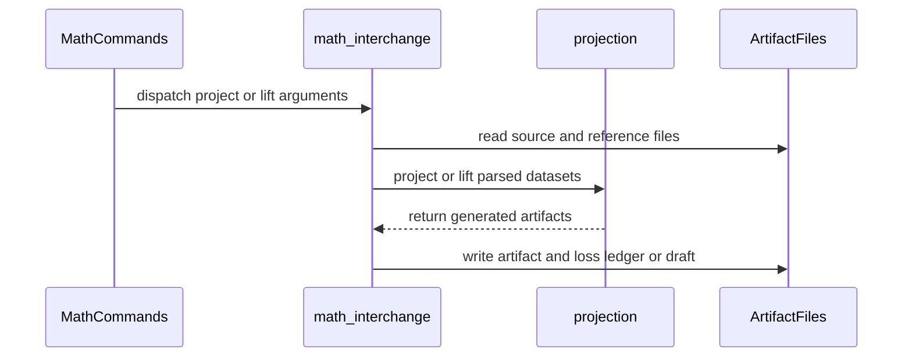

# PR #1888 — comments and review threads

1 comment(s). **Every one needs a disposition** in
`review-debt.md`: addressed (with the commit hash) or declined (with the
reason posted in reply). Bot comments count.

## 1. coderabbitai — 


<!-- This is an auto-generated comment: summarize by coderabbit.ai -->
<!-- review_stack_entry_start -->

<a href="https://app.coderabbit.ai/change-stack/Blackcat-Informatics/gmeow-ontology/pull/1888?cs_source=review_comment"><picture><source media="(prefers-color-scheme: dark)" srcset="https://storage.googleapis.com/coderabbit_public_assets/review-stack-in-coderabbit-ui-dark.svg?v=3"><source media="(prefers-color-scheme: light)" srcset="https://storage.googleapis.com/coderabbit_public_assets/review-stack-in-coderabbit-ui.svg?v=3"></picture></a>

<!-- review_stack_entry_end -->
<!-- This is an auto-generated comment: review in progress by coderabbit.ai -->

> [!NOTE]
> Currently processing new changes in this PR. This may take a few minutes, please wait...
> 
> <details>
> <summary><strong>⚙️ Run configuration</strong></summary>
> <dl>
> <dd>
> 
> - **Configuration used**: Repository UI
> - **Review profile**: ASSERTIVE
> - **Plan**: Team
> - **Run ID**: `f8194cbb-c9da-4a36-987c-43e9e8f28755`
> 
> </dd>
> </dl>
> </details>
> 
> <details>
> <summary><strong>📥 Commits</strong></summary>
> <dl>
> <dd>
> 
> Reviewing files that changed from the base of the PR and between 5b21f45d2c0933f9a343639257ef8945d2f485a9 and da59fdeaa3c395b0c8cf7dcd0ad26616e5afccdb.
> 
> </dd>
> </dl>
> </details>
> 
> <details>
> <summary><strong>📒 Files selected for processing: 5</strong></summary>
> <dl>
> <dd>
> 
> * `crates/gmeow-cli/src/passthrough.rs`
> * `crates/gmeow-cli/tests/math_projection_cli.rs`
> * `crates/math-lift/src/projection/tests.rs`
> * `crates/validate/src/lint.tests.rs`
> * `slices/grounding/math/module.ttl`
> 
> </dd>
> </dl>
> </details>
> 
> ```ascii
> +----------------------------------------------------------+
> | If your code was a carrot, I'd bury it and forget where. |
> +----------------------------------------------------------+
>   \
>    \     /)/)
>         ( '')
>         /  |
>       o(___)
> ```

<!-- end of auto-generated comment: review in progress by coderabbit.ai -->

<!-- walkthrough_start -->

<details>
<summary><strong>📝 Summary</strong></summary>
<dl>
<dd>

<!-- This is an auto-generated comment: release notes by coderabbit.ai -->

## Summary by CodeRabbit

- **New Features**
  - Added mathematical projection and lifting commands with explicit source, target, subject, reference, and output options.
  - Added support for MathML, OpenMath, Data Cube, STATO, and QUDT representations.
  - Projection artifacts now include preservation records and loss ledgers.
  - Pipeline outputs include mathematical projection artifacts and competency queries.

- **Bug Fixes**
  - Invalid, unsupported, ambiguous, or incomplete mathematical artifacts now fail without producing partial output.
  - Prevented projection artifacts and loss ledgers from using the same path.

- **Documentation**
  - Added projection contracts, examples, reference data, translations, and queries for tracking preservation and unsupported constructs.

<!-- end of auto-generated comment: release notes by coderabbit.ai -->
The change adds projection and lifting codecs for five mathematical interchange formats. It adds CLI commands and pipeline support to generate, validate, archive, and distribute selected projection artifacts, loss records, and competency queries.

**Changes: Mathematical Interchange**

|Layer / File(s)|Summary|
|:---|:---|
|**Projection contracts and public API** <br> `crates/math-lift/...`, `crates/math/...`, `slices/grounding/math/module.ttl`, `slices/grounding/math/design/*`, `slices/grounding/math/examples/*`, `slices/grounding/math/i18n/*`, `metadata/references.ttl`|Defines projection requests, target selection, diagnostics, shared frame support, and public codec exports.|
|**Projection codecs and loss records** <br> `crates/math-lift/src/projection.rs`, `crates/math-lift/src/projection/expression.rs`, `slices/grounding/math/queries/competency/*`|Projects canonical RDF into MathML, OpenMath, QUDT, STATO, and Data Cube artifacts with source-bound records and loss ledgers.|
|**Inbound artifact lifting** <br> `crates/math-lift/src/projection/inbound.rs`|Validates external artifacts and reference data before emitting canonical draft graphs.|
|**CLI projection and lift commands** <br> `crates/gmeow-cli/src/lib.rs`, `crates/gmeow-cli/src/passthrough.rs`, `crates/gmeow-cli/tests/math_projection_cli.rs`|Adds `project` and `lift` commands with explicit files, target selection, output validation, diagnostics, and integration tests.|
|**Pipeline generation and artifact distribution** <br> `crates/pipeline/...`, `slices/core/pipeline/module.ttl`, `slices/core/pipeline/i18n/*`|The math producer stage consumes source and mapping products and emits selected projections and competency queries. Archive, snapshot fanout, and sink stages include the generated outputs.|
|**Codec and loss-ledger validation** <br> `crates/math-lift/src/projection/tests.rs`, `crates/validate/src/lint.tests.rs`|Adds tests for codec output, input validation, projection requests, loss records, competency queries, and lint behavior.|

<!-- change_assessment_start -->
**Priority:** ⬇️ Low


**Estimated code review effort:** 4 (Complex) | ~60 minutes

<!-- change_assessment_commit:"5b21f45d2c0933f9a343639257ef8945d2f485a9" -->
**Change:** Feature
<!-- change_assessment_end -->

### Sequence Diagram(s)



</dd>
</dl>
</details>

<!-- walkthrough_end -->
<details>
<summary><strong>Merge Risk:</strong> <strong>🟡 Moderate</strong> · up to <code>5b21f</code></summary>
<dl>
<dd>

<!-- final_review_risk_start -->
<!-- final_review_risk_label
**Merge Risk:** **🟡 Moderate** · up to `5b21f`
-->
<!-- final_review_risk_coverage:{"sourceCommitId":"5b21f45d2c0933f9a343639257ef8945d2f485a9","coveredCommitId":"5b21f45d2c0933f9a343639257ef8945d2f485a9","kind":"reviewed"} -->

Projection requests for MathML renderings and OpenMath expressions, including the shipped example, are declared invalid by the new ontology restriction, so ontology validation can reject requests the codecs support. Projection outputs written by the CLI are also readable only by their owner on Unix. Fix the source restriction before merge; the file-permission issue is a small follow-up.
<!-- final_review_risk_end -->

</dd>
</dl>
</details>
<!-- pre_merge_checks_walkthrough_start -->


<!-- pre_merge_checks_override_start -->
> [!IMPORTANT]
> ## Pre-merge checks failed
> 
> Please resolve all errors before merging. Addressing warnings is optional.
<!-- pre_merge_checks_override_end -->

<strong><sup><picture></picture></sup> Failed checks: 1 error</strong>

|     Check name     |                                            Status                                            | Explanation                                                                                                                                                                                               | Resolution                                                                         |
| :---------------- | :------------------------------------------------------------------------------------------: | :-------------------------------------------------------------------------------------------------------------------------------------------------------------------------------------------------------- | :--------------------------------------------------------------------------------- |
| Docstring Coverage |  | Docstring coverage is 41.28% which is insufficient. The required threshold is 80.00%. Docstring coverage is scoped to functions touched by this diff. Analyzed 109 functions across 19 files. (6 skipped… | Write docstrings for the functions missing them to satisfy the coverage threshold. |

<details>
<summary><strong><sup><picture></picture></sup> Passed checks: 4 passed</strong></summary>
<dl>
<dd>

|         Check name         |                                             Status                                             | Explanation                                                                                                                                                                                               |
| :------------------------ | :--------------------------------------------------------------------------------------------: | :-------------------------------------------------------------------------------------------------------------------------------------------------------------------------------------------------------- |
|         Title check        |  | The title accurately and concisely describes the implementation of mathematical target projections and conservative lifts. It contains no agentic branding.                                               |
|      Description check     |  | The description is detailed and on-topic. It explains what changed, why it changed, validation performed, known limitations, and related issue context. It does not reproduce every template heading or … |
|     Linked Issues check    |  | Check skipped because no linked issues were found for this pull request.                                                                                                                                  |
| Out of Scope Changes check |  | Check skipped because no linked issues were found for this pull request.                                                                                                                                  |

<details>
<summary><strong>Full details: Description check</strong></summary>
<dl>
<dd>

**Explanation**

The description is detailed and on-topic. It explains what changed, why it changed, validation performed, known limitations, and related issue context. It does not reproduce every template heading or checklist item, but the required context is mostly present.

</dd>
</dl>
</details>

</dd>
</dl>
</details>

<details>
<summary><strong>Full details: Docstring Coverage</strong></summary>
<dl>
<dd>

**Explanation**

Docstring coverage is 41.28% which is insufficient. The required threshold is 80.00%. Docstring coverage is scoped to functions touched by this diff. Analyzed 109 functions across 19 files. (6 skipped: 6 unsupported.)

**Resolution**

Write docstrings for the functions missing them to satisfy the coverage threshold.

</dd>
</dl>
</details>

<!-- pre_merge_checks_walkthrough_end -->
<!-- finishing_touch_checkbox_start -->

<details>
<summary><strong>✨ Finishing Touches</strong></summary>
<dl>
<dd>

<details open>
<summary><strong>📝 Generate docstrings</strong></summary>
<dl>
<dd>

- [ ] <!-- {"checkboxId":"3e1879ae-f29b-4d0d-8e06-d12b7ba33d98"} --> Commit to this branch
- [ ] <!-- {"checkboxId":"7962f53c-55bc-4827-bfbf-6a18da830691"} --> Create a new PR

</dd>
</dl>
</details>
<details open>
<summary><strong>🧪 Generate unit tests (beta)</strong></summary>
<dl>
<dd>

- [ ] <!-- {"checkboxId": "6ba7b810-9dad-11d1-80b4-00c04fd430c8", "radioGroupId": "utg-output-choice-group-unknown_comment_id"} --> Commit to this branch
- [ ] <!-- {"checkboxId": "f47ac10b-58cc-4372-a567-0e02b2c3d479", "radioGroupId": "utg-output-choice-group-unknown_comment_id"} --> Create a new PR

</dd>
</dl>
</details>
<details open>
<summary><strong>✨ Simplify code</strong></summary>
<dl>
<dd>

- [ ] <!-- {"checkboxId": "9a4e3077-58f6-4eba-b7ee-62e936ea00ea", "radioGroupId": "simplify-output-choice-group-unknown_comment_id"} --> Commit to this branch
- [ ] <!-- {"checkboxId": "f120d606-b0e2-4b7d-8316-181794555b43", "radioGroupId": "simplify-output-choice-group-unknown_comment_id"} --> Create a new PR

</dd>
</dl>
</details>

</dd>
</dl>
</details>

<!-- finishing_touch_checkbox_end -->

<!-- autopilot:start -->
- [ ] <!-- {"checkboxId":"2708ad07-9f24-4260-9c11-7dc76a49f2e3"} --> <strong title="Keep fixing CodeRabbit findings and required CI, and resolving merge conflicts">Autofix</strong> · Keep fixing CodeRabbit findings and required CI, and resolving merge conflicts
<!-- autopilot:end -->
<!-- tips_start -->


<!-- poem_footer_start -->
<sub>A rabbit checks each ledger line  <br>Five codecs lift the math to shine  <br>XML and Turtle cross the stream  <br>Loss records guard each careful dream  <br>Pipelines carry outputs bright  <br>And drafts return by candlelight</sub>
<!-- poem_footer_end -->

<sub>Comment `@coderabbitai help` to get the list of available commands.</sub>

<!-- tips_end -->

