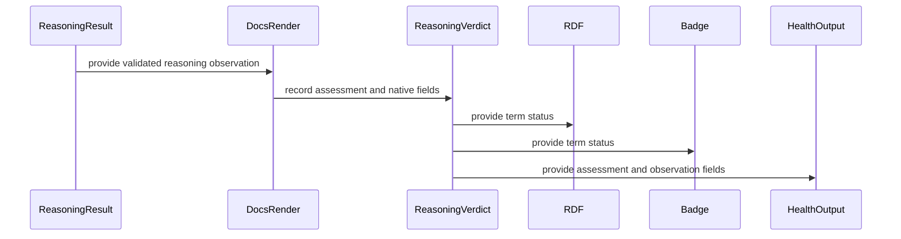

# PR #1830 — comments and review threads

8 comment(s). **Every one needs a disposition** in
`review-debt.md`: addressed (with the commit hash) or declined (with the
reason posted in reply). Bot comments count.

## 1. paudley — 

# Stable proof observation fixture admission

Principles 4, 7, 17 and 18 govern this repair. The real CI failure is stable-prefix/recompute-aggregate admission for stage-goal-directed. Source inspection shows the stage emits only its own named graph and observation artifact, with no retained upstream carrier or handle. Therefore its actual product is an independent contribution, not an aggregate. Keep the fixture loader fail-closed and corpus production outside tests.

## Task 1: Align the actual stage and authored DAG contract

Declare Persistent in Rust and cachePersistentContribution in the canonical pipeline slice, bump implementation identity, and preserve proof checking on production misses. Do not change the cache codec or authentication. Add a metadata-only regression that binds the real DAG and checks every selected fixture target for stable persistent admission. It executes no stage and creates no corpus. Use focused synthetic validation and normal hooks. Full producer acceptance remains hosted because local fingerprint probes are prohibited.

## Task 2: Publish and integrate

Run the strict affected Rust checks, commit and push normally, publish a PR and incorporate available CodeRabbit findings. Qualify the explicit producer and downstream consumers in hosted CI. Merge through ghprsq under standing authorization and record all failures honestly.

## Evidence and limitations

Stage brief retrieved the complete issue with no comments, 14 search results and the last 200 merge trailers. No prior attempt references this issue. Broader recurrence is unknown; three recorded defect classes are not counts of this specific defect. No independent-agent APIs or coding-ethos recommendation/map tools are available in this session. This is implementing-agent analysis, not an independent verdict. The earlier make-sync repair is already merged. A selector deletion or a weaker fixture admission was rejected because it would hide the missing cross-process capability.

## Related generation failure: issue 1828

The selected supersession source carries a Writing System lossy recovery refutation but no get/put legs. program_verdicts correctly rejects that incomplete execution object. Preserve the refutation, the LossyLens rung and the executor hard failure. Supply explicit authored RDF-type projection and inverse candidate paths, as with the neighboring supersession examples, and prove a synthetic lossy source remains a violated section rather than becoming a fabricated recovery. Do not derive a lawful section from the lossy declaration. Source authoring must be validated by the hosted generation lane; no test may compile the repository corpus. Keep this repair in a separate commit on this closely related CI repair branch.

## 2. coderabbitai — 

<!-- This is an auto-generated comment: summarize by coderabbit.ai -->
<!-- review_stack_entry_start -->

<a href="https://app.coderabbit.ai/change-stack/Blackcat-Informatics/gmeow-ontology/pull/1830?scope=ghh_OusAJGA4HG8ljoOV0wJvVx8NmnZIjc2DdjmxOu0xZWA&amp;cs_source=review_comment"><picture><source media="(prefers-color-scheme: dark)" srcset="https://storage.googleapis.com/coderabbit_public_assets/review-stack-in-coderabbit-ui-dark.svg?v=3"><source media="(prefers-color-scheme: light)" srcset="https://storage.googleapis.com/coderabbit_public_assets/review-stack-in-coderabbit-ui.svg?v=3"></picture></a>

<!-- review_stack_entry_end -->
<!-- recent_review_start -->

No actionable comments were generated in the recent review. 🎉

<details>
<summary><strong>ℹ️ Recent review info</strong></summary>
<dl>
<dd>

<details>
<summary><strong>⚙️ Run configuration</strong></summary>
<dl>
<dd>

- **Configuration used**: Repository UI
- **Review profile**: ASSERTIVE
- **Plan**: Team
- **Run ID**: `e0931e0c-922c-4442-a014-c837d99b7b9e`

</dd>
</dl>
</details>

<details>
<summary><strong>📥 Commits</strong></summary>
<dl>
<dd>

Reviewing files that changed from the base of the PR and between a6c9c99866766844bc7919c58c5da89058a2df12 and ab1a26067c60dd5f0f05e84362abcfb9f2e4d61e.

</dd>
</dl>
</details>

<details>
<summary><strong>📒 Files selected for processing: 8</strong></summary>
<dl>
<dd>

* `crates/logic/src/explain.rs`
* `crates/pipeline/src/stages/carrier.reasoning_edb_projection_tests.rs`
* `crates/pipeline/src/stages/carrier.rs`
* `crates/pipeline/src/stages/carrier.term_entailments_tests.rs`
* `crates/pipeline/src/stages/carrier/test_support.rs`
* `crates/pipeline/src/stages/docs_render.rs`
* `crates/pipeline/src/stages/docs_render/reasoning_tests.rs`
* `crates/pipeline/src/stages/gts_sink.rs`

</dd>
</dl>
</details>

**Included review availability:** This review used your included allowance. 0 included reviews remain after this review. Your included PR review attempts over the past 7 days set your current allowance at 3 reviews per hour.

</dd>
</dl>
</details>


<!-- review_details_start -->

<details>
<summary><strong>📜 Recent review details</strong></summary>
<dl>
<dd>

<details>
<summary><strong>🧰 Additional context used</strong></summary>
<dl>
<dd>

<details>
<summary><strong>📚 Code guidelines: 1</strong></summary>

```
.github/copilot-instructions.md — unknown
```

</details><details>
<summary><strong>📓 Path-based instructions: 2</strong></summary>

<details>
<summary><strong>Ensure Rust code is formatted with `cargo fmt` and passes `cargo clippy` with warnings treated as errors.</strong></summary>


**📄 CodeRabbit inference engine (.github/copilot-instructions.md)**

**Files:**
- `crates/pipeline/src/stages/carrier.reasoning_edb_projection_tests.rs`
- `crates/pipeline/src/stages/carrier/test_support.rs`
- `crates/logic/src/explain.rs`
- `crates/pipeline/src/stages/gts_sink.rs`
- `crates/pipeline/src/stages/docs_render.rs`
- `crates/pipeline/src/stages/docs_render/reasoning_tests.rs`
- `crates/pipeline/src/stages/carrier.term_entailments_tests.rs`
- `crates/pipeline/src/stages/carrier.rs`

</details>
<details>
<summary><strong>Refer to the project-root `AGENTS.md` for available `make` targets and developer commands, such as `make check` and `gmeow-dev sync`.</strong></summary>


**📄 CodeRabbit inference engine (.github/copilot-instructions.md)**

**Files:**
- `crates/pipeline/src/stages/carrier.reasoning_edb_projection_tests.rs`
- `crates/pipeline/src/stages/carrier/test_support.rs`
- `crates/logic/src/explain.rs`
- `crates/pipeline/src/stages/gts_sink.rs`
- `crates/pipeline/src/stages/docs_render.rs`
- `crates/pipeline/src/stages/docs_render/reasoning_tests.rs`
- `crates/pipeline/src/stages/carrier.term_entailments_tests.rs`
- `crates/pipeline/src/stages/carrier.rs`

</details>

</details><details>
<summary><strong>🔀 Multi-repo context Blackcat-Informatics/purrdf, Blackcat-Informatics/gmeow-gts</strong></summary>

## Linked repositories findings

### Blackcat-Informatics/purrdf

- No direct references to the changed goal-directed cache identity, `cachePersistentContribution`, or correspondence symbols were found. The relevant GTS boundary is separate: GTS is read through the authoritative importer, while the CLI refuses to write GTS files. `crates/cli/src/format.rs:140-156` [::Blackcat-Informatics/purrdf::]
- GTS-to-RDF projection records dropped envelope data—including sidecar SHACL/ShEx resources and suppressions—in a loss ledger rather than silently carrying it into the dataset (`crates/cli/src/source.rs:485-530`). The PR does not modify this boundary. [::Blackcat-Informatics/purrdf::]

### Blackcat-Informatics/gmeow-gts

- No references to the goal-directed stage, cache policies, correspondence recovery, or ontology pipeline were found. GTS documents itself as ontology-independent, though it is the primary distribution method for GMEOW (`README.md:45-65`, `README.md:1100-1118`). [::Blackcat-Informatics/gmeow-gts::]

No cross-repository consumer or API mismatch was identified.

</details>

</dd>
</dl>
</details>

<details>
<summary><strong>🔇 Additional comments: 9</strong></summary><blockquote>

<details>
<summary><strong>crates/pipeline/src/stages/docs_render.rs: 2</strong></summary><blockquote>

`40-49`: LGTM!


Also applies to: 91-139

<!-- cr-comment:v1:6b39ddf21a9e9ede06197e9c -->


`1022-1022`: LGTM!

<!-- cr-comment:v1:c26d6e04c0c4cbf6ec826fb0 -->

</blockquote></details>
<details>
<summary><strong>crates/pipeline/src/stages/docs_render/reasoning_tests.rs: 1</strong></summary><blockquote>

`58-58`: LGTM!

<!-- cr-comment:v1:ebd36a19d0fe469ed7e410f0 -->

</blockquote></details>
<details>
<summary><strong>crates/logic/src/explain.rs: 1</strong></summary><blockquote>

`54-55`: LGTM!

<!-- cr-comment:v1:382d582239ef5ba003f34567 -->

</blockquote></details>
<details>
<summary><strong>crates/pipeline/src/stages/carrier.reasoning_edb_projection_tests.rs: 1</strong></summary><blockquote>

`5-5`: LGTM!

<!-- cr-comment:v1:d6c3a4c7755fa9f639c9b53f -->

</blockquote></details>
<details>
<summary><strong>crates/pipeline/src/stages/carrier.rs: 1</strong></summary><blockquote>

`2804-2822`: LGTM!


Also applies to: 2824-2848, 2849-2880, 2890-2932

<!-- cr-comment:v1:e78ae35d9631fd5ad4775cf3 -->

</blockquote></details>
<details>
<summary><strong>crates/pipeline/src/stages/carrier/test_support.rs: 1</strong></summary><blockquote>

`359-368`: LGTM!

<!-- cr-comment:v1:15fd4bde94e7eb9815414588 -->

</blockquote></details>
<details>
<summary><strong>crates/pipeline/src/stages/carrier.term_entailments_tests.rs: 1</strong></summary><blockquote>

`5-236`: LGTM!

<!-- cr-comment:v1:a9282459e0c87c36cbbb07a4 -->

</blockquote></details>
<details>
<summary><strong>crates/pipeline/src/stages/gts_sink.rs: 1</strong></summary><blockquote>

`198-198`: LGTM!

<!-- cr-comment:v1:fcd398779c7bc5444430fa56 -->

</blockquote></details>

</blockquote></details>

</dd>
</dl>
</details>

<!-- review_details_end -->


<!-- recent_review_end -->
<!-- walkthrough_start -->

<details>
<summary><strong>📝 Summary</strong></summary>
<dl>
<dd>

<!-- This is an auto-generated comment: release notes by coderabbit.ai -->

## Summary by CodeRabbit

* **Reliability**
  * Goal-directed workflow results now persist between runs, helping preserve validated observations.
  * Lossy correspondences are checked against their recovery guarantees: mappings that lose source detail remain acceptable as lossy, but not as exact recoveries.
* **Validation**
  * Correspondence checks require both mapping legs and detect when either leg invalidates the result.
  * Authenticated pipeline stages are checked for stable identifiers and persistent caching.
* **Documentation**
  * Reasoning results distinguish consistent, inconsistent, and undetermined outcomes. Documentation and badges avoid implying classes are satisfiable when results are incomplete or unsupported, and provide more detail about reasoning assessments.

<!-- end of auto-generated comment: release notes by coderabbit.ai -->
The documentation pipeline now records native consistency assessments and observation fields, including undetermined results. The carrier projects entailments from native reasoning data. The changes also add executable legs to a lossy correspondence and switch the goal-directed stage to persistent caching.

**Changes: Native Reasoning Observations**

|Layer / File(s)|Summary|
|:---|:---|
|**Native verdict construction** <br> `crates/docs-model/src/model.rs`, `crates/pipeline/src/stages/docs_render.rs`, `crates/pipeline/src/stages/docs_render/reasoning_tests.rs`|`ReasoningVerdict` now records a three-state consistency assessment, native input and result fields, unsupported constructs, and unsatisfiable classes. Valid inconclusive results produce an undetermined assessment; invalid input still fails. Tests cover these outcomes and retained observations.|
|**Reasoning status projections and reports** <br> `crates/docs-model/src/rdf.rs`, `crates/docs-model/src/badge.rs`, `crates/docs-print/src/render.rs`, `crates/docs/src/render.rs`|Term status, badges, printed output, and the health dashboard distinguish undetermined results from satisfiable and unsatisfiable results. The health output no longer claims that remaining classes are satisfiable when consistency is not established.|
|**Observation validation and vocabulary** <br> `crates/docs-model/src/*tests.rs`, `crates/docs-print/tests/render.rs`, `crates/docs/src/render.tests.rs`, `crates/docs/tests/coverage_dimensions.rs`, `crates/pipeline/src/stages/carrier.ustar_tests.rs`, `slices/core/documentation/module.ttl`|Tests and fixtures use explicit verdict fields and cover undetermined output. The vocabulary defines four reasoning statuses and clarifies when satisfiability is undetermined.|

**Native Term Entailments**

|Layer / File(s)|Summary|
|:---|:---|
|**Native entailment projection** <br> `crates/pipeline/src/stages/carrier.rs`, `crates/pipeline/src/stages/carrier.term_entailments_tests.rs`, `crates/pipeline/src/stages/carrier/test_support.rs`, `crates/logic/src/explain.rs`, `crates/pipeline/src/stages/carrier.reasoning_edb_projection_tests.rs`|The carrier now projects term entailments from the typed native reasoning result rather than parsing serialized explanations. It matches terms in inferred conclusions and positive premises, including modal premises and quoted terms, and retains premise context. Tests cover matching and rejection cases. `canonical_rule_iri` is now public.|

**Correspondence Recovery**

|Layer / File(s)|Summary|
|:---|:---|
|**Recovery legs and gate validation** <br> `imports/supersession-correspondences.ttl`, `crates/logic/src/correspondence_exec.tests.rs`|The writing-system split correspondence declares get and candidate put legs. A test checks missing-leg rejection, lossy recovery, a recoverable control, and rejection of a `SectionRetraction`/`mnemomorphic` overclaim.|

**Goal-Directed Stage Persistence**

|Layer / File(s)|Summary|
|:---|:---|
|**Persistent admission and fixture contract** <br> `crates/pipeline/src/stages/goal_directed.rs`, `slices/core/pipeline/module.ttl`, `crates/pipeline/src/fixture.tests.rs`|The goal-directed stage changes from `Recompute` to `Persistent`, and its implementation version changes. The pipeline declaration uses the persistent-contribution cache disposition. A test checks that authenticated fixture stages use `StablePrefix` stability and `Persistent` cache policy.|

<!-- change_assessment_start -->
**Priority:** ➖ Normal


**Estimated code review effort:** 4 (Complex) | ~45 minutes

<!-- change_assessment_commit:"ab1a26067c60dd5f0f05e84362abcfb9f2e4d61e" -->
**Change:** Bug fix · **Severity of issue fixed:** Medium
<!-- change_assessment_end -->

### Sequence Diagram(s)



**Possibly related PRs**

- [Blackcat-Informatics/gmeow-ontology#1693](https://github.com/Blackcat-Informatics/gmeow-ontology/pull/1693): Introduces the typed native reasoning substrate consumed by the documentation and carrier changes here.

</dd>
</dl>
</details>

<!-- walkthrough_end -->
<details>
<summary><strong>Merge Risk:</strong> <strong>🔵 Low</strong> · up to <code>ab1a2</code></summary>
<dl>
<dd>

<!-- final_review_risk_start -->
<!-- final_review_risk_label
**Merge Risk:** **🔵 Low** · up to `ab1a2`
-->
<!-- final_review_risk_coverage:{"sourceCommitId":"ab1a26067c60dd5f0f05e84362abcfb9f2e4d61e","coveredCommitId":"ab1a26067c60dd5f0f05e84362abcfb9f2e4d61e","kind":"reviewed"} -->

Term panels can omit a link when a documented term appears inside a quoted-triple premise. This bounded limitation does not appear to block merging.
<!-- final_review_risk_end -->

</dd>
</dl>
</details>
<!-- pre_merge_checks_walkthrough_start -->


<!-- pre_merge_checks_override_start -->
> [!IMPORTANT]
> ## Pre-merge checks failed
> 
> Please resolve all errors before merging. Addressing warnings is optional.
<!-- pre_merge_checks_override_end -->

<strong><sup><picture></picture></sup> Failed checks: 1 error</strong>

|      Check name     |                                            Status                                            | Explanation                                                                                                                                                                                               | Resolution                                                                                                                                                                                                                             |
| :----------------- | :------------------------------------------------------------------------------------------: | :-------------------------------------------------------------------------------------------------------------------------------------------------------------------------------------------------------- | :------------------------------------------------------------------------------------------------------------------------------------------------------------------------------------------------------------------------------------- |
| Linked Issues check |  | The implementation addresses the coding objectives. [`#1828`] adds executable recovery legs and focused controls. [`#1829`] uses persistent goal-directed admission and adds an admission regression. [`#1833`… | Run the explicit fixture-prefix producer, both generation lanes, downstream consumers, and dependent validation from the reviewed head. Provide passing results with the exact admitted identities and the repaired recovery evidence. |

<details>
<summary><strong><sup><picture></picture></sup> Passed checks: 4 passed</strong></summary>
<dl>
<dd>

|         Check name         |                                             Status                                             | Explanation                                                                                                                                                                                               |
| :------------------------ | :--------------------------------------------------------------------------------------------: | :-------------------------------------------------------------------------------------------------------------------------------------------------------------------------------------------------------- |
| Out of Scope Changes check |  | The persistent cache admission, recovery-leg data, native documentation model, authenticated stage-reason reader, renderers, and focused tests directly support [`#1828`], [`#1829`], or [`#1833`]. The public… |
|     Docstring Coverage     |  | Docstring coverage is 90.77% which is sufficient. The required threshold is 80.00%. Docstring coverage is scoped to functions touched by this diff. Analyzed 65 functions across 22 files.                |
|         Title check        |  | The title is concise, accurate, and describes the main pipeline change. It contains no agentic branding.                                                                                                  |
|      Description check     |  | The description is detailed and relevant. It explains the changes, validation results, known failures, pending work, and linked issues. It does not reproduce the template headings or checklist, but it… |

<details>
<summary><strong>Full details: Out of Scope Changes check</strong></summary>
<dl>
<dd>

**Explanation**

The persistent cache admission, recovery-leg data, native documentation model, authenticated stage-reason reader, renderers, and focused tests directly support [`#1828`], [`#1829`], or [`#1833`]. The public visibility change and test fixture updates support the native proof and documentation tests. The available evidence shows no unrelated change.

</dd>
</dl>
</details>

<details>
<summary><strong>Full details: Description check</strong></summary>
<dl>
<dd>

**Explanation**

The description is detailed and relevant. It explains the changes, validation results, known failures, pending work, and linked issues. It does not reproduce the template headings or checklist, but it covers most required information.

</dd>
</dl>
</details>

</dd>
</dl>
</details>

<details>
<summary><strong>Full details: Linked Issues check</strong></summary>
<dl>
<dd>

**Explanation**

The implementation addresses the coding objectives. [`#1828`] adds executable recovery legs and focused controls. [`#1829`] uses persistent goal-directed admission and adds an admission regression. [`#1833`] carries native axes, unsupported observations, and distinct documentation statuses while preserving validation and gate behavior. However, the required qualification is incomplete. The current description reports a failed hosted generation at run 38981058280 and states that full generation, fixture-prefix consumption, and dependent acceptance remain pending for [`#1828`] and [`#1829`].

**Resolution**

Run the explicit fixture-prefix producer, both generation lanes, downstream consumers, and dependent validation from the reviewed head. Provide passing results with the exact admitted identities and the repaired recovery evidence.

</dd>
</dl>
</details>

<!-- pre_merge_checks_walkthrough_end -->

- [ ] <!-- {"checkboxId":"585bb3f6-faf5-4dbf-96d2-74e382adf19a"} --> Fix all pre-merge checks with AI
<!-- finishing_touch_checkbox_start -->

<details>
<summary><strong>✨ Finishing Touches</strong></summary>
<dl>
<dd>

<details open>
<summary><strong>📝 Generate docstrings</strong></summary>
<dl>
<dd>

- [ ] <!-- {"checkboxId":"3e1879ae-f29b-4d0d-8e06-d12b7ba33d98"} --> Commit to this branch
- [ ] <!-- {"checkboxId":"7962f53c-55bc-4827-bfbf-6a18da830691"} --> Create a new PR

</dd>
</dl>
</details>
<details open>
<summary><strong>🧪 Generate unit tests (beta)</strong></summary>
<dl>
<dd>

- [ ] <!-- {"checkboxId": "6ba7b810-9dad-11d1-80b4-00c04fd430c8", "radioGroupId": "utg-output-choice-group-unknown_comment_id"} --> Commit to this branch
- [ ] <!-- {"checkboxId": "f47ac10b-58cc-4372-a567-0e02b2c3d479", "radioGroupId": "utg-output-choice-group-unknown_comment_id"} --> Create a new PR

</dd>
</dl>
</details>
<details open>
<summary><strong>✨ Simplify code</strong></summary>
<dl>
<dd>

- [ ] <!-- {"checkboxId": "9a4e3077-58f6-4eba-b7ee-62e936ea00ea", "radioGroupId": "simplify-output-choice-group-unknown_comment_id"} --> Commit to this branch
- [ ] <!-- {"checkboxId": "f120d606-b0e2-4b7d-8316-181794555b43", "radioGroupId": "simplify-output-choice-group-unknown_comment_id"} --> Create a new PR

</dd>
</dl>
</details>

</dd>
</dl>
</details>

<!-- finishing_touch_checkbox_end -->

<!-- autopilot:start -->
- [ ] <!-- {"checkboxId":"2708ad07-9f24-4260-9c11-7dc76a49f2e3"} --> <strong title="Keep fixing CodeRabbit findings and required CI, and resolving merge conflicts">Autofix</strong> · Keep fixing CodeRabbit findings and required CI, and resolving merge conflicts
<!-- autopilot:end -->
<!-- tips_start -->


<!-- poem_footer_start -->
<sub>A rabbit reads the verdicts in the light,<br>Undetermined now has amber, clear and bright.<br>Native proofs show terms and where they came,<br>While recovery legs declare their name.<br>Persistent stages keep their stated track,<br>And carrots mark the facts we carry back.</sub>
<!-- poem_footer_end -->

<sub>Comment `@coderabbitai help` to get the list of available commands.</sub>

<!-- tips_end -->

## 3. paudley — 

# Review remediation

The active PR is 1830, with source repair scope owned by 1828 and 1829. CodeRabbit reviewed ff3cfe1c6 and found one focused test gap plus insufficient documentation coverage. Hosted acceptance remains pending; the bot's timeout is not a terminal producer failure.

1. Add a recoverable formula with the exact same get and put programs used by the lossy control. Require discharge, then mutate each leg independently and require violation. Retain the existing loss refutation, missing-leg failure and overclaim failure. Run the native correspondence execution selection.
2. Document the changed stage interface and synthetic controls with their actual contracts. Normal formatting, strict Rust checks and commit hooks remain mandatory. Publish one review repair commit and reply to the inline finding with actual evidence.
3. Refresh hosted CI and bot coverage for the new source. Reuse the prior five fixture and 47 combined tests only within their unchanged behavioral scope. Do not claim full qualification or independent completion from these controls. No independent-agent API is available; shared cache/pipeline acceptance remains open until real production execution establishes it.

## 4. paudley — 

# Review disposition

CodeRabbit reviewed ff3cfe1c6 under run 06ce39fb-637b-41ad-aec2-2cd5e1bd71b6. All four production/metadata changes received explicit LGTM summaries. Its single inline finding (comment 4297931137) correctly identified that the lossy formula refutes before either resolved path relation is evaluated.

The repair adds a recoverable formula with the identical get/put programs. It requires discharge, then independently mutates each resolved body and requires violation. The original lossy refutation, missing-program refusal and overclaim rejection remain. All 42 native correspondence-execution tests passed in review-recovery-tests.log.

Repair 1da90b0c1 passed strict producer-independent workspace/all-target Clippy with warnings denied (review-clippy.log, 2m02s), then all normal commit hooks (review-commit.log). No hook or check was bypassed. Updated hosted results remain required.

The bot's documentation finding (45.45%, required 80%) is addressed with contracts for the stage interface and touched controls. Updated bot measurement remains pending. Its linked-issue acceptance finding remains open: exact-source hosted producer/fixture/generation/downstream qualification cannot be replaced by synthetic tests. A check observation timeout is not a reason to restart a live producer.

Complete comments and review submissions are retained in review-comments.json, review-submissions.json and review-inline-comments.json. No independent completion audit is claimed. This is an implementing-agent disposition and does not represent an independent verdict.

## 5. paudley — 

# Native term panels: production phase correction

Hosted run 38981058280, generation (b), job 117247724307 failed on
bc230b3f6: missing stage-snapshot product for term entailments. Exact failure:
native-panels-generation-b-failure.log. Builds and lint passed; this is not a
successful generation. Other live jobs were left running. The b reasoning phase
recorded 2,790,123ms; this is not a controlled speed comparison.

The previous lifetime assessment was wrong. The production caller is
docs_render::render_docs_graph, before SnapshotStage consumes its output.
stage-gts-compose and stage-snapshot are both real, distinct stages. Renaming
snapshot, adding a dependency on a downstream stage, or retaining another
carrier would be incorrect. The sink label in the failure came from the reused
error constructor, not the actual execution phase.

Term panels now read only stage-reason, which DocsRenderStage already declares
as a carrier input and already uses for its reasoning verdict. Native owner,
graph pin, payload identity and result admission remain mandatory. Missing-input
and missing-firing diagnostics now identify stage-docs-render. The documentation
implementation identity advances to v13. No new carrier edge, parser fallback,
alias, second reasoning pass or weaker check is introduced.

The old fixture fabricated a downstream snapshot and released reason, so its
nineteen passing checks did not establish production wiring. That fixture is
removed. Its replacement uses the live reason product. A new regression checks
actual DocsRenderStage, ReasonStage and SnapshotStage dependency declarations,
renders panels with the declared reason input alone, and refuses a released
carrier. Existing native modal/world/quoted/directional/refusal cases remain.
All inputs are tiny explicit synthetic products, never corpus production.

Focused qualification: native-panels-phase-tests.log records all 15 selected
term-panel and shared native-reader cases passing in 0.046s, after a 5m58 build.
This includes the real-stage dependency/lifetime regression. Strict
producer-independent workspace/all-target Clippy passed in 3m14:
native-panels-phase-clippy.log. Full hosted generation is not established by
these synthetic checks.

Published as ab1a26067. Normal signed commit hooks and push passed; exact logs
are native-panels-phase-commit.log and native-panels-phase-push.log. No hook was
bypassed. Current-head hosted generation and independent review remain pending.

The obsolete explanation parser, RawDerivation and three parser-only formatters
remain deleted. Full hosted generation, semantic completion, prepared canon and
reasoning-performance acceptance remain unproven.

## 6. paudley — 

@coderabbitai review

Please review the current bc230b3f6 native term-panel replacement, including retained-snapshot ownership, authenticated native result checks, modal worlds, nested quoted values and removal of the explanation parser. The previous coverage marker still names a6c9c9986. All 19 focused checks and strict Clippy passed; hosted full production remains pending.

## 7. coderabbitai — 

<!-- This is an auto-generated reply by CodeRabbit -->
<!-- CodeRabbit review command invocation: v2:e1a7d8845b7a7990fdf5fc777bf14039784e617fc1172dc0992f7955c4a9355a -->
<details>
<summary>⚠️ Action not completed</summary>

Review rate limited.

> Note: CodeRabbit is an incremental review system and does not re-review already reviewed commits. This command is applicable only when automatic reviews are paused.

</details>

## 8. paudley — 

# Combined repair qualification

The existing three-PR stack is pushed: pipeline bc230b3f6, helper 213e0bd2a, proof 9cd02cd77. Actual-base synchronization was clean. No new branch, worktree or PR was created, and no final integration or main push occurred.

The replacement deletes CertifiedAnswer, RawDerivation, the explanation Turtle parser and its three obsolete formatters. Production callers preserve the complete native certificate and selected proof; native question preparation supports independent checking. The sink reads the authenticated Reasoning payload already retained by the snapshot, preserving modal worlds and nested/directional terms without another parser or longer original-carrier retention.

Combined qualification: 136/136 focused synthetic tests passed in 31.540s, including the live source-only repository seal. Strict producer-independent workspace/all-target Clippy passed in 1m38. The complete helpers-hygiene target passed on the final combined head. Exact logs: combined-repair-focused-tests.log, combined-repair-clippy.log, combined-repair-helpers-final.log. Corpus was not produced. The earlier overly broad selection was interrupted during compilation and is not counted as a pass.

Deleting the parser reduced fixed-hasher copies from 702 to 701. The authoritative helper ledger records that decrease only. A pipeline-only ledger regeneration would add or raise other unresolved helper debt, so that generated change was discarded; the helper repairs remain a required part of final integration. No scanner, exemption, dependency or semantic admission was weakened. A misplaced untracked review report was moved into Stage and its identical root reply duplicate removed; neither entered source. Normal commit hooks passed after that correction. Pushes succeeded.

CodeRabbit explicitly reviewed executable-source head 9086140cf, reporting no actionable findings and 88.71% documentation coverage. The only subsequent source delta is the measured one-line ledger decrease. Linked-issue/scope checks were skipped; they do not establish full issue completion. The separate pipeline review request was rate limited and is recorded as unavailable.

Hosted final-source production, authenticated consumers and full acceptance remain pending. No local optimized producer, fingerprint, full gate or machine probe ran. All PRs remain open; final integration uses ghprsq after actual acceptance. Full canon semantics, prepared canon, installed proof composition and measured production performance remain open under the standing plan. Principles 4, 6, 7, 17 and 18 apply.

