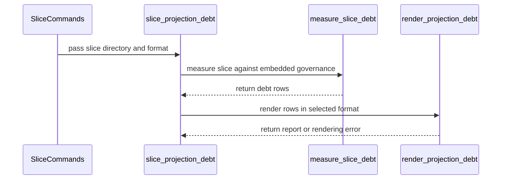

# PR #1887 — comments and review threads

1 comment(s). **Every one needs a disposition** in
`review-debt.md`: addressed (with the commit hash) or declined (with the
reason posted in reply). Bot comments count.

## 1. coderabbitai — 


<!-- This is an auto-generated comment: summarize by coderabbit.ai -->
<!-- review_stack_entry_start -->

<a href="https://app.coderabbit.ai/change-stack/Blackcat-Informatics/gmeow-ontology/pull/1887?cs_source=review_comment"><picture><source media="(prefers-color-scheme: dark)" srcset="https://storage.googleapis.com/coderabbit_public_assets/review-stack-in-coderabbit-ui-dark.svg?v=3"><source media="(prefers-color-scheme: light)" srcset="https://storage.googleapis.com/coderabbit_public_assets/review-stack-in-coderabbit-ui.svg?v=3"></picture></a>

<!-- review_stack_entry_end -->
<!-- This is an auto-generated comment: review in progress by coderabbit.ai -->

> [!NOTE]
> Currently processing new changes in this PR. This may take a few minutes, please wait...
> 
> <details>
> <summary><strong>⚙️ Run configuration</strong></summary>
> <dl>
> <dd>
> 
> - **Configuration used**: Repository UI
> - **Review profile**: ASSERTIVE
> - **Plan**: Team
> - **Run ID**: `2f7207dc-9dfe-4b41-8ca6-02b52fa23af0`
> 
> </dd>
> </dl>
> </details>
> 
> <details>
> <summary><strong>📥 Commits</strong></summary>
> <dl>
> <dd>
> 
> Reviewing files that changed from the base of the PR and between e813ba91e0640a7411fa06b7805bb7ab0eceabaa and 23d45d14492fbe04bd42a3fb9039a3ab08208cf1.
> 
> </dd>
> </dl>
> </details>
> 
> <details>
> <summary><strong>📒 Files selected for processing: 7</strong></summary>
> <dl>
> <dd>
> 
> * `crates/slice-quality/src/lib.rs`
> * `crates/slice-quality/src/projection_debt.rs`
> * `crates/slice-quality/src/projection_debt.tests.rs`
> * `docs/PROJECTION-VOCABULARY-RATCHET.md`
> * `slices/core/slice-quality-rubric/i18n/fr.po`
> * `slices/core/slice-quality-rubric/i18n/zh.po`
> * `slices/core/slice-quality-rubric/module.ttl`
> 
> </dd>
> </dl>
> </details>
> 
> ```ascii
> +-------------------------------------------+
> | I am a verified code reviewer on Twitter. |
> +-------------------------------------------+
>   \
>    \   (\__/)
>        (•ㅅ•)
>        / 　 づ
> ```

<!-- end of auto-generated comment: review in progress by coderabbit.ai -->

<!-- walkthrough_start -->

<details>
<summary><strong>📝 Summary</strong></summary>
<dl>
<dd>

<!-- This is an auto-generated comment: release notes by coderabbit.ai -->

## Summary by CodeRabbit

* **New Features**
  * Added a projection-debt report showing measured residue, ceilings, headroom, deficits, and zero-budget items.
  * Reports support human-readable and TSV output through the CLI and Makefile.
* **Bug Fixes**
  * Improved validation for required files, source identities, duplicate or unknown ceilings, malformed inputs, symlinks, and traversal failures.
  * Manifests with anything other than exactly one declared slice are now rejected.
* **Documentation**
  * Added guidance for triaging projection debt, remediation routes, measurement requirements, and vocabulary counting rules.

<!-- end of auto-generated comment: release notes by coderabbit.ai -->
Adds projection-debt measurement and human or TSV reporting for an explicitly supplied slice. The CLI uses embedded governance, while developer reporting uses the shared row and rendering logic. Surface discovery now propagates validation and filesystem errors. Documentation and translations describe counting scope and remediation routes.

**Changes: Projection Debt**

|Layer / File(s)|Summary|
|:---|:---|
|**Fallible source discovery** <br> `crates/slice-quality/src/lib.rs`, `crates/slice-quality/src/report.rs`, `crates/gmeow-dev-cli/src/dev_slice_quality.rs`|Slice and DSL surface discovery now returns errors for invalid sources, filesystem failures, and recursive traversal problems. Manifest parsing requires exactly one `gmeow:Slice`. Developer measurement and relocation paths propagate surface-resolution errors.|
|**Debt measurement and rendering** <br> `crates/slice-quality/src/projection_debt.rs`, `crates/slice-quality/src/projection_debt.tests.rs`, `crates/slice-quality/src/model.rs`, `crates/slice-quality/src/lib.rs`|Adds projection-debt rows, signed headroom, governance and source validation, and human and TSV rendering with checked aggregate totals. Tests cover measurement, validation, filesystem integrity, and arithmetic boundaries.|
|**CLI and developer command integration** <br> `crates/gmeow-cli/src/lib.rs`, `crates/gmeow-cli/src/commands.rs`, `crates/gmeow-dev-cli/src/dev_slice_quality.rs`, `Makefile`|Adds the installed slice projection-debt command and Make target. The developer command uses the shared row model and renderer. Budget deficits remain report data; input and rendering errors fail.|
|**Counting scope and remediation guidance** <br> `docs/PROJECTION-DEBT-TRIAGE.md`, `docs/PROJECTION-VOCABULARY-RATCHET.md`, `slices/core/slice-quality-rubric/module.ttl`, `slices/core/slice-quality-rubric/i18n/*`|Documents quantitative counting scope, authoring-purity checks, report behavior, and remediation routes for 137 registry commitments. Updates the related English, French, and Chinese guidance.|

<!-- change_assessment_start -->
**Priority:** ➖ Normal


**Estimated code review effort:** 3 (Moderate) | ~25 minutes

<!-- change_assessment_commit:"e813ba91e0640a7411fa06b7805bb7ab0eceabaa" -->
**Change:** Feature
<!-- change_assessment_end -->

### Sequence Diagram(s)



</dd>
</dl>
</details>

<!-- walkthrough_end -->
<details>
<summary><strong>Merge Risk:</strong> <strong>🟡 Moderate</strong> · up to <code>e813b</code></summary>
<dl>
<dd>

<!-- final_review_risk_start -->
<!-- final_review_risk_label
**Merge Risk:** **🟡 Moderate** · up to `e813b`
-->
<!-- final_review_risk_coverage:{"sourceCommitId":"e813ba91e0640a7411fa06b7805bb7ab0eceabaa","coveredCommitId":"e813ba91e0640a7411fa06b7805bb7ab0eceabaa","kind":"reviewed"} -->

Resolve the manifest-only slice failure before merging: it can prevent repository-wide quality commands from completing. Correct the translation keys and clarify the guarded-vocabulary guidance as well.
<!-- final_review_risk_end -->

</dd>
</dl>
</details>
<!-- pre_merge_checks_walkthrough_start -->

<details>
<summary><strong>Pre-merge checks: <sup><picture></picture></sup> 5</strong></summary>
<dl>
<dd>

|         Check name         |                                             Status                                             | Explanation                                                                                                                                                                                               |
| :------------------------ | :--------------------------------------------------------------------------------------------: | :-------------------------------------------------------------------------------------------------------------------------------------------------------------------------------------------------------- |
|         Title check        |  | The title accurately describes the projection-debt measurement and remediation classification changes. It is concise and contains no agentic branding.                                                    |
|      Description check     |  | The description provides a detailed summary, validation status, scope decisions, caveats, and linked issue. It omits the template headings and explicit checklist items, but it is mostly complete and r… |
|     Linked Issues check    |  | Issue `#1652` requires decisions on the counted surface, triage of seeded commitments, and a shippable measured/headroom view. The change keeps `rdfs:domain` and `rdfs:range` outside the numeric budget,… |
| Out of Scope Changes check |  | The changes stay within Issue `#1652`. CLI wiring, source-discovery error propagation, measurement and rendering code, tests, documentation, the Make target, and translated guidance support the measured… |
|     Docstring Coverage     |  | Docstring coverage is 83.87% which is sufficient. The required threshold is 80.00%. Docstring coverage is scoped to functions touched by this diff. Analyzed 31 functions across 8 files. (6 skipped: 6 … |

<details>
<summary><strong>Full details: Description check</strong></summary>
<dl>
<dd>

**Explanation**

The description provides a detailed summary, validation status, scope decisions, caveats, and linked issue. It omits the template headings and explicit checklist items, but it is mostly complete and remains relevant to the changes.

</dd>
</dl>
</details>

<details>
<summary><strong>Full details: Linked Issues check</strong></summary>
<dl>
<dd>

**Explanation**

Issue `#1652` requires decisions on the counted surface, triage of seeded commitments, and a shippable measured/headroom view. The change keeps `rdfs:domain` and `rdfs:range` outside the numeric budget, keeps OWL outside the numeric budget while retaining purity and reasoning checks, and documents the counting contract. `docs/PROJECTION-DEBT-TRIAGE.md` classifies all 137 current commitment records into grounding, ownership-reconciliation, or sealed-zero routes. `measure_slice_debt` and `render_projection_debt` use the native counter and exact signed headroom. The `gmeow slice projection-debt &lt;slice-dir&gt;` command exposes this view without a checkout or generation. Tests cover source validation, trusted policy, documentary entries, counting, and wide totals. Relocation netting remains separately owned by `#1642`, as stated by the issue.

</dd>
</dl>
</details>

<details>
<summary><strong>Full details: Out of Scope Changes check</strong></summary>
<dl>
<dd>

**Explanation**

The changes stay within Issue `#1652`. CLI wiring, source-discovery error propagation, measurement and rendering code, tests, documentation, the Make target, and translated guidance support the measured projection-debt surface or its counting and policy decisions. The translation catalog whitespace changes are non-functional and do not add unrelated behavior. No ceiling, floor, or legacy surface changes are introduced.

</dd>
</dl>
</details>

<details>
<summary><strong>Full details: Docstring Coverage</strong></summary>
<dl>
<dd>

**Explanation**

Docstring coverage is 83.87% which is sufficient. The required threshold is 80.00%. Docstring coverage is scoped to functions touched by this diff. Analyzed 31 functions across 8 files. (6 skipped: 6 unsupported.)

</dd>
</dl>
</details>

</dd>
</dl>
</details>

<!-- pre_merge_checks_walkthrough_end -->
<!-- finishing_touch_checkbox_start -->

<details>
<summary><strong>✨ Finishing Touches</strong></summary>
<dl>
<dd>

<details open>
<summary><strong>📝 Generate docstrings</strong></summary>
<dl>
<dd>

- [ ] <!-- {"checkboxId":"3e1879ae-f29b-4d0d-8e06-d12b7ba33d98"} --> Commit to this branch
- [ ] <!-- {"checkboxId":"7962f53c-55bc-4827-bfbf-6a18da830691"} --> Create a new PR

</dd>
</dl>
</details>
<details open>
<summary><strong>🧪 Generate unit tests (beta)</strong></summary>
<dl>
<dd>

- [ ] <!-- {"checkboxId": "6ba7b810-9dad-11d1-80b4-00c04fd430c8", "radioGroupId": "utg-output-choice-group-unknown_comment_id"} --> Commit to this branch
- [ ] <!-- {"checkboxId": "f47ac10b-58cc-4372-a567-0e02b2c3d479", "radioGroupId": "utg-output-choice-group-unknown_comment_id"} --> Create a new PR

</dd>
</dl>
</details>
<details open>
<summary><strong>✨ Simplify code</strong></summary>
<dl>
<dd>

- [ ] <!-- {"checkboxId": "9a4e3077-58f6-4eba-b7ee-62e936ea00ea", "radioGroupId": "simplify-output-choice-group-unknown_comment_id"} --> Commit to this branch
- [ ] <!-- {"checkboxId": "f120d606-b0e2-4b7d-8316-181794555b43", "radioGroupId": "simplify-output-choice-group-unknown_comment_id"} --> Create a new PR

</dd>
</dl>
</details>

</dd>
</dl>
</details>

<!-- finishing_touch_checkbox_end -->

<!-- autopilot:start -->
- [ ] <!-- {"checkboxId":"2708ad07-9f24-4260-9c11-7dc76a49f2e3"} --> <strong title="Keep fixing CodeRabbit findings and required CI, and resolving merge conflicts">Autofix</strong> · Keep fixing CodeRabbit findings and required CI, and resolving merge conflicts
<!-- autopilot:end -->
<!-- tips_start -->


<!-- poem_footer_start -->
<sub>I’m a rabbit with a tally to make,<br>I count each projection for goodness’ sake.<br>Signed headroom hops across the page,<br>TSV and human reports take the stage.<br>I nibble a carrot and bound away.</sub>
<!-- poem_footer_end -->

<sub>Comment `@coderabbitai help` to get the list of available commands.</sub>

<!-- tips_end -->

