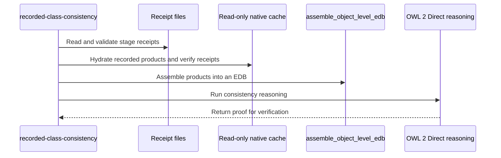

# PR #1837 — comments and review threads

7 comment(s). **Every one needs a disposition** in
`review-debt.md`: addressed (with the commit hash) or declined (with the
reason posted in reply). Bot comments count.

## 1. coderabbitai — 

<!-- This is an auto-generated comment: summarize by coderabbit.ai -->
<!-- review_stack_entry_start -->

<a href="https://app.coderabbit.ai/change-stack/Blackcat-Informatics/gmeow-ontology/pull/1837?cs_source=review_comment"><picture><source media="(prefers-color-scheme: dark)" srcset="https://storage.googleapis.com/coderabbit_public_assets/review-stack-in-coderabbit-ui-dark.svg?v=3"><source media="(prefers-color-scheme: light)" srcset="https://storage.googleapis.com/coderabbit_public_assets/review-stack-in-coderabbit-ui.svg?v=3"></picture></a>

<!-- review_stack_entry_end -->
<!-- This is an auto-generated comment: review in progress by coderabbit.ai -->

> [!NOTE]
> Currently processing new changes in this PR. This may take a few minutes, please wait...
> 
> <details>
> <summary><strong>⚙️ Run configuration</strong></summary>
> <dl>
> <dd>
> 
> - **Configuration used**: Repository UI
> - **Review profile**: ASSERTIVE
> - **Plan**: Team
> - **Run ID**: `5118ac29-1eca-4023-9827-fb6dce5cc16d`
> 
> </dd>
> </dl>
> </details>
> 
> <details>
> <summary><strong>📥 Commits</strong></summary>
> <dl>
> <dd>
> 
> Reviewing files that changed from the base of the PR and between 271463204390e193c1706009feb89f8994476038 and 673132cd5aa0b137d38c4c932ca7734f5215c7b1.
> 
> </dd>
> </dl>
> </details>
> 
> <details>
> <summary><strong>⛔ Files ignored due to path filters: 2</strong></summary>
> <dl>
> <dd>
> 
> * `Cargo.lock` is excluded by `!**/*.lock`
> * `fuzz/Cargo.lock` is excluded by `!**/*.lock`
> 
> </dd>
> </dl>
> </details>
> 
> <details>
> <summary><strong>📒 Files selected for processing: 37</strong></summary>
> <dl>
> <dd>
> 
> * `Makefile`
> * `crates/gmeow-cli/src/commands/reasoning_report.rs`
> * `crates/logic-compile/src/error.rs`
> * `crates/logic-compile/src/frontend/tests.rs`
> * `crates/logic-compile/src/xcl/tests.rs`
> * `crates/logic/Cargo.toml`
> * `crates/logic/src/external_evidence.rs`
> * `crates/logic/src/external_evidence.tests.rs`
> * `crates/logic/src/lib.rs`
> * `crates/logic/src/physical/chase.rs`
> * `crates/logic/src/physical/effects/value_flow.rs`
> * `crates/logic/src/physical/seminaive/joint.rs`
> * `crates/logic/src/physical/seminaive/joint/families/analysis.rs`
> * `crates/logic/src/physical/seminaive/joint/input.rs`
> * `crates/logic/src/physical/seminaive/joint/input/admission.rs`
> * `crates/logic/src/physical/seminaive/joint/input/reachability.rs`
> * `crates/logic/src/program_analysis.rs`
> * `crates/logic/src/reason/mod.rs`
> * `crates/logic/src/reason/mod.tests.rs`
> * `crates/logic/src/reason/program.rs`
> * `crates/logic/src/timing.rs`
> * `crates/pipeline/src/error.rs`
> * `crates/reason-wasm/Cargo.toml`
> * `crates/reason-wasm/examples/refresh-witness-conjecture.rs`
> * `crates/reason-wasm/examples/refresh-witness-reason.rs`
> * `crates/reason-wasm/src/lib.rs`
> * `crates/reason-wasm/tests/WITNESS.conjecture.nq`
> * `crates/reason-wasm/tests/WITNESS.reason.nq`
> * `crates/reason-wasm/tests/support/closure_witness.rs`
> * `crates/reason-wasm/tests/witness_reason.rs`
> * `slices/core/pipeline/i18n/fr.po`
> * `slices/core/pipeline/i18n/zh.po`
> * `slices/core/pipeline/module.ttl`
> * `slices/grounding/logic/i18n/fr.po`
> * `slices/grounding/logic/i18n/zh.po`
> * `slices/grounding/logic/module.ttl`
> * `slices/grounding/logic/tests/competency.ttl`
> 
> </dd>
> </dl>
> </details>
> 
> ```ascii
> +-----------------------------------------------------------------------------+
> | Easy things should be easy and hard things should be possible. - Larry Wall |
> +-----------------------------------------------------------------------------+
>   \
>    \     /)/)
>         ( '')
>         /  |
>       o(___)
> ```

<!-- end of auto-generated comment: review in progress by coderabbit.ai -->

<!-- recent_review_start -->

No actionable comments were generated in the recent review. 🎉

<details>
<summary><strong>ℹ️ Recent review info</strong></summary>
<dl>
<dd>

<details>
<summary><strong>⚙️ Run configuration</strong></summary>
<dl>
<dd>

- **Configuration used**: Repository UI
- **Review profile**: ASSERTIVE
- **Plan**: Team
- **Run ID**: `4c73a9ad-00af-453b-8ebf-968a1af3bd48`

</dd>
</dl>
</details>

<details>
<summary><strong>📥 Commits</strong></summary>
<dl>
<dd>

Reviewing files that changed from the base of the PR and between 7db11af84126e7157f1a084d3ef3722d73d524ef and 271463204390e193c1706009feb89f8994476038.

</dd>
</dl>
</details>

<details>
<summary><strong>⛔ Files ignored due to path filters: 1</strong></summary>
<dl>
<dd>

* `fuzz/Cargo.lock` is excluded by `!**/*.lock`

</dd>
</dl>
</details>

<details>
<summary><strong>📒 Files selected for processing: 2</strong></summary>
<dl>
<dd>

* `crates/pipeline/examples/recorded-class-consistency.rs`
* `fuzz/Cargo.toml`

</dd>
</dl>
</details>

**Included review availability:** This review used your included allowance. 1 included review remains after this review. Your included PR review attempts over the past 7 days set your current allowance at 2 reviews per hour.

</dd>
</dl>
</details>


<!-- review_details_start -->

<details>
<summary><strong>📜 Recent review details</strong></summary>
<dl>
<dd>

<details>
<summary><strong>⏰ Context from checks skipped due to timeout: 4</strong></summary>
<dl>
<dd>

* GitHub Check: generation (a)
* GitHub Check: fixture-prefix
* GitHub Check: generation (b)
* GitHub Check: rust-prebuild

</dd>
</dl>
</details>

<details>
<summary><strong>🧰 Additional context used</strong></summary>
<dl>
<dd>

<details>
<summary><strong>📚 Code guidelines: 1</strong></summary>

```
.github/copilot-instructions.md — unknown
```

</details><details>
<summary><strong>📓 Path-based instructions: 2</strong></summary>

<details>
<summary><strong>Ensure Rust code is formatted with `cargo fmt` and passes `cargo clippy` with warnings treated as errors.</strong></summary>


**📄 CodeRabbit inference engine (.github/copilot-instructions.md)**

**Files:**
- `crates/pipeline/examples/recorded-class-consistency.rs`

</details>
<details>
<summary><strong>Refer to the project-root `AGENTS.md` for available `make` targets and developer commands, such as `make check` and `gmeow-dev sync`.</strong></summary>


**📄 CodeRabbit inference engine (.github/copilot-instructions.md)**

**Files:**
- `fuzz/Cargo.toml`
- `crates/pipeline/examples/recorded-class-consistency.rs`

</details>

</details>

</dd>
</dl>
</details>

<details>
<summary><strong>🔇 Additional comments: 2</strong></summary><blockquote>

<details>
<summary><strong>fuzz/Cargo.toml: 1</strong></summary><blockquote>

`26-26`: LGTM!

<!-- cr-comment:v1:7da27ac6518db526d0bb6fe4 -->

</blockquote></details>
<details>
<summary><strong>crates/pipeline/examples/recorded-class-consistency.rs: 1</strong></summary><blockquote>

`37-37`: LGTM!


Also applies to: 44-44, 52-52, 62-62, 81-81, 179-179, 216-224, 236-236, 277-277

<!-- cr-comment:v1:a81457e95c42a18550584e10 -->

</blockquote></details>

</blockquote></details>

</dd>
</dl>
</details>

<!-- review_details_end -->


<!-- recent_review_end -->
<!-- walkthrough_start -->

<details>
<summary><strong>📝 Summary</strong></summary>
<dl>
<dd>

<!-- This is an auto-generated comment: release notes by coderabbit.ai -->

## Summary by CodeRabbit

* **New Features**
  * Added a command-line tool to inspect recorded pipeline inputs and run consistency checks on selected worlds, including proof verification and detailed reports.
  * Added commands to check and run the recorded-input consistency example.
* **Refactor**
  * Updated graph selection across pipeline and related tools to use the current graph projection behavior.
* **Chores**
  * Aligned workspace dependency revisions.

<!-- end of auto-generated comment: release notes by coderabbit.ai -->
The workspace pins PurRDF dependencies to a new revision and updates named-graph projections to use `project_graph`. The pipeline exposes recorded-input APIs and adds an example that hydrates recorded products and evaluates OWL 2 Direct consistency.

**Changes: Pipeline projections and recorded consistency**

|Layer / File(s)|Summary|
|:---|:---|
|**Pin PurRDF and update graph projections** <br> `Cargo.toml`, `fuzz/Cargo.toml`, `crates/bundle-view/src/diagnostics_reader.rs`, `crates/conformance/{Cargo.toml,src/compare.rs}`, `crates/mcp/src/{lib.rs,tests.rs}`, `crates/pipeline/src/{cache.rs,medium/*,stages/*}`, `crates/pipeline/tests/*`, `crates/validate/tests/conformance_support/mod.rs`, `slices/core/pipeline/module.ttl`|PurRDF dependencies now point to a new revision. Graph-selection call sites and related tests use `project_graph` with RDF IRI terms. The LPG description refers to native graph projection.|
|**Expose recorded-input APIs** <br> `crates/pipeline/src/error.rs`, `crates/pipeline/src/scheduler.rs`, `crates/pipeline/src/stages/carrier.rs`|The pipeline adds and registers the `RecordedInput` diagnostic. `ActionIdentity` and `assemble_object_level_edb` are public.|
|**Add recorded consistency command** <br> `Makefile`, `crates/pipeline/Cargo.toml`, `crates/pipeline/examples/recorded-class-consistency.rs`|The example validates receipts, hydrates products through the read-only native cache, assembles an EDB, and runs consistency reasoning with proof verification. Make targets type-check and run the example.|

<!-- change_assessment_start -->
**Priority:** ➖ Normal


**Estimated code review effort:** 3 (Moderate) | ~30 minutes

<!-- change_assessment_commit:"271463204390e193c1706009feb89f8994476038" -->
**Change:** Bug fix
<!-- change_assessment_end -->

### Sequence Diagram(s)



</dd>
</dl>
</details>

<!-- walkthrough_end -->
<details>
<summary><strong>Merge Risk:</strong> <strong>⚪ Minimal</strong> · up to <code>27146</code></summary>
<dl>
<dd>

<!-- final_review_risk_start -->
<!-- final_review_risk_label
**Merge Risk:** **⚪ Minimal** · up to `27146`
-->
<!-- final_review_risk_coverage:{"sourceCommitId":"271463204390e193c1706009feb89f8994476038","coveredCommitId":"271463204390e193c1706009feb89f8994476038","kind":"reviewed"} -->

Empty worlds are clearly marked as unselectable, resolving the prior listing ambiguity. No actionable merge risk remains in the supplied review context.
<!-- final_review_risk_end -->

</dd>
</dl>
</details>
<!-- pre_merge_checks_walkthrough_start -->

<details>
<summary><strong>Pre-merge checks: <sup><picture></picture></sup> 5</strong></summary>
<dl>
<dd>

|         Check name         |                                             Status                                             | Explanation                                                                                                                                                                                               |
| :------------------------ | :--------------------------------------------------------------------------------------------: | :-------------------------------------------------------------------------------------------------------------------------------------------------------------------------------------------------------- |
|         Title check        |  | The title accurately describes the main pipeline change and contains no agentic branding.                                                                                                                 |
|      Description check     |  | The description provides a detailed summary, rationale, validation results, limitations, and reviewer context. It does not use explicit Checklist or Notes headings, but the required information is sub… |
|     Docstring Coverage     |  | Docstring coverage is 91.07% which is sufficient. The required threshold is 80.00%. Docstring coverage is scoped to functions touched by this diff. Analyzed 56 functions across 32 files. (1 skipped: 1… |
|     Linked Issues check    |  | Check skipped because no linked issues were found for this pull request.                                                                                                                                  |
| Out of Scope Changes check |  | Check skipped because no linked issues were found for this pull request.                                                                                                                                  |

<details>
<summary><strong>Full details: Description check</strong></summary>
<dl>
<dd>

**Explanation**

The description provides a detailed summary, rationale, validation results, limitations, and reviewer context. It does not use explicit Checklist or Notes headings, but the required information is substantially covered.

</dd>
</dl>
</details>

<details>
<summary><strong>Full details: Docstring Coverage</strong></summary>
<dl>
<dd>

**Explanation**

Docstring coverage is 91.07% which is sufficient. The required threshold is 80.00%. Docstring coverage is scoped to functions touched by this diff. Analyzed 56 functions across 32 files. (1 skipped: 1 unsupported.)

</dd>
</dl>
</details>

</dd>
</dl>
</details>

<!-- pre_merge_checks_walkthrough_end -->
<!-- finishing_touch_checkbox_start -->

<details>
<summary><strong>✨ Finishing Touches</strong></summary>
<dl>
<dd>

<details open>
<summary><strong>📝 Generate docstrings</strong></summary>
<dl>
<dd>

- [ ] <!-- {"checkboxId":"3e1879ae-f29b-4d0d-8e06-d12b7ba33d98"} --> Commit to this branch
- [ ] <!-- {"checkboxId":"7962f53c-55bc-4827-bfbf-6a18da830691"} --> Create a new PR

</dd>
</dl>
</details>
<details open>
<summary><strong>🧪 Generate unit tests (beta)</strong></summary>
<dl>
<dd>

- [ ] <!-- {"checkboxId": "6ba7b810-9dad-11d1-80b4-00c04fd430c8", "radioGroupId": "utg-output-choice-group-unknown_comment_id"} --> Commit to this branch
- [ ] <!-- {"checkboxId": "f47ac10b-58cc-4372-a567-0e02b2c3d479", "radioGroupId": "utg-output-choice-group-unknown_comment_id"} --> Create a new PR

</dd>
</dl>
</details>
<details open>
<summary><strong>✨ Simplify code</strong></summary>
<dl>
<dd>

- [ ] <!-- {"checkboxId": "9a4e3077-58f6-4eba-b7ee-62e936ea00ea", "radioGroupId": "simplify-output-choice-group-unknown_comment_id"} --> Commit to this branch
- [ ] <!-- {"checkboxId": "f120d606-b0e2-4b7d-8316-181794555b43", "radioGroupId": "simplify-output-choice-group-unknown_comment_id"} --> Create a new PR

</dd>
</dl>
</details>

</dd>
</dl>
</details>

<!-- finishing_touch_checkbox_end -->

<!-- autopilot:start -->
- [ ] <!-- {"checkboxId":"2708ad07-9f24-4260-9c11-7dc76a49f2e3"} --> <strong title="Keep fixing CodeRabbit findings and required CI, and resolving merge conflicts">Autofix</strong> · Keep fixing CodeRabbit findings and required CI, and resolving merge conflicts
<!-- autopilot:end -->
<!-- tips_start -->


<!-- poem_footer_start -->
<sub>I’m a rabbit with receipts to inspect,<br>I hop through graphs and check each select.<br>The cache keeps products read-only and neat,<br>The reasoner checks what proofs repeat.<br>With `project_graph`, I bound and explore,<br>Then thump my paws and ask for more!</sub>
<!-- poem_footer_end -->

<sub>Comment `@coderabbitai help` to get the list of available commands.</sub>

<!-- tips_end -->

## 2. paudley — 

# Recorded-input consumer qualification

## Current acceptance update

PurRDF PR 567 merged through ghprsq as ff302c091db9b7aebc497221512549e82a7ab729;
the reviewed af8936e6 source remains the exact dependency pin. Its task worktree
and branch are cleaned up. The source shortcut and retired graph API are deleted.

646bf451f fixes CodeRabbit's listing finding by explicitly flagging zero-count
worlds as unselectable. Focused type-check, normal signed hooks and push passed;
the review reply is published and the thread resolved. Doc comments now explain
the recorded consumer boundaries. No independent completion auditor is available;
owner assessment must not be represented as independent judgment.

Final executable observations: native-final-list.log lists nine real worlds,
default 179177, imports 8099, logic 52366. native-final-imports.log records native
True/DecidedWithinBoundaries with DataRange, one replayed proof and prepare/decide/
replay times 27/36/29ms. native-final-logic.log records the same bounded answer
with DataRange and UnrecognizedTerm, one replayed proof, 152/132/97ms. Selection
took 287ms and 260ms respectively. These concurrent observations establish no
speedup ratio or unrestricted canonical admission.

The corrected default run completed selection of exactly 179177 assertions,
then native preparation REFUSED invalid object property at private term 9336.
native-projection-default.log contains no verdict or proof replay. The earlier
180062-row shortcut refusal is historical, not the actual default result.
Six final-control-*.log operations passed refusal expectations on the current
executable: empty arguments, missing selector (original I/O cause retained),
duplicate producer, wrong profile, unexpected producer and altered receipt.
No operation rebuilt corpus, derived a current fingerprint, or repaired cache.

Hosted run 39002241472 passed producer-build, rust-prebuild, lint and helpers,
but generation (both lanes) and fixture-prefix correctly refused a missed fuzz
dependency pin. Downstream jobs skipped and quality failed. The fuzz manifest
is corrected; make maint-pin-purrdf changed only its 31 native source references
and left the production lock unchanged. A TOML comparison passed for all 31
PurRDF package identities across both locks. Full hosted repair qualification
remains pending. See fuzz-pin-resolution.log and fuzz-pin-commit.log.

The full logic goal and issue 1803 remain open, including full class delegation
and engine deletion. The historical input store is preserved. Its authenticated
products do not establish that current sources have completed the production
pipeline. Native proof and certificate values remain authoritative in memory;
JSON Debug observations are never reconstructed into a proof authority.

## 3. paudley — 

# Recorded native world results

Explicit read-only consumers of the same three authenticated historical products.
The implementation is 646bf451f, with the af8936e6 native pin. The later fuzz-only
dependency alignment does not change these executable paths. All worlds use the
complete production object EDB before native graph selection. No corpus producer,
current fingerprint, cache repair, profile change or host probe ran. Principles
4 and 7. Raw results are native-final-*.log; the corrected default operation is
native-projection-default.log. Exact input identities remain in
recorded-input-locator.json and each operation's hydration observations.

World suffixes below use https://blackcatinformatics.ca/gmeow/graph/.
Times are prepare / decide / source-bound proof replay in milliseconds. These
concurrently observed runs are not a controlled speedup comparison.

| World | Assertions | Native result | Boundaries | Times (ms) | Replayed runs |
| --- | ---: | --- | --- | --- | ---: |
| default | 179177 | Preparation refused | Invalid object property, private term 9336 | no decision | 0 |
| imports | 8099 | True / DecidedWithinBoundaries | DataRange | 27 / 36 / 29 | 1 |
| logic | 52366 | True / DecidedWithinBoundaries | DataRange, UnrecognizedTerm | 152 / 132 / 97 | 1 |
| examples | 13436 | True / DecidedWithinBoundaries | DataRange, UnrecognizedTerm | 28 / 6 / 55 | 1 |
| relational-core | 377397 | True / DecidedWithinBoundaries | DataRange | 921 / 654 / 515 | 1 |
| statements | 114 | True / Decided | none | 0 / 0 / 0 | 1 |
| demo/jointly-acyclic | 22 | True / Decided | none | 0 / 0 / 0 | 1 |
| demo/model-summarizing-acyclic | 18 | True / Decided | none | 0 / 0 / 0 | 1 |
| demo/super-weakly-acyclic | 22 | True / Decided | none | 0 / 0 / 0 | 1 |

All eight named selections exited successfully and retained their native
certificates and proof contexts. A bounded result is not unrestricted consistency.
The default refusal is malformed-input admission, not False or an Unknown
decision. None of these OWL Direct operations evaluates GMEOW canonical admission
or authenticates current complete sources. Native delegation must preserve GMEOW
class/source/world/domain semantics before deleting the still-active class
implementation. Dropping unsupported premises is not a repair.

## 4. paudley — 

@coderabbitai review

Please recheck final head 271463204, especially the changes since your reviewed
7db11af84: zero-count worlds are explicitly marked unselectable, consumer boundary
doc comments are added, and the missed fuzz manifest/lock now use exactly the
same PurRDF source as production. All 31 native package identities match.

The native dependency is now merged through purrdf PR 567. The default shortcut
and retired named-only API are removed, with no alias or fallback. Please verify
the selected-world callers and read-only receipt preflight remain wired through
the intended production assembler/native cache and graph projection.

Actual recorded execution now covers all nine worlds: eight named worlds each
replay one proof (four Decided, four DecidedWithinBoundaries), while corrected
default selection has 179177 assertions and native preparation refuses an
invalid property. No canonical consistency or complete class-engine replacement
is claimed. The full issue 1803 remains open; this PR is the graph/consumer
integration. Full hosted qualification is running and has not passed yet.

Please identify any remaining functional or admission gap in this PR's actual
implementation and evidence rather than treating the open broader engine move
as completed. Principles 4 and 7.

## 5. coderabbitai — 

<!-- This is an auto-generated reply by CodeRabbit -->
<!-- CodeRabbit review command invocation: v2:a0ab5c0a397ce688f446cb6048577d860c06d5b660f7df8d1a8973580ed225f9 -->
<details>
<summary>✅ Action performed</summary>

Review finished.

> Note: CodeRabbit is an incremental review system and does not re-review already reviewed commits. This command is applicable only when automatic reviews are paused.

</details>

## 6. paudley — 

# Production census and dependent gate status

The source ownership repair is already merged. Twenty selected controls passed
in 5.065s on the current native pin, including extracted arbitrary test names,
misleading production test-like names, composed cfg, shared ownership, unresolved
module typed causes, production Seal A/B/C negatives, and both live producer-map
and no-authorship-bypass checks. The source corpus-producer scanner also passed.
No test built a corpus. See test-module-census-controls.log.

The actual make crate-check operation ran through its real dev CLI with the
existing test-profile executable. This command is source inspection and requires
no producer admission; the optimized producer launcher was not run. It reported
13 failures: ten stale browser capability attestations (four engines still name
PurRDF 2.0.0 while native selects 3.0.1), and three unbound diagnostic kinds.
There were no test-module production classification failures.

The three diagnostic kinds now bind canonical compiler-source and recorded-
consumer failure classes. Their operational boundaries and complete French and
Chinese annotations are authored together; the compiler failure roster includes
the previously omitted operational classes. No ceiling or seal is weakened.
Six current codec/cause/registry controls pass (nextest run
d9e31a19-6295-4d32-ac63-f63ec8ff6620, 0.075s execution). The initial macro clause-
order compile failure is retained separately and fixed. i18n lint passes with
427 existing catalog warnings; none names the new terms. The second actual
crate-check has only the ten browser attestation failures, so full acceptance
of the census issue remains unmet. See failure-vocabulary-crate-check.log.

Fresh query and reason browser package builds are running on the unchanged
release/WASM profile. No stale attestation version was edited to claim a build.
The remaining browser builds require the authenticated producer-built native
codebook. The historical input store has no aggregate fixture selector at the
expected path; no selector, packet or receipt was fabricated. Hosted fixture
production remains live under run 39005456875. No local corpus/fingerprint
factory, host probe or resource cap was used.

The two wasm flag variables are cleared with the shell builtin before invoking
the existing package Make targets with WASM_CARGO=cargo. This preserves the
Makefile's target-flag isolation without executing its banned env command;
it does not add a compiler profile change, probe or execution limit.

Issue 1755 is independently closed after all sixteen representation acceptance
controls passed. Issues 1761, 1762 and the full pipeline/class-engine work remain
open. Current pushed head 271463204 has passed hosted producer-build,
rust-prebuild, lint, helpers and CodeRabbit; generation and fixture jobs remain
pending. CodeRabbit reviewed that exact head and reports 91.07% doc coverage.
The new diagnostic source repair still needs publication and final hosted review.

## 7. paudley — 

@coderabbitai review

Please review the pushed integrated head 673132cd5, including the failure-class bindings/report projections, shared six-package build recipe, browser monotonic timing, and portable semantic seal. The retired conjecture-only refresher is deleted; its replacement verifies and refreshes both native attestations and remains excluded from test execution.

The actual native producer verified the seven-fact selected closure, corroborated and refuted-in-standpoint conjectures, and determinism. All four optimized-package Node checks pass byte-for-byte against those native outputs after synchronization with main. The final affected native test inventory is still compiling; it is not claimed passed. Please check that canonical rule hashes own the semantic seal while target-specific operation contracts and execution limits remain intact, and that no alias, fallback or test-reachable corpus producer was introduced.

The earlier listing thread is addressed and resolved. Full class-engine replacement remains part of the active goal; this PR does not claim that complete-canon acceptance.

