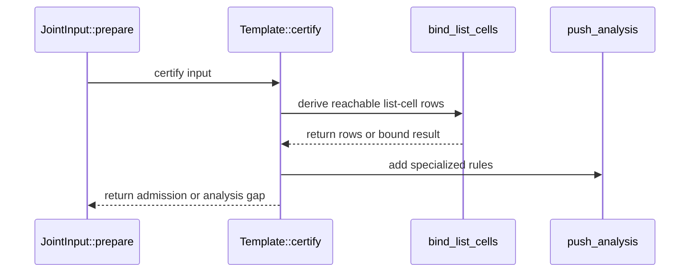

# PR #1793: fix(1789): specialize termination analysis without combinatorial products

State: OPEN   Repo: Blackcat-Informatics/gmeow-ontology   Forge: github

## Comments (2)

### coderabbitai — 2026-10-04T05:00:53Z

<!-- This is an auto-generated comment: summarize by coderabbit.ai -->
<!-- review_stack_entry_start -->

<a href="https://app.coderabbit.ai/change-stack/Blackcat-Informatics/gmeow-ontology/pull/1793?scope=ghh_OusAJGA4HG8ljoOV0wJvVx8NmnZIjc2DdjmxOu0xZWA&amp;cs_source=review_comment"></a>

Navigate logical layers of code changes, visualize relationships, and explore their blast radius.

<!-- review_stack_entry_end -->
<details>
<summary>🧰 Additional context used</summary>

<details>
<summary>📚 Code guidelines (1)</summary>

```
.github/copilot-instructions.md — auto-discovered
```

</details>

</details>
<!-- walkthrough_start -->

<details>
<summary>📝 Summary</summary>

<!-- This is an auto-generated comment: release notes by coderabbit.ai -->

## Summary by CodeRabbit

* **Bug Fixes**
  * Improved handling of list-based rules with large numbers of members, allowing valid rules to proceed even when their analysis involves many possible combinations.
  * Reduced irrelevant matches when evaluating property chains across separate lists.

<!-- end of auto-generated comment: release notes by coderabbit.ai -->
## Walkthrough

Property-rule analysis now records list-head and member-cell pairs. Input admission uses immutable joins and reachable list cells when specializing rules. Input preparation handles certification results directly, and new tests cover large list-based schema inputs.

### Changes

**List-Aware Admission Certification**

|Layer / File(s)|Summary|
|:---|:---|
|**Track list cells in rule analysis** <br> `crates/logic/src/physical/seminaive/property.rs`, `crates/logic/src/physical/chase.rs`, `crates/logic/src/physical/seminaive/joint/families.rs`|Property analysis returns list-head and member-cell pairs. `StatementRule` carries this metadata, with constructors initializing it from property analysis or as empty.|
|**Certify list-aware input admission** <br> `crates/logic/src/physical/seminaive/joint/input/admission.rs`|Certification discharges immutable atoms, binds reachable list cells, deduplicates matches by relevant-variable projection, and reports incomplete analysis. Fallback enumeration preserves a completed first-pass admission when it cannot continue.|
|**Wire and test admission results** <br> `crates/logic/src/physical/seminaive/joint/input.rs`, `crates/logic/src/physical/seminaive/joint/input/tests.rs`|Input preparation passes certification results to existing result handling. New tests cover a 600-member disjoint union and a property chain amid unrelated lists.|

<!-- change_assessment_start -->
**Priority:** ➖ Normal

**Estimated code review effort:** 3 (Moderate) | ~25 minutes

<!-- change_assessment_commit:"51b7abd40cbdccf79c525086a853a2ec132ffc1d" -->
**Change:** Bug fix
<!-- change_assessment_end -->

### Sequence Diagram(s)



</details>

<!-- walkthrough_end -->
<!-- final_review_risk_start -->
**Merge Risk:** _🔵 Low_ · up to `51b7a`
<!-- final_review_risk_coverage:{"sourceCommitId":"51b7abd40cbdccf79c525086a853a2ec132ffc1d","coveredCommitId":"51b7abd40cbdccf79c525086a853a2ec132ffc1d","kind":"reviewed"} -->

Input admission could spend extra time on adversarial list structures. This is a minor performance concern that can be fixed with a small work counter, and the change is otherwise mergeable.
<!-- final_review_risk_end -->
<!-- pre_merge_checks_walkthrough_start -->

---

<!-- pre_merge_checks_override_start -->
> [!IMPORTANT]
> ## Pre-merge checks failed
> 
> Please resolve all errors before merging. Addressing warnings is optional.
<!-- pre_merge_checks_override_end -->

### ❌ Failed checks (1 error)

|     Check name     | Status  | Explanation                                                                                                                                                                                 | Resolution                                                                         |
| :----------------: | :------ | :------------------------------------------------------------------------------------------------------------------------------------------------------------------------------------------ | :--------------------------------------------------------------------------------- |
| Docstring Coverage | ❌ Error | Docstring coverage is 50.00% which is insufficient. The required threshold is 80.00%. Docstring coverage is scoped to functions touched by this diff. Analyzed 22 functions across 6 files. | Write docstrings for the functions missing them to satisfy the coverage threshold. |

<details>
<summary>✅ Passed checks (4 passed)</summary>

|         Check name         | Status   | Explanation                                                                                                                                                                                               |
| :------------------------: | :------- | :-------------------------------------------------------------------------------------------------------------------------------------------------------------------------------------------------------- |
|         Title check        | ✅ Passed | The title accurately summarizes the change: it describes specializing termination analysis to avoid combinatorial products. It is concise and contains no agentic branding.                               |
|      Description check     | ✅ Passed | The description explains the problem, changes, tests, and verification. It omits the template's Checklist and Notes sections; checklist acknowledgements, including docs and CLA status, are not provide… |
|     Linked Issues check    | ✅ Passed | Check skipped because no linked issues were found for this pull request.                                                                                                                                  |
| Out of Scope Changes check | ✅ Passed | Check skipped because no linked issues were found for this pull request.                                                                                                                                  |

</details>

<!-- pre_merge_checks_walkthrough_end -->

- [ ] <!-- {"checkboxId":"585bb3f6-faf5-4dbf-96d2-74e382adf19a"} --> Fix all pre-merge checks with AI
<!-- finishing_touch_checkbox_start -->

<details>
<summary>✨ Finishing Touches 💡 2</summary>

<!-- finishing_touch_suggestion:docstrings -->
<details open>
<summary>📝 Generate docstrings 💡</summary>

- [ ] <!-- {"checkboxId":"3e1879ae-f29b-4d0d-8e06-d12b7ba33d98"} --> Commit to this branch
- [ ] <!-- {"checkboxId":"7962f53c-55bc-4827-bfbf-6a18da830691"} --> Create a new PR

</details>
<details open>
<summary>🧪 Generate unit tests (beta)</summary>

- [ ] <!-- {"checkboxId": "6ba7b810-9dad-11d1-80b4-00c04fd430c8", "radioGroupId": "utg-output-choice-group-unknown_comment_id"} --> Commit to this branch
- [ ] <!-- {"checkboxId": "f47ac10b-58cc-4372-a567-0e02b2c3d479", "radioGroupId": "utg-output-choice-group-unknown_comment_id"} --> Create a new PR

</details>
<details open>
<summary>✨ Simplify code</summary>

- [ ] <!-- {"checkboxId": "9a4e3077-58f6-4eba-b7ee-62e936ea00ea", "radioGroupId": "simplify-output-choice-group-unknown_comment_id"} --> Commit to this branch
- [ ] <!-- {"checkboxId": "f120d606-b0e2-4b7d-8316-181794555b43", "radioGroupId": "simplify-output-choice-group-unknown_comment_id"} --> Create a new PR

</details>


<!-- finishing_touch_suggestion:fix_ci -->
<details open>
<summary>🛠️ Fix failing CI checks 💡</summary>

- [ ] <!-- {"checkboxId": "9f0d24fb-b419-4f01-baf0-8b26b6424f34", "radioGroupId": "fix-ci-output-choice-group-5976765640"} --> Commit to this branch
- [ ] <!-- {"checkboxId": "6d21cfe8-ec3f-40e2-9222-b8318b64d3b0", "radioGroupId": "fix-ci-output-choice-group-5976765640"} --> Create a new PR

</details>
</details>

<!-- finishing_touch_checkbox_end -->

<!-- autopilot:start -->
- [ ] <!-- {"checkboxId":"2708ad07-9f24-4260-9c11-7dc76a49f2e3"} --> <strong title="Keep fixing CodeRabbit findings and required CI, and resolving merge conflicts">Autopilot</strong> · Keep fixing CodeRabbit findings and required CI, and resolving merge conflicts
<!-- autopilot:end -->
<!-- tips_start -->

---


<!-- poem_footer_start -->
<sub>I’m a rabbit with a list to trace,<br>From head to cell, I hop apace.<br>Immutable facts join the flow,<br>Reachable members help rules grow.<br>Large lists no longer blur the view,<br>I nibble tests and thump “that’s true!”</sub>
<!-- poem_footer_end -->

<sub>Comment `@coderabbitai help` to get the list of available commands.</sub>

<!-- tips_end -->

### paudley — 2026-10-04T05:30:18Z

Production result (run 18, this branch merged with current `main`): **the input-specific termination certificate now decides on the full corpus.**

- The analysis completed over **22,916 specialized statements**. The `dl:disjointUnion-disjoint` and `dl:property-chain` exhaustions are gone, and the refusal no longer says "not decided".
- Peak producer RSS was 11.5 GB; stage-reason reached the certificate after about 61 minutes of pipeline time.
- The certificate **refuses** with 11,202 weak-acyclicity cycle edges. These are dominated by generic positions: `differentFrom` objects (1,485), `instanceOf logic:Thing` (614), then `gmeow:Agent` and `gmeow:Entity`. Example: `subject-object[S|<…/skolem/004a4c65…>] -> predicate-object[O|<…/gmeow/skillProficiencyAgent>]`.

Whether that is a genuine existential cycle in the ontology or an over-approximation (position-only minimum laws force weak acyclicity only; witness `differentFrom` and clash typing may re-enter restricted classes) is under investigation as #1789 follow-up work. This PR stays scoped to the specialization blow-up it fixes.

