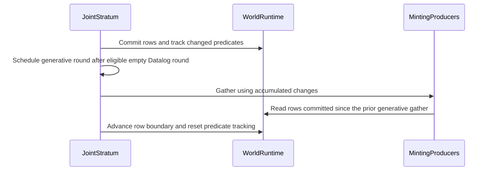

# PR #1798: feat(1796): run the restricted chase Datalog-first

State: OPEN   Repo: Blackcat-Informatics/gmeow-ontology   Forge: github

## Comments (1)

### coderabbitai — 2026-10-04T06:30:01Z

<!-- This is an auto-generated comment: summarize by coderabbit.ai -->
<!-- review_stack_entry_start -->

<a href="https://app.coderabbit.ai/change-stack/Blackcat-Informatics/gmeow-ontology/pull/1798?scope=ghh_OusAJGA4HG8ljoOV0wJvVx8NmnZIjc2DdjmxOu0xZWA&amp;cs_source=review_comment"></a>

Navigate logical layers of code changes, visualize relationships, and explore their blast radius.

<!-- review_stack_entry_end -->
<details>
<summary>🧰 Additional context used</summary>

<details>
<summary>📚 Code guidelines (1)</summary>

```
.github/copilot-instructions.md — auto-discovered
```

</details>

</details>
<!-- walkthrough_start -->

<details>
<summary>📝 Summary</summary>

<!-- This is an auto-generated comment: release notes by coderabbit.ai -->

## Summary by CodeRabbit

* **Bug Fixes**
  * Datalog rules now get a chance to complete relationships before witness-generating rules run, helping valid executions satisfy reverse restrictions without creating unnecessary witnesses.
  * Witness-generating rules run after Datalog processing reaches a stable point. Ordinary property rules continue to use changes from the current round.
* **Documentation**
  * Clarified the execution order and its effect on witness generation in the logic performance guide.

<!-- end of auto-generated comment: release notes by coderabbit.ai -->
## Walkthrough

The chase and joint executors now defer witness-minting rules until Datalog-only execution makes no progress. The joint executor tracks committed rows and changed predicates between witness gathers. A test covers a Datalog-derived back edge, and the design document describes the scheduling order.

### Changes

**Generative Scheduling**

|Layer / File(s)|Summary|
|:---|:---|
|**Chase rule classification and scheduling** <br> `crates/logic/src/physical/chase.rs`|Prepared chase rules are classified by whether they mint existential witnesses or reifier nodes. The chase runs Datalog-only rounds first, enables minting rules after a no-progress round, and returns to Datalog-only scheduling after a productive round.|
|**Joint executor phases and witness gathering** <br> `crates/logic/src/physical/seminaive/joint.rs`|The joint executor schedules generative rounds after eligible empty Datalog rounds. It tracks committed rows and changed predicates between gathers. Witness-frontier properties and minting producers use accumulated changes during generative rounds; other properties and producers continue to use the current round delta.|
|**Schedule test and design description** <br> `crates/logic/src/reason/program/list_tests.rs`, `slices/grounding/logic/design/LOGIC-PERFORMANCE.md`|The test checks that a Datalog rule derives a back edge for an existentially created posting and that execution creates one witness. The design document describes the schedule and its relation to restricted-chase certificates.|

<!-- change_assessment_start -->
**Priority:** ⬇️ Low

**Estimated code review effort:** 3 (Moderate) | ~25 minutes

<!-- change_assessment_commit:"12e5c4f8a395971c49126dbcdb6d822eb04f635f" -->
**Change:** Bug fix
<!-- change_assessment_end -->

### Sequence Diagram(s)



</details>

<!-- walkthrough_end -->
<!-- final_review_risk_start -->
**Merge Risk:** _🔵 Low_ · up to `12e5c`
<!-- final_review_risk_coverage:{"sourceCommitId":"12e5c4f8a395971c49126dbcdb6d822eb04f635f","coveredCommitId":"12e5c4f8a395971c49126dbcdb6d822eb04f635f","kind":"reviewed"} -->

Datalog-only workloads do unnecessary work at completion. This is a bounded performance cost, so the change is mergeable with a follow-up to skip the empty round.
<!-- final_review_risk_end -->
<!-- pre_merge_checks_walkthrough_start -->

---

<!-- pre_merge_checks_override_start -->
> [!IMPORTANT]
> ## Pre-merge checks failed
> 
> Please resolve all errors before merging. Addressing warnings is optional.
<!-- pre_merge_checks_override_end -->

### ❌ Failed checks (1 error)

|     Check name     | Status  | Explanation                                                                                                                                                                                | Resolution                                                                         |
| :----------------: | :------ | :----------------------------------------------------------------------------------------------------------------------------------------------------------------------------------------- | :--------------------------------------------------------------------------------- |
| Docstring Coverage | ❌ Error | Docstring coverage is 55.56% which is insufficient. The required threshold is 80.00%. Docstring coverage is scoped to functions touched by this diff. Analyzed 9 functions across 3 files. | Write docstrings for the functions missing them to satisfy the coverage threshold. |

<details>
<summary>✅ Passed checks (4 passed)</summary>

|         Check name         | Status   | Explanation                                                                                                                                                                                               |
| :------------------------: | :------- | :-------------------------------------------------------------------------------------------------------------------------------------------------------------------------------------------------------- |
|         Title check        | ✅ Passed | The title concisely and accurately describes the Datalog-first restricted-chase scheduling change. It contains no agentic branding.                                                                       |
|      Description check     | ✅ Passed | The description explains the problem, changes, tests, and verification results. It does not include the template’s Checklist or Notes sections, but it provides substantial reviewer context and covers … |
|     Linked Issues check    | ✅ Passed | Check skipped because no linked issues were found for this pull request.                                                                                                                                  |
| Out of Scope Changes check | ✅ Passed | Check skipped because no linked issues were found for this pull request.                                                                                                                                  |

</details>

<!-- pre_merge_checks_walkthrough_end -->

- [ ] <!-- {"checkboxId":"585bb3f6-faf5-4dbf-96d2-74e382adf19a"} --> Fix all pre-merge checks with AI
<!-- finishing_touch_checkbox_start -->

<details>
<summary>✨ Finishing Touches 💡 2</summary>

<!-- finishing_touch_suggestion:docstrings -->
<details open>
<summary>📝 Generate docstrings 💡</summary>

- [ ] <!-- {"checkboxId":"3e1879ae-f29b-4d0d-8e06-d12b7ba33d98"} --> Commit to this branch
- [ ] <!-- {"checkboxId":"7962f53c-55bc-4827-bfbf-6a18da830691"} --> Create a new PR

</details>
<details open>
<summary>🧪 Generate unit tests (beta)</summary>

- [ ] <!-- {"checkboxId": "6ba7b810-9dad-11d1-80b4-00c04fd430c8", "radioGroupId": "utg-output-choice-group-unknown_comment_id"} --> Commit to this branch
- [ ] <!-- {"checkboxId": "f47ac10b-58cc-4372-a567-0e02b2c3d479", "radioGroupId": "utg-output-choice-group-unknown_comment_id"} --> Create a new PR

</details>
<details open>
<summary>✨ Simplify code</summary>

- [ ] <!-- {"checkboxId": "9a4e3077-58f6-4eba-b7ee-62e936ea00ea", "radioGroupId": "simplify-output-choice-group-unknown_comment_id"} --> Commit to this branch
- [ ] <!-- {"checkboxId": "f120d606-b0e2-4b7d-8316-181794555b43", "radioGroupId": "simplify-output-choice-group-unknown_comment_id"} --> Create a new PR

</details>


<!-- finishing_touch_suggestion:fix_ci -->
<details open>
<summary>🛠️ Fix failing CI checks 💡</summary>

- [ ] <!-- {"checkboxId": "9f0d24fb-b419-4f01-baf0-8b26b6424f34", "radioGroupId": "fix-ci-output-choice-group-5977323783"} --> Commit to this branch
- [ ] <!-- {"checkboxId": "6d21cfe8-ec3f-40e2-9222-b8318b64d3b0", "radioGroupId": "fix-ci-output-choice-group-5977323783"} --> Create a new PR

</details>
</details>

<!-- finishing_touch_checkbox_end -->

<!-- autopilot:start -->
- [ ] <!-- {"checkboxId":"2708ad07-9f24-4260-9c11-7dc76a49f2e3"} --> <strong title="Keep fixing CodeRabbit findings and required CI, and resolving merge conflicts">Autopilot</strong> · Keep fixing CodeRabbit findings and required CI, and resolving merge conflicts
<!-- autopilot:end -->
<!-- tips_start -->

---


<!-- poem_footer_start -->
<sub>I’m a rabbit, hopping past the Datalog stream,<br>I wait for its quiet, then gather a beam.<br>New rows and predicates come into view,<br>One witness takes shape as the back edge comes through.<br>The rules settle down, and the chase finds its end.</sub>
<!-- poem_footer_end -->

<sub>Comment `@coderabbitai help` to get the list of available commands.</sub>

<!-- tips_end -->

