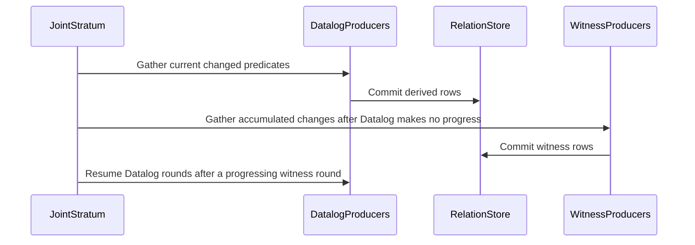

# PR #1802: fix(1757): certify and run native reasoning on the production corpus

State: OPEN   Repo: Blackcat-Informatics/gmeow-ontology   Forge: github

## Comments (6)

### coderabbitai — 2026-10-05T12:15:02Z

<!-- This is an auto-generated comment: summarize by coderabbit.ai -->
<!-- review_stack_entry_start -->

<a href="https://app.coderabbit.ai/change-stack/Blackcat-Informatics/gmeow-ontology/pull/1802?scope=ghh_OusAJGA4HG8ljoOV0wJvVx8NmnZIjc2DdjmxOu0xZWA&amp;cs_source=review_comment"><picture><source media="(prefers-color-scheme: dark)" srcset="https://storage.googleapis.com/coderabbit_public_assets/review-stack-in-coderabbit-ui-dark.svg?v=3"><source media="(prefers-color-scheme: light)" srcset="https://storage.googleapis.com/coderabbit_public_assets/review-stack-in-coderabbit-ui.svg?v=3"></picture></a>

<!-- review_stack_entry_end -->
<!-- recent_review_start -->

No actionable comments were generated in the recent review. 🎉

<details>
<summary><strong>ℹ️ Recent review info</strong></summary>
<dl>
<dd>

<details>
<summary><strong>⚙️ Run configuration</strong></summary>
<dl>
<dd>

- **Configuration used**: Repository UI
- **Review profile**: ASSERTIVE
- **Plan**: Team
- **Run ID**: `0de424bb-1a3a-4acf-a7e1-298376321ad2`

</dd>
</dl>
</details>

<details>
<summary><strong>📥 Commits</strong></summary>
<dl>
<dd>

Reviewing files that changed from the base of the PR and between 1d5d7f36dd84ba90a3ae762ea5dcf9ff825654ad and b797a315e09cf6a118e0ca60975007a65f43a138.

</dd>
</dl>
</details>

<details>
<summary><strong>📒 Files selected for processing: 2</strong></summary>
<dl>
<dd>

* `crates/logic/src/physical/chase.tests.rs`
* `crates/logic/src/reason/artifacts.tests.rs`

</dd>
</dl>
</details>

<details>
<summary><strong>🔗 Linked repositories identified</strong></summary>
<dl>
<dd>

CodeRabbit considers these linked repositories for cross-repo context during reviews:

- [`Blackcat-Informatics/purrdf`](https://github.com/Blackcat-Informatics/purrdf) _(auto-detected)_
- [`Blackcat-Informatics/gmeow-gts`](https://github.com/Blackcat-Informatics/gmeow-gts) _(auto-detected)_

</dd>
</dl>
</details>

**Included review availability:** This review used your included allowance. 3 included reviews remain after this review. Your included PR review attempts over the past 7 days set your current allowance at 5 reviews per hour.

<!-- review_details_start -->

<details>
<summary><strong>⏰ Context from checks skipped due to timeout: 3</strong></summary>
<dl>
<dd>

* GitHub Check: rust-prebuild
* GitHub Check: producer-build
* GitHub Check: lint

</dd>
</dl>
</details>

<details>
<summary><strong>🧰 Additional context used</strong></summary>
<dl>
<dd>

<details>
<summary><strong>📚 Code guidelines: 1</strong></summary>

```
.github/copilot-instructions.md — auto-discovered
```

</details><details>
<summary><strong>📓 Path-based instructions: 2</strong></summary>

<details>
<summary><strong>Ensure Rust code is formatted with `cargo fmt` and passes `cargo clippy` with warnings treated as errors.</strong></summary>


**📄 CodeRabbit inference engine (.github/copilot-instructions.md)**

**Files:**
- `crates/logic/src/physical/chase.tests.rs`
- `crates/logic/src/reason/artifacts.tests.rs`

</details>
<details>
<summary><strong>Refer to the project-root `AGENTS.md` for available `make` targets and developer commands, such as `make check` and `gmeow-dev sync`.</strong></summary>


**📄 CodeRabbit inference engine (.github/copilot-instructions.md)**

**Files:**
- `crates/logic/src/physical/chase.tests.rs`
- `crates/logic/src/reason/artifacts.tests.rs`

</details>

</details><details>
<summary><strong>🔀 Multi-repo context Blackcat-Informatics/purrdf, Blackcat-Informatics/gmeow-gts</strong></summary>

## Linked repositories findings

### `Blackcat-Informatics/purrdf`

- Qualified cardinality restrictions support both `owl:onClass` and `owl:onDataRange` through the same filler-resolution path, so the PR’s ontology changes to `logic:onDataRange rdfs:Literal` are compatible with PurRDF’s parser contract. `crates/entail/src/owl_dl/parser.rs:989-1000` [::Blackcat-Informatics/purrdf::]
- PurRDF treats `xsd:anyURI` as a data-range name syntactically, but its range engine leaves `xsd:anyURI` in the unmodeled remainder; `rdfs:Literal` represents the whole data domain. The PR’s specialized `anyURI` reasoning therefore remains responsibility of GMEOW’s native reasoner. `crates/entail/src/owl_dl/parser.rs:606-618`, `crates/xsd/src/range.rs:44-49,167-170` [::Blackcat-Informatics/purrdf::]

### `Blackcat-Informatics/gmeow-gts`

- GTS is explicitly ontology-independent and treats GMEOW semantics as a downstream profile concern. The PR’s chase/admission changes do not require a GTS core change. `docs/GTS-SPEC.md:43-47` [::Blackcat-Informatics/gmeow-gts::]
- GTS compares literals by exact lexical form, datatype, language tag, and direction without datatype canonicalization. Its XSD helper accepts `xsd:anyURI` lexical forms unchanged. Thus the PR’s XML-whitespace normalization and `anyURI` equality/facet behavior must remain in the reasoning layer rather than being delegated to GTS transport. `docs/GTS-SPEC.md:700-706`, `go/xsd/xsd.go:1-8,95-105` [::Blackcat-Informatics/gmeow-gts::]

</details>

</dd>
</dl>
</details>

<details>
<summary><strong>🔇 Additional comments: 2</strong></summary><blockquote>

<details>
<summary><strong>crates/logic/src/physical/chase.tests.rs: 1</strong></summary><blockquote>

`2089-2089`: LGTM!


Also applies to: 2093-2093

<!-- cr-comment:v1:358417603c04e4148001ab0a -->

</blockquote></details>
<details>
<summary><strong>crates/logic/src/reason/artifacts.tests.rs: 1</strong></summary><blockquote>

`363-369`: LGTM!

<!-- cr-comment:v1:a143e358273ce72ed00a36bb -->

</blockquote></details>

</blockquote></details>

<!-- review_details_end -->

</dd>
</dl>
</details>


<!-- recent_review_end -->
<!-- walkthrough_start -->

<details>
<summary><strong>📝 Summary</strong></summary>
<dl>
<dd>

<!-- This is an auto-generated comment: release notes by coderabbit.ai -->

## Summary by CodeRabbit

* **Reasoning Improvements**
  * Witness-generating rules now run after ordinary rule processing reaches a pause, allowing existing facts to prevent unnecessary witnesses.
  * More programs can be certified for complete reasoning; unsupported cases provide clearer explanations and may still require a budget.
  * Equivalent spellings of cardinality qualifiers are treated consistently, and cardinality conflicts are limited to affected individuals.
  * `xsd:anyURI` is recognized as an unbounded datatype, with length restrictions measured on its whitespace-collapsed text.
  * Data-property cardinality constraints now consistently use literal value ranges.

* **Diagnostics**
  * Inconclusive results and encoding failures provide more detail about what could not be processed.

<!-- end of auto-generated comment: release notes by coderabbit.ai -->
The changes add Datalog-first restricted-chase execution and restricted joint acyclicity certification. They also expand native admission analysis, refine definition-writer and cardinality checks, recognize `xsd:anyURI`, update result diagnostics and artifact tests, and revise selected ontology declarations.

**Changes: Restricted Chase and Native Admission**

|Layer / File(s)|Summary|
|:---|:---|
|**Datalog-first chase rounds** <br> `crates/logic/src/physical/chase.rs`, `crates/logic/src/physical/seminaive/joint.rs`, `crates/logic/src/physical/seminaive/joint/families*`, `crates/logic/src/reason/program/list_tests.rs`, `slices/grounding/logic/design/LOGIC-PERFORMANCE.md`|Non-minting producers run before witness-minting producers. The joint stratum tracks accumulated changes and reports obstruction details.|
|**Joint graph and RJA certification** <br> `crates/logic/src/physical/chase.rs`, `crates/logic/src/physical/chase.tests.rs`, `crates/logic/src/native_semantics.rs`|Certification adds null-flow graph analysis and RJA. RJA removes candidate edges only when positive Datalog closure proves a restricted trigger is satisfied.|
|**Settled-relation admission** <br> `crates/logic/src/physical/seminaive/joint/input*`, `crates/logic/src/physical/seminaive/property.rs`, `crates/logic/src/physical/seminaive/property/minimum.rs`|Native admission derives bounded closures for eligible witness-free relations and specializes producers against settled facts. Tests cover closure, list bindings, and refusal cases.|

**Definition-Writer Checks**

|Layer / File(s)|Summary|
|:---|:---|
|**Scoped and assertion-aware writer detection** <br> `crates/logic/src/physical/effects*`, `crates/logic/src/physical/seminaive/joint.rs`|Writer detection considers world ownership, overlap, clash admission, and bounded finite writes. Already asserted writes do not count as definition writers.|

**Cardinality Reasoning**

|Layer / File(s)|Summary|
|:---|:---|
|**Qualifier normalization and class-bound clashes** <br> `crates/logic/src/reason/dl.rs`, `crates/logic/src/reason/refute/counting.rs`, `crates/logic/src/reason/program/minimum_tests.rs`, `crates/logic/src/reason/refute/native/tests.rs`|Alternate qualifier spellings are compared by normalized meaning. Property obligations are generated only for individuals whose asserted class has contradictory bounds.|

**Datatype Support**

|Layer / File(s)|Summary|
|:---|:---|
|**anyURI recognition and constructor errors** <br> `crates/logic/src/physical/seminaive/property/datatype*`, `crates/logic/src/physical/seminaive/property/datatype/extent.rs`, `crates/logic/src/reason/value.rs`|`xsd:anyURI` is recognized as a named datatype with an infinite value space. Tests cover its membership and length facets. Invalid-constructor errors identify the datatype and constructor state.|

**Result Diagnostics**

|Layer / File(s)|Summary|
|:---|:---|
|**Blocked-read and encoding diagnostics** <br> `crates/logic/src/result.rs`, `crates/logic/src/result_rdf/native.rs`, `crates/pipeline/src/stages/docs_render.rs`|Blocked native reads are included among unsupported constructs. Encoding and inconclusive-result diagnostics include receipt-size or unsupported-construct details.|

**Reasoning Artifact Tests**

|Layer / File(s)|Summary|
|:---|:---|
|**Execution-backed artifact test fixtures** <br> `crates/logic/src/reason/artifacts.tests.rs`|Tests use native execution or projection-only results to check typed RDF objects, receipts, explanations, statuses, and validation.|

**Ontology Declaration Updates**

|Layer / File(s)|Summary|
|:---|:---|
|**Literal-qualified constraints and message literals** <br> `slices/core/*/module.ttl`, `slices/extensions/images/module.ttl`, `slices/grounding/lang/module.ttl`, `slices/grounding/math/module.ttl`, `slices/grounding/logic/module.ttl`, `slices/vocabulary.ttl`|Selected cardinality restrictions now use `rdfs:Literal` as a data range. Constraint-message text remains unchanged where language tags were removed.|

<!-- change_assessment_start -->
**Priority:** ➖ Normal

**Estimated code review effort:** 4 (Complex) | ~60 minutes

<!-- change_assessment_commit:"b797a315e09cf6a118e0ca60975007a65f43a138" -->
**Change:** Bug fix
<!-- change_assessment_end -->

### Sequence Diagram(s)



</dd>
</dl>
</details>

<!-- walkthrough_end -->
<details>
<summary><strong>Merge Risk:</strong> <strong>🔵 Low</strong> · up to <code>b797a</code></summary>
<dl>
<dd>

<!-- final_review_risk_start -->
<!-- final_review_risk_label
**Merge Risk:** **🔵 Low** · up to `b797a`
-->
<!-- final_review_risk_coverage:{"sourceCommitId":"b797a315e09cf6a118e0ca60975007a65f43a138","coveredCommitId":"b797a315e09cf6a118e0ca60975007a65f43a138","kind":"reviewed"} -->

Invalid nonnumeric values may pass validation for approximationError and rootSystemRank. The issue is limited to these properties, but their numeric ranges should be enforced before relying on the resulting data.
<!-- final_review_risk_end -->

</dd>
</dl>
</details>
<!-- pre_merge_checks_walkthrough_start -->


<!-- pre_merge_checks_override_start -->
> [!IMPORTANT]
> ## Pre-merge checks failed
> 
> Please resolve all errors before merging. Addressing warnings is optional.
<!-- pre_merge_checks_override_end -->

<strong><sup><picture></picture></sup> Failed checks: 1 error</strong>

|     Check name     |                                            Status                                            | Explanation                                                                                                                                                                                   | Resolution                                                                         |
| :---------------- | :------------------------------------------------------------------------------------------: | :-------------------------------------------------------------------------------------------------------------------------------------------------------------------------------------------- | :--------------------------------------------------------------------------------- |
| Docstring Coverage |  | Docstring coverage is 77.78% which is insufficient. The required threshold is 80.00%. Docstring coverage is scoped to functions touched by this diff. Analyzed 225 functions across 28 files. | Write docstrings for the functions missing them to satisfy the coverage threshold. |

<details>
<summary><strong><sup><picture></picture></sup> Passed checks: 4 passed</strong></summary>
<dl>
<dd>

|         Check name         |                                             Status                                             | Explanation                                                                                                                                                                                               |
| :------------------------ | :--------------------------------------------------------------------------------------------: | :-------------------------------------------------------------------------------------------------------------------------------------------------------------------------------------------------------- |
|         Title check        |  | The title accurately summarizes the main changes: termination certification and native reasoning execution on the production corpus. It is concise and contains no agentic branding.                      |
|      Description check     |  | The description provides detailed change context, validation results, known limitations, dependencies, and acceptance status. It does not use the required Summary, Validation, Checklist, and Notes hea… |
|     Linked Issues check    |  | Check skipped because no linked issues were found for this pull request.                                                                                                                                  |
| Out of Scope Changes check |  | Check skipped because no linked issues were found for this pull request.                                                                                                                                  |

</dd>
</dl>
</details>

<!-- pre_merge_checks_walkthrough_end -->

- [ ] <!-- {"checkboxId":"585bb3f6-faf5-4dbf-96d2-74e382adf19a"} --> Fix all pre-merge checks with AI
<!-- finishing_touch_checkbox_start -->

<details>
<summary><strong>✨ Finishing Touches: 💡 1</strong></summary>
<dl>
<dd>

<!-- finishing_touch_suggestion:docstrings -->
<details open>
<summary><strong>📝 Generate docstrings: 💡</strong></summary>
<dl>
<dd>

- [ ] <!-- {"checkboxId":"3e1879ae-f29b-4d0d-8e06-d12b7ba33d98"} --> Commit to this branch
- [ ] <!-- {"checkboxId":"7962f53c-55bc-4827-bfbf-6a18da830691"} --> Create a new PR

</dd>
</dl>
</details>
<details open>
<summary><strong>🧪 Generate unit tests (beta)</strong></summary>
<dl>
<dd>

- [ ] <!-- {"checkboxId": "6ba7b810-9dad-11d1-80b4-00c04fd430c8", "radioGroupId": "utg-output-choice-group-unknown_comment_id"} --> Commit to this branch
- [ ] <!-- {"checkboxId": "f47ac10b-58cc-4372-a567-0e02b2c3d479", "radioGroupId": "utg-output-choice-group-unknown_comment_id"} --> Create a new PR

</dd>
</dl>
</details>
<details open>
<summary><strong>✨ Simplify code</strong></summary>
<dl>
<dd>

- [ ] <!-- {"checkboxId": "9a4e3077-58f6-4eba-b7ee-62e936ea00ea", "radioGroupId": "simplify-output-choice-group-unknown_comment_id"} --> Commit to this branch
- [ ] <!-- {"checkboxId": "f120d606-b0e2-4b7d-8316-181794555b43", "radioGroupId": "simplify-output-choice-group-unknown_comment_id"} --> Create a new PR

</dd>
</dl>
</details>

</dd>
</dl>
</details>

<!-- finishing_touch_checkbox_end -->

<!-- autopilot:start -->
- [ ] <!-- {"checkboxId":"2708ad07-9f24-4260-9c11-7dc76a49f2e3"} --> <strong title="Keep fixing CodeRabbit findings and required CI, and resolving merge conflicts">Autopilot</strong> · Keep fixing CodeRabbit findings and required CI, and resolving merge conflicts
<!-- autopilot:end -->
<!-- tips_start -->


<!-- poem_footer_start -->
<sub>A rabbit checks the rules at dawn,<br>While witness-makers wait their turn.<br>Nulls hop past fixed reads, not wide,<br>Closed facts help the cycles learn.<br>The graphs grow clear; the rows align,<br>Then carrots mark the finish line.</sub>
<!-- poem_footer_end -->

<sub>Comment `@coderabbitai help` to get the list of available commands.</sub>

<!-- tips_end -->

### paudley — 2026-10-15T17:52:38Z

Review remediation pushed as 22193fc44 (Principles 4, 7, 17 and 18).

- Restricted blocking now retains original clause exactness before ordinary NAF/builtin filters or property operations are relaxed. Its Datalog closure excludes relaxed clauses and variable-predicate pair projections/reverse bridges. Source specialization preserves the exactness metadata.
- Binary restricted-head searches enforce distinct guards, including bindings of frozen universal variables. Guarded binary producers remain non-blockable after statement lowering discards those guards.
- anyURI length/minLength/maxLength use PurRDF's XML whitespace collapse and Unicode character counts through the existing datatype plan.
- Finite-write products use saturating multiplication. The three source provenance comments and helper-ledger final newline named by hosted lint are repaired.

Executed verification:

- make fmt: passed.
- make nextest-synthetic with the chase, joint and any_uri selection: 124 passed, 2132 skipped; nextest fd9ab4ba-45b1-422a-8c50-6e2ed7f8eb7c. This includes a genuine two-distinct-witness cycle and finite execution-prefix exhaustion, plus valid single-witness inverse examples. Test-profile compilation reported unused manifest dependencies csv and flate2; neither was suppressed.
- make lint: passed.
- Normal git commit and push: succeeded. No hook bypass or compiler/profile weakening.

Current acceptance remains incomplete. No full make check, authenticated fixture production, new production verdict, two cold-generation comparison, or independent completion audit is claimed on this commit. The prior fixture-prefix failure is an unsupported native verdict at docs rendering. The ownership agreement in #1803 assigns the generic DL/chase engines to PurRDF; the recorded released-engine benchmark does not yet decide the two large production worlds within budget. That evidence is not replaced by the focused tests above.

The branch also now contains the previously committed corpus repairs from #1804; that ancestry was already present on the local combined branch and is preserved. Other logic issues and prerequisite PRs remain open pending their individual acceptance and ghprsq integration.

@coderabbitai review

Please reassess the four recorded findings on the current head, particularly the distinction between conservative Skolem-flow over-approximation and the exact evidence used to block restricted triggers. None of the review threads has been resolved merely by posting this update.


### coderabbitai — 2026-10-15T18:02:39Z

<!-- This is an auto-generated reply by CodeRabbit -->
<!-- CodeRabbit review command invocation: v2:29c223310988f1cf6fc1012c9d6372a728b2a8de4b6f5c51939028f39e288d21 -->
<details>
<summary>⚠️ Action not completed</summary>

Already reviewed the last commit. Use `@coderabbitai full review` to rerun a review of the entire changeset.

> Note: CodeRabbit is an incremental review system and does not re-review already reviewed commits. This command is applicable only when automatic reviews are paused.

</details>

### paudley — 2026-10-15T18:49:33Z

Review follow-up is pushed through 1d5d7f36d (Principles 1, 4, 7, 12, 17 and 18):

- d3ca06032 preserves ordinary distinct_pairs and separates restricted-blocking premises from the deliberately coarser vocabulary quotient. A reproduced cycle exhausted 40 steps while previously receiving a false certificate because two ordinary data URIs were identified. It is now refused; valid mixed operator spellings remain certifiable. Unknown-count summaries cannot supply two guaranteed witnesses; the selected count-1 expansion is covered.
- 551dee071 compares admitted anyURI enumeration values using the substrate's XML whitespace normalization and preserves unknown foreign/nonmatching values.
- 13a44f7a9 integrates the native artifact-test fixture repair from #1782. Real execution evidence is retained and missing/mismatched evidence is rejected.
- 1d5d7f36d removes the unused csv/flate2 dependencies and refreshes the existing locks without changing PurRDF selections or compiler settings.

Verified on the combined working source: make fmt, make lint, and 152 focused tests (nextest d240e531-3bac-4fe6-b5bb-3141da4549f5; 3801 skipped). These include actual SHACL consumer controls for the numeric-range repair. That canonical math source/compiler change is still uncommitted pending its required full qualification, so its review finding stays open.

Full production/corpus qualification, both authenticated artifact-verifier cases, cold-generation comparison and independent completion review remain open. #1805 is now in active implementation on an isolated branch; its plan is published. No merge or issue-completion claim is made.

@coderabbitai review


### coderabbitai — 2026-10-15T18:53:09Z

<!-- This is an auto-generated reply by CodeRabbit -->
<!-- CodeRabbit review command invocation: v2:be740e0fc5094ec7620339aaec3ed4d5fd3f921e1a5b6fa199cdfef65d2bd9f4 -->
<details>
<summary>⚠️ Action not completed</summary>

Already reviewed the last commit. Use `@coderabbitai full review` to rerun a review of the entire changeset.

> Note: CodeRabbit is an incremental review system and does not re-review already reviewed commits. This command is applicable only when automatic reviews are paused.

</details>

### paudley — 2026-10-15T20:21:53Z

The native-rule migration has passed its expanded development controls: 951 of 952 cases passed in the expanded run, and the sole fixture-identity assertion was corrected to match its authored plain literal and passed its focused recheck. This covers the native RDF rule round trip, all CL dialect metadata round trips, all six atom-scope dimensions, gate controls, the reviewed `!sameTerm` golden, and the production-profile GTS carrier-root/write/import/read control. The latter preserves a dynamic predicate, directional literal, negation, guard and rule scope through the actual statement layer. Principles 2, 3, 4, 7, 17 and 18 apply.

The first combined full gate failed helper hygiene: 716 default-hasher copies against 705 and 27 collection copies against 19. Those findings remain part of the failed run. The uncommitted repair uses PurRDF's fixed hasher in the affected native tables and its existing collection builders/walker in eight counted copies, plus the IR projection walker. Cell identities, native value kinds, graph scopes and malformed-list errors are retained. The collection count returns to 19; the hasher count falls to 704. The complete generated debt diff was inspected: its only change lowers the hasher count from 705 to 704. No ceiling or duplicate group was raised.

The compiler directly names the already-linked `purrdf-core` workspace package to call these collection APIs; both locks add only that edge, without package/version/profile/feature changes. A new product regression requires malformed selected value lists to fail shape admission rather than produce a weaker shape. The latest lint passes. The affected expanded tests and helper gate are still running, so these additional repairs are not yet reported as validated.

The optimized producer and first full run remain in flight. The coordinator rechecks source/configuration after compilation and refuses a receipt when they changed, so the earlier build cannot qualify these later edits. A fresh required full qualification is still needed after the repairs settle; it is an explicitly required retry of a failed gate. No test constructs the ontology corpus, no corpus-backed test has been waived, and no canonical commit, fresh-source CI pass, completion audit, readiness or merge is claimed. The published PR head remains `b797a315e`.


